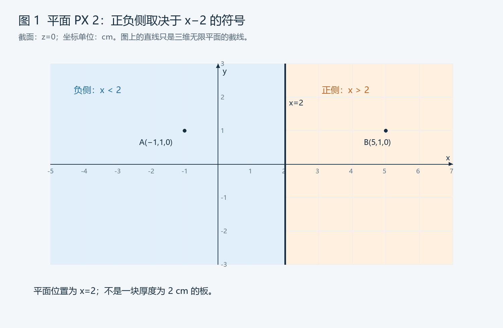
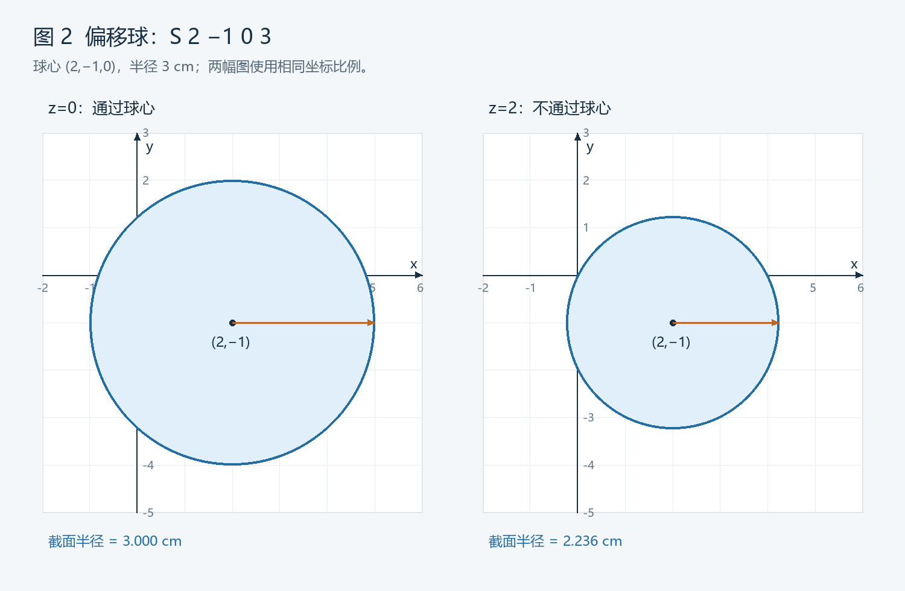
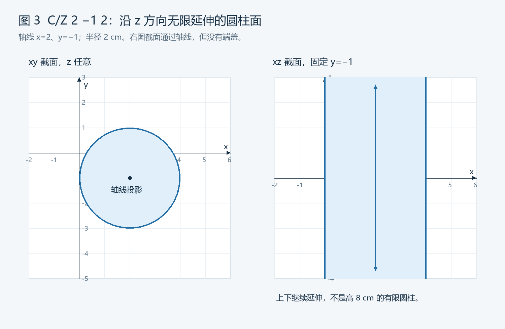
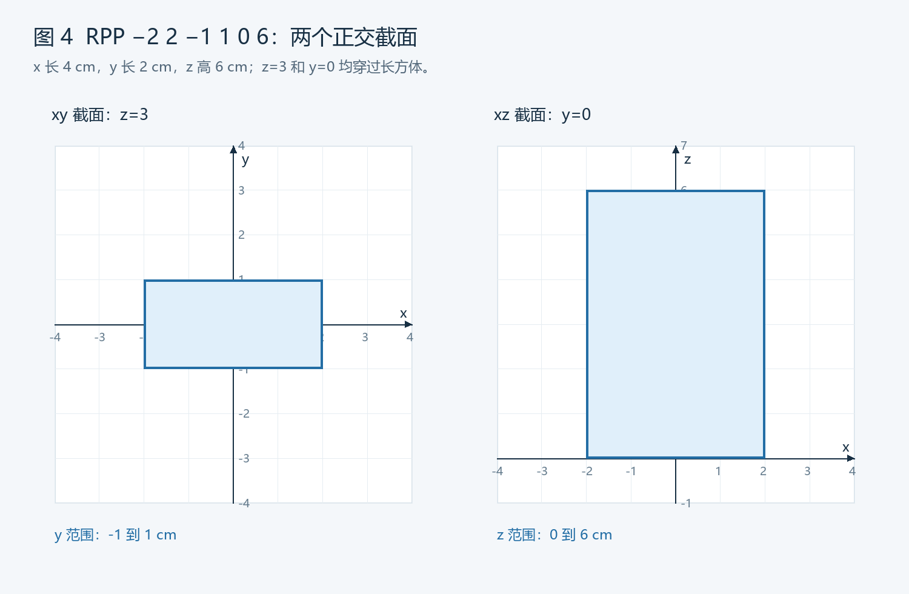
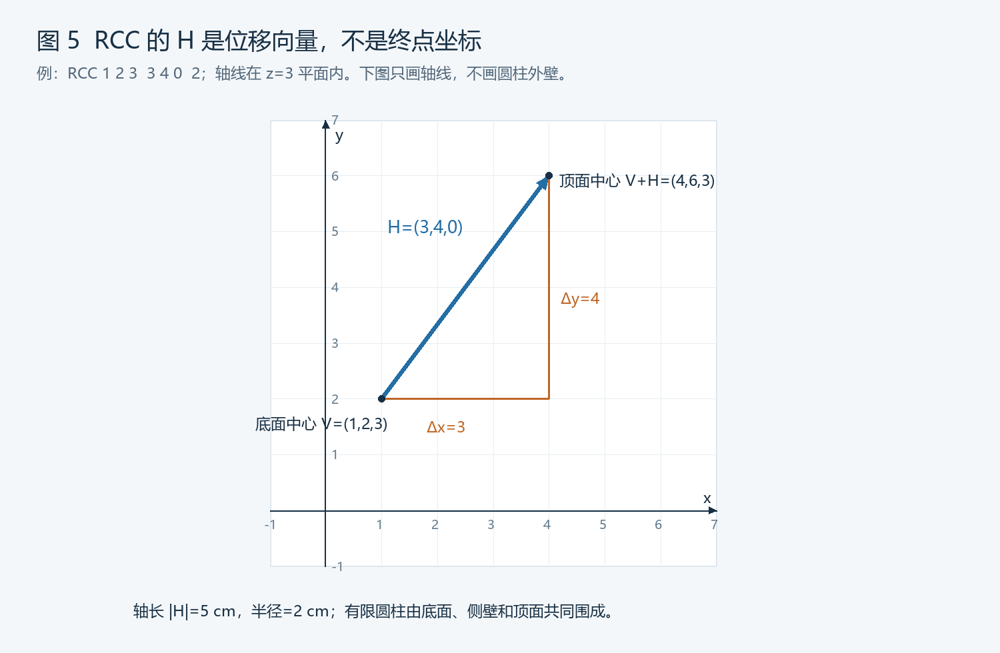

# 第 4 部分：曲面与几何边界

> 本课目标：看到一张常见曲面卡，能够解释它在三维空间中的位置、方向和尺寸，判断一个点位于哪一侧，并检查它是否符合图纸要求。
>
> 学习重点：先看懂边界，再学习如何把多个边界组合成完整区域。复杂的交、并、补及栅元划分，留到第 5 部分展开。
>
> 前置知识：[第三部分：读懂输入文件的整体结构](./03_读懂输入文件的整体结构.md)。长度单位采用 cm，必要单位换算可复习[第二部分](./2_必要的物理基础与单位.md)。
>
> 示例范围：常见 MCNP 6 系列构造实体几何。文中的输入片段用于识读，手工判点和配图用于几何核对，未实际运行 MCNP。

## 阅读导航

| 节 | 内容 | 解决的问题 |
|---|---|---|
| 1～3 | 学习目标、曲面概念、三维坐标 | 边界、区域、坐标分别是什么 |
| 4～5 | 曲面函数与卡结构 | 文本怎样对应空间中的边界 |
| 6～8 | 平面与正负侧 | 为什么符号必须结合方程判断 |
| 9～10 | 球面与偏移球 | 如何看懂球心、半径和球壳 |
| 11～13 | 圆柱面与有限圆柱 | 为什么圆柱面没有自动封口 |
| 14～16 | RPP、RCC 和宏体 | 如何识读有限长方体和圆柱体 |
| 17～18 | 进阶曲面与截面 | 怎样认识复杂形式并避免看图误判 |
| 19～22 | 从尺寸到边界、案例、边界行为和修改 | 把读图与修改连起来 |
| 23～24 | 几何核查与速查 | 用统一方法检查 AI 生成的几何 |
| 25～26 | 练习与解析 | 通过计算与判点巩固 |
| 27 | 完成标准与资料 | 判断是否可以进入下一部分 |

建议分四次学习：先读 1～8 节，掌握平面与符号；再读 9～16 节，识别常见形状；随后读案例与检查；最后完成练习。无需一次背下全部公式。

---

## 1. 为什么这一部分是读懂模型的关键

### 1.1 看懂编号还不够

第三部分已经知道：

```text
10 1 -1.0 -101 imp:p=1
```

其中 `-101` 引用曲面 101 的负侧。

但只有查到：

```text
101 so 2
```

才能进一步说：这里使用以原点为球心、半径 2 cm 的球面，负侧为球内。

如果曲面改成：

```text
101 px 2
```

同样的 `-101` 就表示 `x<2 cm` 的半空间，形状完全不同。

因此，**几何含义由曲面定义与栅元选择共同决定。**

### 1.2 你的学习目标

学完应能：

- 区分曲面、封闭体和填充材料的栅元。
- 解释坐标位置与长度尺寸的不同。
- 识别 PX、PY、PZ、P、SO、S、SX、SY、SZ。
- 识别 CX、CY、CZ 和 C/X、C/Y、C/Z。
- 知道无限曲面为什么需要其他边界。
- 解释 RPP、RCC 的主要参数。
- 用代入法判断点在正侧、负侧还是边界上。
- 从尺寸描述检查输入是否存在半径、位置、方向或长度错误。
- 修改后追踪关联区域，而不只改一行数值。

### 1.3 本课不要求掌握的内容

暂时不要求独立设计复杂三维装置，也不要求记住全部曲面类型、宏体面编号和坐标变换矩阵。

重要的是建立一种可重复使用的几何阅读方法。

---

## 2. 曲面、物体与区域

### 2.1 MCNP 的“曲面”包括平面

这里的 surface 是广义边界，可以是：

- 平面。
- 球面。
- 圆柱面。
- 圆锥面。
- 其他二次曲面。
- 由宏体描述的一组封闭边界。

不要因为中文叫“曲面”，就排除平面。

### 2.2 一个球面不等于一个有材料的球

```text
101 so 3
```

这只定义原点球面，半径 3 cm。

它本身没有：

- 材料组成。
- 密度。
- 壁厚。
- 自动启用的探测响应。

要有材料球，还需要某个栅元采用其内部，并引用相应材料和密度。

### 2.3 边界没有实体厚度

一个平面不能代表一块有厚度的板材；一个球面不能同时代表壳的内外壁。

例如球壳内半径 3 cm、外半径 3.5 cm，需要两条边界：

```text
101 so 3
102 so 3.5
```

曲面之间的空间才可能成为壳材料所在区域。

### 2.4 闭合与不闭合

| 边界形式 | 是否单独包围有限体积 |
|---|---|
| 一个普通平面 | 否 |
| 两个平行平面 | 否，夹层沿其他方向无限延伸 |
| 一个球面 | 可以围出有限球内区域 |
| 一个 CZ 圆柱面 | 否，沿轴线无限延伸 |
| 圆柱面加两个端面 | 可以围出有限圆柱区域 |
| RPP 长方体宏体 | 可以描述封闭长方体边界 |
| RCC 圆柱宏体 | 可以描述带端盖的有限圆柱边界 |

是否闭合，关系到区域是否有限、统计体积是否符合需求，以及模型是否遗漏其他空间。

### 2.5 只定义边界，不会自动划分整个世界

曲面卡列表不是 CAD 软件中“添加实体”的直接等价物。

软件不会看到几个面，就自动猜出哪个区域是空气、哪个是水、哪里应该停止跟踪。

栅元描述负责选择区域，材料及输运设置另行决定。第五部分将系统讲区域组合。

---

## 3. 三维坐标：先固定参照系

### 3.1 点的位置

三维直角坐标记为：

```text
P=(x,y,z)
```

例如：

```text
P=(2,-1,5) cm
```

表示相对于当前坐标原点，x=2 cm、y=-1 cm、z=5 cm。

三个数字不是长、宽、高；它们首先是一个点的坐标。

### 3.2 右手坐标系

采用右手坐标关系：`x`、`y`、`z` 的方向要保持一致。

你可以为了方便，把装置轴线取为 z 轴，把某个底面中心取为原点。但这是建模选择，不是所有 MCNP 模型都强制以“竖直”为 z。

“前、后、上、下”只有在说明坐标方向后才明确。

### 3.3 负坐标不是负尺寸

```text
x=-5 cm
```

表示位置在 x 轴负向，不表示长度为负。

两个端面在 x=-5 与 x=5，间距为：

```text
5-(-5)=10 cm
```

而不是 5 cm。

### 3.4 坐标与位移向量

两个点：

```text
A=(1,2,3)
B=(4,6,3)
```

从 A 到 B 的位移：

```text
H=B-A=(3,4,0)
```

长度：

```text
|H|=sqrt(3²+4²+0²)=5 cm
```

“终点坐标 B”与“位移向量 H”不是同一组数。RCC 宏体会直接用到这个区别。

### 3.5 点到原点、点到点的距离

```text
到原点距离 r=sqrt(x²+y²+z²)

两点距离 d=sqrt[(x2-x1)²+(y2-y1)²+(z2-z1)²]
```

球面关心到球心的三维距离，圆柱面关心到轴线的垂直距离。二者不要混用。

### 3.6 图纸中的中心尺寸与边界坐标

若长方体中心为 x=8 cm，沿 x 的总长为 6 cm：

```text
x_min=8-6/2=5 cm
x_max=8+6/2=11 cm
```

不能把中心 8 和总长 6 直接当成两个边界，写成 x=8、x=6。

### 3.7 所有示例先统一单位

```text
直径 40 mm → 半径 20 mm → 2 cm
总高 100 mm → 10 cm
壁厚 2 mm → 0.2 cm
```

先确定物理含义，再换单位，最后填参数。

---

## 4. 曲面方程：f=0 描述边界

### 4.1 一个统一的表示

许多常见曲面可写为：

```text
f(x,y,z)=0
```

例如平面 x=2：

```text
f=x-2
```

原点半径 3 的球面：

```text
f=x²+y²+z²-9
```

满足 f=0 的点在边界上。

### 4.2 正侧和负侧

在这些普通隐式曲面的语境中：

```text
f>0 → 正侧
f<0 → 负侧
f=0 → 曲面上
```

栅元几何里写正的曲面编号，选择相应正侧；写负的曲面编号，选择相应负侧。

对宏体和专门形式，需要结合其定义理解，不能随意给每一种形式发明一个 f。

### 4.3 代入判点法

判断点 P 在哪一侧：

1. 找到实际曲面卡。
2. 写出对应函数。
3. 将 P 的坐标代入。
4. 算出符号。
5. 与栅元选择的正负侧比较。

例如平面 `PX 2`，点 P=(1,0,0)：

```text
f=1-2=-1<0
```

因此位于负侧。

### 4.4 符号不是材料属性

负侧不是“有材料”，正侧不是“真空”。

这取决于哪个栅元选择了哪一侧，以及栅元怎样填充。

同样，曲面几何函数为负，与栅元密度字段中的负号没有关系。

### 4.5 边界点不适合初学判点

手工检查时，先选择明显在内或在外的点，避免恰好位于曲面。

粒子实际穿越边界时，程序使用专门的定位与跟踪处理；浮点数与容差也有影响。

不要通过“给所有面都移动一个极小量”来随意解决边界问题，这可能引入缝隙或重叠。

### 4.6 同一几何位置可以有相反的方向约定

```text
f=x-2
g=-x+2=-f
```

f=0 与 g=0 描述同一个平面，但正负侧相反。

这是理解一般平面和修改系数时最重要的提醒之一。

---

## 5. 曲面卡怎样阅读

### 5.1 最简单的形式

```text
[曲面号] [类型助记符] [参数列表]
```

例如：

```text
101 so 3
```

| 字段 | 意义 |
|---|---|
| 101 | 曲面标识号 |
| SO | 原点球面类型 |
| 3 | 半径，cm |

### 5.2 可选变换字段

有些曲面卡还会在编号和类型之间指定坐标变换等信息。

因此不要规定“曲面第 2 项永远是类型”或“第 3 项永远是尺寸”。先识别当前卡形式。

本课主要使用未施加变换的直观例子。变换的完整阅读安排在后续进阶部分。

### 5.3 类型决定参数顺序

```text
101 so 3
102 s 2 -1 0 3
```

两者最后的 3 都是半径，但参数列表长度不同，因为第二个球心可偏离原点。

```text
201 cz 2
202 c/z 3 -1 2
```

第二个圆柱面有轴线偏移坐标，不能沿用 CZ 的单参数读法。

### 5.4 先说明类型，再解释数字

建议为每条曲面建立笔记：

```text
编号：
类型：
是否有变换：
参数顺序：
位置与方向：
尺寸与单位：
方程或几何条件：
哪些栅元使用它：
```

曲面类型和参数顺序可查 [MCNP 6.3.0 手册第 5.3 节与曲面表](https://mcnp.lanl.gov/pdf_files/TechReport_2022_LANL_LA-UR-22-30006Rev.1_KuleszaAdamsEtAl.pdf)。以下例子结合这些标准形式作教学展开。

---

## 6. PX、PY、PZ：垂直于坐标轴的平面

### 6.1 PX 的正确含义

```text
101 px 2
```

表示：

```text
x=2 cm
```

这是垂直于 x 轴的无限平面，平面内沿 y、z 方向延伸。

它不是“沿 x 轴延伸的平面”，也不是 x=0 到 x=2 的板材。

### 6.2 正负侧

```text
f=x-2
```

| 点 | f 值 | 所在侧 |
|---|---:|---|
| (0,0,0) | -2 | 负侧 |
| (3,0,0) | 1 | 正侧 |
| (2,5,-7) | 0 | 平面上 |

y、z 怎么变化，都不会改变 x=2 这个边界条件。



图中只显示 z=0 的二维截面，图上的竖线代表三维平面与截面的交线，平面本身不限于画出的线段范围。

### 6.3 PY 与 PZ

```text
102 py -3
103 pz 5
```

| 类型 | 方程 | 正侧 | 负侧 |
|---|---|---|---|
| PY -3 | y=-3 | y>-3 | y<-3 |
| PZ 5 | z=5 | z>5 | z<5 |

`PY -3` 中的 -3 是平面位置，不是“选择负侧”。选择哪一侧由栅元里的带符号引用决定。

### 6.4 两个平面构成夹层

```text
101 px -1
102 px 1
```

如果选曲面 101 正侧和曲面 102 负侧：

```text
101 -102
```

得到：

```text
-1<x<1
```

厚度为 2 cm，但在 y、z 方向仍无限延伸。

这里的空格表示同时满足两个几何条件，完整栅元组合规则下一课展开。

### 6.5 正坐标不意味着正侧区域

平面 x=5 位于原点的正 x 方向，但它的负侧区域包括 x<5，其中也包含许多正坐标点，例如 x=2。

“坐标正负”和“相对曲面正负侧”是不同的判断。

### 6.6 居中板与从原点开始的板

厚度 2 cm，可以有不同位置：

```text
中心在 x=0：边界 -1 与 1
前表面在 x=0：边界 0 与 2
中心在 x=10：边界 9 与 11
```

同样的厚度不代表同样的空间位置。给 AI 提需求时，必须说明固定中心、前表面还是后表面。

---

## 7. 一般平面 P：斜面怎样写

### 7.1 参数形式

```text
201 p A B C D
```

对应方程：

```text
Ax+By+Cz-D=0
```

或：

```text
Ax+By+Cz=D
```

`(A,B,C)` 为法向量，不能三个都为零。

### 7.2 与 PX 的等价形式

```text
101 px 2
```

可由同一方向约定的一般平面表示为：

```text
201 p 1 0 0 2
```

两者函数都是 x-2，正负侧也一致。

### 7.3 斜面例子

```text
201 p 1 1 0 4
```

对应：

```text
x+y=4
```

它与 z 无关，沿 z 方向延伸。

在 z=0 的 xy 截面中，通过 (4,0)、(0,4) 两点。

点 (1,1,0)：

```text
f=1+1-4=-2 → 负侧
```

点 (3,3,0)：

```text
f=3+3-4=2 → 正侧
```

### 7.4 D 不一定等于到原点的距离

一般平面到原点的垂直距离为：

```text
d=|D|/sqrt(A²+B²+C²)
```

所以上例距离是：

```text
4/sqrt(2)≈2.828 cm
```

只有法向量已经单位化等条件下，D 才具有直接的相应有向距离解释。

### 7.5 统一乘正数：位置和侧向保持

```text
201 p 1 1 0 4
202 p 2 2 0 8
```

第二个函数是第一个的 2 倍：零点和正负号都相同。

注意要把 A、B、C、D 全部同比例改变，只改其中一项通常会改变几何。

### 7.6 统一乘负数：位置相同，正负侧相反

```text
201 p 1 1 0 4
202 p -1 -1 0 -4
```

几何平面相同，但如果用相同符号引用，选择的半空间相反。

不能因为两个平面方程看起来“等价”，就未经联动检查直接替换曲面卡。

### 7.7 两个平行斜面的真实间距

```text
201 p 1 1 0 4
202 p 1 1 0 8
```

法向间距为：

```text
d=|8-4|/sqrt(1²+1²)=2.828 cm
```

不是 4 cm。斜板的法向厚度与沿某坐标轴测得的间隔可能不同。

---

## 8. 把三类负号彻底分开

### 8.1 一条栅元与一张曲面

```text
10 1 -1.0 -101 imp:p=1

101 px -2
```

这里有三个不同意义的负号：

| 位置 | 意义 |
|---|---|
| 栅元密度 -1.0 | 指示按质量密度解释，数值为 1.0 g/cm³ |
| 栅元几何 -101 | 选择曲面 101 的负侧 |
| 曲面 PX -2 | 平面坐标为 x=-2 cm |

对于这条曲面：

```text
f=x-(-2)=x+2
```

负侧是 x<-2，不是 x<2。

### 8.2 不用“左边右边”代替函数判断

在固定 xy 图中，PX 的正负侧可以直观称左右；换一个视角或曲面方向，这种说法可能失效。

优先使用：

```text
x<某值
y>某值
到球心距离<R
到轴线距离>R
```

这些条件比“上面、下面、里面”更清晰。

### 8.3 一次判点不能证明整个区域正确

一个代表点满足条件，说明该点符合；并不证明区域没有远处的意外分支、缺口或无限延伸。

需要结合边界类型、其他条件和不同截面整体检查。

### 8.4 共面但不同号的修改检查

如果 AI 为了“简化系数”把平面整体反号，至少要检查所有引用该面的栅元符号。

如果本来就要交换选侧，则是有意改变模型；两者的目的不能混淆。

---

## 9. SO：原点球面

### 9.1 基本写法

```text
301 so 3
```

SO 中的 O 是字母，不是因为半径或中心为零而随意写一个数字。

方程：

```text
x²+y²+z²=3²
f=x²+y²+z²-9
```

### 9.2 正侧和负侧

```text
-301 → r<3，球内
 301 → r>3，球外
```

这对标准球面形式直观成立，因为比较的是到球心的距离与半径。

### 9.3 判点

| 点 | 距球心距离 | f | 位置 |
|---|---:|---:|---|
| (0,0,0) | 0 | -9 | 内 |
| (2,0,0) | 2 | -5 | 内 |
| (3,0,0) | 3 | 0 | 面上 |
| (2,2,2) | sqrt(12) | 3 | 外 |

最后一行说明：即使每个坐标绝对值都小于 3，也不一定在半径 3 的球内。

### 9.4 半径与直径

```text
SO 3 → 半径3 cm，直径6 cm
```

如果图纸给“外径 60 mm”，先得到半径 30 mm，再换成 3 cm。

### 9.5 球心、表面最近距离和源距离

源点到球心的距离，不等于源点到球表面的最近距离。

对于球外点，若到球心距离为 d、球半径 R，则最近表面距离为 d-R。

例如源到球心 10 cm，球半径 3 cm，则最近表面间隙为 7 cm。

在描述“探测器距源多少厘米”时，需要说明到中心还是到前表面。

### 9.6 球壳的两个半径

```text
301 so 3
302 so 3.2
```

壳厚为 0.2 cm，即 2 mm。

相应球壳条件是：

```text
301 -302
```

球面只描述边界；壳内是什么材料，由采用这组条件的栅元决定。

---

## 10. S、SX、SY、SZ：球心偏移

### 10.1 一般球面 S

```text
303 s 2 -1 0 3
```

参数顺序：

```text
S x0 y0 z0 R
```

即球心 `(2,-1,0)`，半径 3 cm。

方程：

```text
(x-2)²+(y+1)²+z²-9=0
```

### 10.2 代入判断

点 A=(2,-1,0)，就是球心：

```text
f=-9 → 内部
```

点 B=(5,-1,0)：

```text
f=3²-9=0 → 面上
```

点 C=(2,3,0)：

```text
f=4²-9=7 → 外部
```



图中是 z=0 截面，恰好通过球心，因此截面圆半径等于球半径。其他截面的半径通常不同。

### 10.3 轴上球心的简写

| 卡 | 球心 | 半径 |
|---|---|---:|
| `304 SX 5 2` | (5,0,0) | 2 |
| `305 SY -3 2` | (0,-3,0) | 2 |
| `306 SZ 4 2` | (0,0,4) | 2 |

SX 中的 X 指球心位于 x 轴，不表示“球只沿 x 方向有半径”。球仍是三维球面。

### 10.4 移动球心与放大球半径

```text
S 2 -1 0 3 → S 4 -1 0 3
```

表示沿 x 移动 2 cm，大小保持。

```text
S 2 -1 0 3 → S 2 -1 0 4
```

表示球变大，球心不动。

两种修改对源到表面的距离、相邻物体间隙和体积的影响不同。

### 10.5 偏移球的外包坐标范围

对于球心 `(x0,y0,z0)`、半径 R：

```text
x 范围：x0-R 到 x0+R
y 范围：y0-R 到 y0+R
z 范围：z0-R 到 z0+R
```

本例为：

```text
x：-1 到 5
y：-4 到 2
z：-3 到 3
```

这是外包范围，不是把整个长方体内所有点都当成球内。

### 10.6 同心球壳必须检查球心也相同

两条球面只有半径一大一小还不够。若球心不同，夹出的形状不再是厚度恒定的同心球壳。

AI 修改“外半径”时，也要核对球心是否被意外改变。

---

## 11. CX、CY、CZ：轴线在坐标轴上的圆柱面

### 11.1 CZ 的含义

```text
401 cz 2
```

表示以 z 轴为轴线、半径 2 cm 的无限圆柱面：

```text
x²+y²-4=0
```

式中没有 z，所以它向 z 正负方向无限延伸。

### 11.2 负侧与正侧

```text
-401 → x²+y²<4，到 z 轴距离小于2
 401 → x²+y²>4，到 z 轴距离大于2
```

点 `(1,0,100)` 在圆柱面负侧，因为到轴线距离仍为 1 cm。

它的 z=100 不会让它自动跑到圆柱“顶面以外”，因为这里根本没有顶面。

### 11.3 三种轴向的对照

| 卡 | 轴线 | 方程 |
|---|---|---|
| `CX R` | x 轴 | y²+z²=R² |
| `CY R` | y 轴 | x²+z²=R² |
| `CZ R` | z 轴 | x²+y²=R² |

规律：方程里没有哪个轴向坐标，就沿该方向无限延伸。

### 11.4 参数中不包含高度

```text
401 cz 2
```

只有一个半径参数。它既不是“半径 2、高度 2”，也不是“直径 2”。

如果需求是高度 10 cm，必须另加端面或使用有限宏体。

### 11.5 圆柱与球的判点区别

同样半径 2：

```text
SO 2：x²+y²+z²<4 才在球内
CZ 2：x²+y²<4 即在柱面内侧，与 z 无关
```

点 `(0,0,10)` 在球外，但在 CZ 的径向内侧。

### 11.6 管道外壁与内壁

```text
401 cz 2
402 cz 2.2
```

可作为同轴管壁的内、外圆柱边界，径向壁厚 0.2 cm。

但如果没有端面，管壁区域仍会沿轴向无限延伸。

---

## 12. C/X、C/Y、C/Z：偏移轴线的圆柱面

### 12.1 与 CZ 的区别

```text
403 c/z 2 -1 2
```

参数顺序为：

```text
C/Z x0 y0 R
```

轴线为：

```text
x=2，y=-1，z 可变
```

半径 2 cm，方程：

```text
(x-2)²+(y+1)²-4=0
```

### 12.2 为什么没有 z0

无限直线 `(2,-1,z)` 本来包含所有 z。

把轴线上的参考点从 z=0 移到 z=5，并没有改变这条无限轴线。

要限制圆柱沿 z 的位置，需要端面或有限长度宏体，不是给 C/Z 再加一个 z0。

### 12.3 三种偏移形式

| 类型 | 参数 | 轴线条件 |
|---|---|---|
| C/X | y0 z0 R | y=y0、z=z0，沿 x 延伸 |
| C/Y | x0 z0 R | x=x0、z=z0，沿 y 延伸 |
| C/Z | x0 y0 R | x=x0、y=y0，沿 z 延伸 |

沿哪个方向延伸，就不需要那个方向的位置参数。

### 12.4 偏移不等于倾斜

`C/Z` 允许轴线离开 z 轴，但轴线仍平行 z 轴。

它不能仅靠修改两个偏移数就变成一条斜轴圆柱。

倾斜圆柱可用相应宏体、坐标变换或一般二次曲面等方式描述，后面会认识。

### 12.5 判点练习示范

对于 `C/Z 2 -1 2`：

| 点 | 到轴线距离 | 判断 |
|---|---:|---|
| (2,-1,0) | 0 | 负侧 |
| (4,-1,10) | 2 | 面上 |
| (2,2,0) | 3 | 正侧 |
| (3,-1,100) | 1 | 负侧 |



图中轴向只画出有限范围，箭头表示继续延伸，不能把绘图窗口当成圆柱端面。

### 12.6 同轴管道必须匹配轴线

若内壁用 `C/Z 2 -1 2`，外壁却用 `CZ 2.2`，二者不是同轴。

即使半径只差 0.2，也不能直接称为处处厚度 0.2 的管壁。

---

## 13. 有限圆柱：圆柱面加两个端面

### 13.1 从需求开始

需求：

```text
轴线：z 轴
半径：2 cm
底面：z=0
顶面：z=6 cm
```

曲面可以定义为：

```text
401 cz 2
501 pz 0
502 pz 6
```

### 13.2 对三个边界分别选侧

圆柱内部应同时满足：

```text
x²+y²<4
z>0
z<6
```

对应几何片段：

```text
-401 501 -502
```

这只是几何表达式，不是完整栅元卡。

### 13.3 为什么两个端面的符号不同

底面 `PZ 0`：保留上方，z>0，所以正侧。

顶面 `PZ 6`：保留下方，z<6，所以负侧。

不是“顶面永远负、底面永远正”的死记硬背；如果一般平面方向改变，仍需按函数判断。

### 13.4 几个代表点

| 点 | 径向条件 | 轴向条件 | 是否在该有限区域内 |
|---|---|---|---|
| (0,0,3) | 满足 | 满足 | 是 |
| (1,0,10) | 满足 | 不满足 | 否 |
| (3,0,3) | 不满足 | 满足 | 否 |
| (1,0,-1) | 满足 | 不满足 | 否 |

这个表帮助你看出“柱面内侧”与“有限圆柱体内部”不是一回事。

### 13.5 中心固定与底面固定

高度 6 cm 可以写成：

```text
底面固定0：z=0 到6
中心固定0：z=-3 到3
中心固定5：z=2 到8
```

改变高度时，需要知道保持哪一个参照不动。

### 13.6 体积核对

```text
V=πR²H=π×2²×6=24π≈75.398 cm³
```

体积可作为数量级检查，但体积正确不保证位置和方向正确。两个放在不同位置的同尺寸圆柱，体积可以完全相同。

---

## 14. RPP：轴对齐长方体宏体

### 14.1 为什么需要宏体

长方体需要六个面；有限圆柱需要侧壁与端盖。宏体用一张卡组织相应封闭边界。

它是几何输入的便利表达，不会自动赋予材料。

### 14.2 RPP 参数顺序

```text
601 rpp xmin xmax ymin ymax zmin zmax
```

例如：

```text
601 rpp -2 2 -1 1 0 6
```

表示：

```text
-2<x<2
-1<y<1
0<z<6
```

尺寸为 4×2×6 cm。

### 14.3 它填的是边界坐标，不是长宽高

不要把上例读成：

```text
中心(-2,2,-1)，尺寸(1,0,6)
```

六个参数是三个坐标区间的端点，顺序固定。

每对都应满足对应最小值小于最大值，形成非零正尺寸。

### 14.4 与六个平面的联系

上例也可理解为六个边界：

```text
611 px -2
612 px 2
613 py -1
614 py 1
615 pz 0
616 pz 6
```

内部区域的几何条件为：

```text
611 -612 613 -614 615 -616
```

RPP 的整体负侧可以直接表示宏体内部：

```text
-601
```

对宏体整体取正侧则是外部，不是“六个面的正侧全部同时满足”。整体外部的逻辑与内部不同，下一课讲交并补时再展开。

### 14.5 两个正交截面



xy 截面显示宽与深；xz 截面显示宽与高。只看其中一幅，不能确认第三个方向的范围。

### 14.6 从中心与尺寸换成 RPP

需求：

```text
中心(5,0,3) cm
x 总长4 cm，y 总长2 cm，z 总长6 cm
```

各方向减、加半长：

```text
x：3 到7
y：-1 到1
z：0 到6
```

因此：

```text
602 rpp 3 7 -1 1 0 6
```

### 14.7 RPP 不直接表达任意旋转长方体

普通 RPP 的面与坐标轴对齐。

若长方体倾斜，需要相应变换、BOX 等合适形式或其他边界组合。不能只改变六个区间端点就把它旋转。

### 14.8 体积与中心

```text
V=(xmax-xmin)(ymax-ymin)(zmax-zmin)
中心=((xmin+xmax)/2,(ymin+ymax)/2,(zmin+zmax)/2)
```

前例体积 48 cm³，中心 (0,0,3)。体积、中心和三个边长一起核对，比只看一个参数更可靠。

---

## 15. RCC：有限圆柱宏体

### 15.1 参数顺序

```text
701 rcc Vx Vy Vz Hx Hy Hz R
```

- `V=(Vx,Vy,Vz)`：一个底面中心。
- `H=(Hx,Hy,Hz)`：从该底面中心指向另一端中心的向量。
- `R`：圆柱半径。

向量长度就是圆柱轴长；不要再单独寻找一个“高度参数”。

### 15.2 轴对齐例子

```text
701 rcc 0 0 0 0 0 6 2
```

底面中心 (0,0,0)，顶面中心 (0,0,6)，半径 2 cm，高度 6 cm。

它表达的有限圆柱内部，与前面 `CZ 2` 配 `PZ 0`、`PZ 6` 的几何区域一致。

普通宏体内部使用相应整体负号 `-701`；材料仍由栅元决定。

### 15.3 H 不是顶面坐标

```text
702 rcc 1 2 3 3 4 0 2
```

表示：

```text
V=(1,2,3)
H=(3,4,0)
顶面中心=V+H=(4,6,3)
轴长=sqrt(3²+4²)=5 cm
半径=2 cm
```

顶面中心不是 (3,4,0)。



图中仅画轴线和分量，圆柱外壁不在图中。底、顶面均垂直于轴向 H。

### 15.4 如果给的是两个端点

需求：从 A=(1,2,3) 到 B=(4,6,3)，半径 2 cm。

先算：

```text
H=B-A=(3,4,0)
```

再写上例，而不是把 B 直接放进 H 的位置。

### 15.5 负向高度向量可以有意义

```text
703 rcc 0 0 6 0 0 -6 2
```

从 z=6 指向 z=0，描述同一轴对齐圆柱的另一种定向安排。

H 分量为负不是“负的物理长度”；轴长仍是向量模 6 cm。

但端面相关朝向、面引用等可能改变，不能把任何依赖具体端面编号的后续设置都默认保持等价。

### 15.6 任意轴向与半径

RCC 可用非零任意 H 指定轴向，不限于坐标轴。

这里的 R 是到轴线的垂直距离，不是投影到 x 或 y 方向上的半宽。

H 不能为零向量，R 应为正，才能描述有效的有限圆柱。

### 15.7 可选：任意点是否在 RCC 内

设 `q=P-V`，定义投影参数：

```text
t=(q·H)/(H·H)
d_perp²=q·q-(q·H)²/(H·H)
```

远离边界时，圆柱内部满足：

```text
0<t<1
d_perp²<R²
```

第一条限制轴向端点，第二条限制到轴线的垂直距离。

点恰好在端面、侧面或交线处属于边界情况，不用简单的严格不等式代替程序边界处理。

### 15.8 宏体参数的手册核对

RPP、RCC 等宏体的参数与面引用规则，可查 [MCNP 6.3.1 手册第 5.3.4 节 Macrobodies](https://mcnp.lanl.gov/pdf_files/TechReport_2024_LANL_LA-UR-24-24602Rev.1_KuleszaAdamsEtAl.pdf)。这里重点掌握整体几何，不要求背面编号。

---

## 16. 宏体与基本曲面怎样对照

### 16.1 目的相同，组织方式不同

| 目标 | 基本曲面方式 | 宏体方式 |
|---|---|---|
| 原点球 | SO | SPH 可描述球心与半径 |
| 有限轴向圆柱 | CZ 加端平面 | RCC |
| 轴对齐长方体 | 六个 PX/PY/PZ | RPP |

选择时应考虑模型已有风格、是否需要共享边界、是否引用具体面，以及修改后能否清楚核对。

### 16.2 SPH 的识读

```text
801 sph 2 -1 0 3
```

表示球心 (2,-1,0)、半径 3 cm 的球宏体。

几何边界与 `S 2 -1 0 3` 可对应，但这不意味着不同类型的每一种内部实现、面引用和工具处理都无需核对。

### 16.3 宏体不意味着自动分配内部各层

一个 RCC 描述一个封闭圆柱外形，不会自动创建：

- 中心空腔。
- 壳体材料。
- 两端不同厚度的端盖。
- 内部探测器。

这些仍需用相应边界与栅元划分表示。

### 16.4 单独引用一个宏体的面

有时会看到带小数点的宏体面标识。

它可能表示宏体某个具体面，而不是小数形式的普通曲面编号或尺寸。

面编号顺序由类型定义。不要凭“1 看起来像底面”猜测，尤其是用于表面统计、源或特定边界时，应查表确认。

### 16.5 几何等价不保证所有输入引用自动等价

把六个平面改成一个 RPP 后，原有表面源、表面 tally 或相关参数引用可能需要调整。

因此，替换几何表达方式是一项有依赖关系的修改，不是单纯压缩几行文字。

---

## 17. 认识进阶曲面：不要求本课熟练编写

### 17.1 圆锥 KX、KY、KZ 及偏移形式

圆锥与圆柱的区别是半径随轴向位置变化。

常见圆锥输入涉及顶点位置、斜率平方及可选的单叶选择参数。不要把角度数值直接当成斜率平方输入。

对于沿 z、顶点 z0、半顶角 θ 的理想圆锥，可用关系理解：

```text
ρ²=tan²(θ)(z-z0)²
```

其中 ρ 为到轴线的距离。这种平方关系可对应两叶结构；实际选择单叶和正负侧要按具体卡定义核对，不能直接照球面口诀判断。

本课不以圆锥作为主要修改案例。

### 17.2 GQ：一般二次曲面

```text
901 gq A B C D E F G H J K
```

对应：

```text
Ax²+By²+Cz²+Dxy+Eyz+Fzx+Gx+Hy+Jz+K=0
```

参数顺序很重要，特别注意交叉项顺序，以及这里的交叉项系数不是自动再乘 2。

有些数学教材采用 `2Dxy` 等约定，不能不转换就抄入 MCNP。

### 17.3 用球面检查 GQ 系数

球心 (2,-1,3)、半径 4：

```text
(x-2)²+(y+1)²+(z-3)²-16=0
```

展开：

```text
x²+y²+z²-4x+2y-6z-2=0
```

可对应：

```text
901 gq 1 1 1 0 0 0 -4 2 -6 -2
```

这是教学核对方法。简单球面通常用 S 更容易阅读，没必要为了复杂而强行写 GQ。

### 17.4 SQ、圆环与其他类型

SQ、TX/TY/TZ 等可以表示其他特定曲面；不同类型有不同参数顺序和方向约定。

遇到时先判断它负责什么几何，再查实际版本手册。不要看到三个半轴或多个半径就猜哪个数代表外径。

### 17.5 变换后的曲面

有变换时，可以在局部坐标系定义简单形状，再映射到全局位置。

此时“局部 SO 的球心在局部原点”不表示全局球心也在 (0,0,0)。

正负侧判点也必须使用与曲面定义一致的坐标，不能拿全局点直接代入未经处理的局部公式。

### 17.6 保留一个明确的查阅边界

本课掌握平面、球、圆柱和 RPP/RCC 后，已经能够读懂大量入门模型。

对于不熟悉的类型，记录：卡名、完整参数、变换、用途与待核对项，再查手册。不依赖 AI 对一个陌生助记符的随口解释。

---

## 18. 截面图：图像取决于切在哪里

### 18.1 截面不是三维物体本身

xy 截面需要指定 z 值，xz 截面需要指定 y 值，yz 截面需要指定 x 值。

仅说“看 xy 图”还不完整。

### 18.2 球的不同截面

球心 z0、半径 R，在 z=z_s 的平面切开，截面圆半径为：

```text
r_slice=sqrt[R²-(z_s-z0)²]
```

条件：

```text
|z_s-z0|<R：圆
|z_s-z0|=R：相切，退化为点
|z_s-z0|>R：没有截面
```

对于球心 (2,-1,0)、R=3：

```text
z=0：半径3
z=2：半径sqrt(5)≈2.236
z=4：没有相交
```

在某一张截面图上没看到球，不一定说明球没有定义。

### 18.3 圆柱的截面方向

对 CZ：

- 垂直轴线的 xy 截面显示圆。
- 通过轴线的 xz 或 yz 截面显示两条平行侧界线。
- 偏离轴线的轴向截面，其可见宽度可能变小。

不能把轴向截面中的矩形或带状区域误判成长方体。

### 18.4 比例是否相同

横纵坐标显示比例不同时，圆可能看起来像椭圆，直角和角度的视觉也可能失真。

核对时使用坐标、尺寸标记和等比例显示，而不是只根据图形看着像什么。

### 18.5 视窗边界不是几何边界

图只画到 x=10，不代表计算边界就在 x=10。

无限平面、无限圆柱被裁切到图窗内，是显示效果，不是新增了封口。

### 18.6 至少两个截面加几个判点

常见轴对齐模型可先看：

- 一个横截面，确认半径或横向尺寸。
- 一个纵截面，确认轴向范围和端盖。
- 几个代表点，确认区域侧向选择。

复杂或倾斜模型还需要更多视图。有限数量的截图不能严格证明任意三维模型都没有问题。

---

## 19. 从尺寸描述得到几何边界

### 19.1 统一的转换流程

```text
自然语言或图纸
    ↓
确定坐标原点与轴向
    ↓
区分中心、端点、半径、直径与厚度
    ↓
统一到 cm
    ↓
计算边界坐标
    ↓
选择曲面类型与参数顺序
    ↓
判点、截面、尺寸与体积核对
```

### 19.2 例一：直径 40 mm 的球

球心在 (10,0,0) cm：

```text
R=40/2 mm=20 mm=2 cm
```

可写：

```text
301 s 10 0 0 2
```

或使用相应轴上球心形式：

```text
301 sx 10 2
```

### 19.3 例二：一块有中心位置的板

需求：

```text
沿 x 厚20 mm
沿 y 宽100 mm
沿 z 高60 mm
中心(5,0,3) cm
```

换算：

```text
x总长2，半长1 → x=4到6
y总长10，半长5 → y=-5到5
z总长6，半长3 → z=0到6
```

宏体：

```text
601 rpp 4 6 -5 5 0 6
```

这是一块有限板。如果只定义 PX 4 与 PX 6，就漏掉了 y、z 的有限尺寸。

### 19.4 例三：偏移圆柱

需求：轴线平行 z，通过 x=3 cm、y=-2 cm，直径 20 mm，底面 z=1 cm，高 50 mm。

换算后：

```text
R=1 cm
H=5 cm
顶面z=6 cm
```

基本曲面方式：

```text
401 c/z 3 -2 1
501 pz 1
502 pz 6
```

宏体方式：

```text
701 rcc 3 -2 1 0 0 5 1
```

两种方式都可以核对出同一个轴向范围和半径。

### 19.5 例四：给两个端点的倾斜圆柱

需求：端面中心 A=(1,2,3)、B=(4,6,3)，直径 4 cm。

```text
H=B-A=(3,4,0)
R=2
```

因此：

```text
701 rcc 1 2 3 3 4 0 2
```

如果 AI 写成 `RCC 1 2 3 4 6 3 2`，它把终点当成位移，顶面会变成 (5,8,6)，轴向与高度都变了。

### 19.6 几何说明表

每个主要对象建议记录：

| 项目 | 应填写的内容 |
|---|---|
| 物理对象 | 球、板、管道、壳体等 |
| 坐标约定 | 全局轴向、原点、必要的局部系 |
| 中心或参考点 | 对应实际什么位置 |
| 尺寸来源 | 图纸、测量或教学假设 |
| 输入单位 | cm |
| 边界定义 | 使用的曲面号、类型和参数 |
| 选侧 | 区域内部满足哪些不等式 |
| 关联对象 | 源、相邻区域、tally、外边界 |

---

## 20. 贯穿案例：有侧壁和端盖的圆柱容器

### 20.1 教学需求

设一个简单、同轴、封闭的圆柱容器：

```text
内空腔半径：2 cm
空腔轴向范围：z=0 到6 cm
侧壁厚度：0.2 cm
底盖厚度：0.2 cm
顶盖厚度：0.2 cm
```

这里暂不指定材料、源和 tally，只检查边界。

### 20.2 内外几何尺寸

空腔：

```text
径向：r<2
轴向：0<z<6
```

容器外轮廓：

```text
外半径=2+0.2=2.2 cm
外底面=-0.2 cm
外顶面=6.2 cm
总高=6.4 cm
```

侧壁厚度与端盖厚度是不同方向的尺寸，不能只改一个半径就认为端盖也存在。

### 20.3 一组基本边界

```text
101 cz 2
102 cz 2.2
201 pz 0
202 pz 6
203 pz -0.2
204 pz 6.2
```

| 曲面 | 意义 |
|---|---|
| 101 | 内侧圆柱边界 |
| 102 | 外侧圆柱边界 |
| 201 | 空腔底面 |
| 202 | 空腔顶面 |
| 203 | 容器外底面 |
| 204 | 容器外顶面 |

### 20.4 选择几个明显位置

| 点 | 几何位置 |
|---|---|
| (0,0,3) | 空腔内部 |
| (2.1,0,3) | 侧壁中间 |
| (0,0,-0.1) | 底盖内部 |
| (0,0,6.1) | 顶盖内部 |
| (2.3,0,3) | 侧面外部 |
| (0,0,6.3) | 顶部外部 |

这些点能帮助发现“有侧壁但没有端盖”“端盖方向写反”等问题。

### 20.5 用 RCC 检查内外轮廓

内空腔轮廓：

```text
301 rcc 0 0 0 0 0 6 2
```

外轮廓：

```text
302 rcc 0 0 -0.2 0 0 6.4 2.2
```

注意外轮廓的高度向量是 6.4，不是外顶面坐标 6.2。

检查：

```text
-0.2+6.4=6.2
```

### 20.6 为什么本课先不写完整容器栅元

知道内外轮廓之后，还需要把容器材料定义成“外轮廓内部减去空腔”等区域，并明确整个空间的划分。

这正是下一部分的交、并、补学习内容。

现在先保证每条边界的位置、半径和方向都正确，再组合区域，能降低一次处理太多概念的难度。

### 20.7 一个体积核对

简化容器材料体积可由外轮廓体积减空腔体积：

```text
V_outer=π×2.2²×6.4
V_void=π×2²×6
V_material=π(30.976-24)=6.976π≈21.916 cm³
```

这对应本节理想平底平顶外轮廓，没有圆角、接缝或其他细节。

若算出的材料体积为负，首先应检查内外尺寸；若体积数量级合理，仍要检查实际区域是否构造正确。

---

## 21. 几何边界与粒子边界行为

### 21.1 普通曲面不等于吸收层

一条普通曲面决定空间分界，粒子穿过后通常进入相邻栅元，按新的材料与设置继续输运。

不要认为：

```text
定义了 SO 100 → 粒子碰到半径100的球面就自动被吸收
```

是否停止跟踪、反射或按特殊条件处理，需要看实际设置。

### 21.2 终止区是栅元设置

例如外部栅元对光子设置重要性零，会终止进入该区的相应粒子跟踪。

这是人为的计算边界安排，不等于真实存在一层完全吸收材料。

如果被截掉的环境原本可能产生返回散射，关注区结果可能受影响。

### 21.3 反射边界与白边界

你可能在曲面定义编号前看到 `*` 或其他专门标记。某些版本中的 `*j` 表示镜面反射边界，`+j` 表示相应白边界处理。

这不是增加一个几何负号，也不是材料厚度参数。不同标记对应不同的粒子边界行为，须按版本说明使用。

尤其不能为了“防止粒子跑掉”就把外表面全改成反射：这会改变物理模型。

### 21.4 三处星号不要混淆

```text
曲面定义中的 *j → 特殊边界条件语境
统计卡中的 *F4 → 改变相应统计含义和单位
变换卡中的星号形式 → 该卡自己的参数约定
```

一个符号在不同卡中有不同功能，不能按外观统一解释。

### 21.5 周期、对称与有限外边界

周期或反射安排常用于有相应物理依据的模型，不是给有限装置随意补上的装饰。

如果利用对称性减少计算区域，需要同时核对源、材料、目标量和归一化是否满足相关条件。

本课只要求能识别“这里不仅是几何，还指定了边界行为”。详细设置在需要时查手册。

---

## 22. 修改曲面时要联动检查什么

### 22.1 改半径

原来：

```text
101 cz 2
102 cz 2.2
```

想把空腔半径改成 3 cm，并保持侧壁 0.2 cm，应同时得到：

```text
101 cz 3
102 cz 3.2
```

如果只改内半径，原外半径比内半径小，已经不符合原设计。

### 22.2 改外径，不等于改半径同样数值

外径从 44 mm 改为 50 mm，外半径从 2.2 cm 变为 2.5 cm。

不能把外径增量 6 mm 直接加到半径上。

### 22.3 改高度时说明固定哪个端面

原底面 z=0，顶面 z=6。

将高度改为 8 cm：

| 约束 | 新范围 |
|---|---|
| 底面固定 0 | 0～8 |
| 顶面固定 6 | -2～6 |
| 中心固定 3 | -1～7 |

同一句“高度改成 8”可能对应三种不同位置，需求必须明确。

### 22.4 移动一个有壳体的对象

整体沿 x 移动 5 cm，至少要检查：

- 内外球面是否一起移动。
- 内外圆柱轴线是否一起偏移。
- 端面是否需要相应移动。
- 源是否应随对象移动。
- tally 是否固定在全局位置，还是跟随对象。
- 外轮廓与周围区域的关系。

对于沿 z 的无限圆柱，仅沿 z 平移不会改变柱面本身，但会改变有限端面的位置。这是几何类型带来的差别。

### 22.5 改几何类型

从 CZ 加端面改为 RCC，从六个平面改为 RPP，都应检查：

- 栅元几何中的引用是否更新。
- 原来单独表面的源或 tally 是否仍指向正确位置。
- 具体面编号和方向有没有变化。
- 变换和其他依赖是否仍适用。

几何轮廓相同，不代表所有卡的引用可以原样保留。

### 22.6 改坐标轴方向

把原来沿 z 的装置改成沿 x，不应只把一个 `CZ` 改成 `CX`。

还要检查：

- 端平面从 PZ 变成什么形式。
- 偏移坐标的对应关系。
- 源方向向量。
- 空间分布、统计位置和变换。
- 图纸与注释中的坐标说明。

### 22.7 改一般平面系数

核对是以下哪一类变化：

- 正比例缩放：相同平面且侧向不变。
- 负比例缩放：相同平面但侧向反转。
- 只改部分系数：通常改变位置或方向。

特别是原来用 `-201` 的区域，不能在平面方向反转后未经检查仍使用原符号。

### 22.8 用户指定的体积、质量和响应区域

几何变化后，自动可计算的几何量与用户手动指定的量可能不同步。

需要查是否存在手写体积、质量、统计除数、后处理面积或其他依赖尺寸的数值。

如果统计区域跟着变大，平均 tally 的物理意义也会变化，不能仅按“材料变厚”解释全部结果。

---

## 23. 几何检查：一套可以重复使用的方法

### 23.1 第一步：把自然语言还原清楚

不够明确：

> 一个半径 2、高 6 的圆柱。

更清楚：

> 半径 2 cm，轴线平行 z，经过 x=3、y=-1，底面中心 z=0，顶面 z=6。

如果信息缺失，先标注未知，不要把 AI 自己补的坐标当成已确认条件。

### 23.2 第二步：检查参数数量与顺序

| 类型 | 常见必需几何参数数量 |
|---|---:|
| PX/PY/PZ | 1 |
| P | 4 |
| SO | 1 |
| S | 4 |
| SX/SY/SZ | 2 |
| CX/CY/CZ | 1 |
| C/X、C/Y、C/Z | 3 |
| RPP | 6 |
| RCC | 7 |

这是本课常见未变换形式的几何参数数目，不含曲面号等外部字段。特殊曲面和扩展形式另查。

参数数目正确仍不意味着含义正确，例如 RCC 的三个 H 分量可能误填成终点。

### 23.3 第三步：做范围与尺寸检查

- 半径是否为正。
- RPP 各方向 min 是否小于 max。
- 内半径是否小于外半径。
- 壁厚是否在期望方向一致。
- RCC 高度向量是否非零。
- 前后表面差值是否等于目标厚度。
- 单位是否全部转换为 cm。

### 23.4 第四步：至少三个判点

对一个简单封闭对象，选择：

1. 明显应在内部的点。
2. 明显应在外部的点。
3. 对当前形状最容易出错的方向上的点。

例如有限圆柱第三点可选径向在内、但 z 超过顶面的点，以检查是否漏封口。

### 23.5 第五步：不同截面交叉检查

球：检查球心位置，以及偏离球心截面的变化。

圆柱：一个径向截面加一个轴向截面。

长方体：至少检查第三个方向的范围。

倾斜物体：确认截面方向与物体轴向关系，而不是仅看外观。

### 23.6 第六步：检查空间关系

两个球的中心距离 d、半径 R1、R2，可帮助初步检查：

```text
d>R1+R2：分离
d=R1+R2：外切
|R1-R2|<d<R1+R2：球面相交
d+min(R1,R2)<max(R1,R2)：小球严格在大球内
```

相切和重合属于需要谨慎检查的边界情况，不能仅靠浮点计算的一次相等比较下结论。

同轴管道则重点检查轴线是否一致、内外半径和轴向范围是否匹配。

### 23.7 体积和对称性只能提供部分证据

- 体积正确，仍可能位置错。
- 横截面正确，仍可能轴向无限。
- 一张图对称，仍可能另一方向偏移。
- 源在物体中心，仍可能统计区域写错。

把不同证据组合使用，才能逐步提高可信度。

### 23.8 常见现象与检查方向

| 现象 | 可先检查 |
|---|---|
| 球看起来偏离期望位置 | SO 与 S 是否用错，坐标系或截面是否正确 |
| 圆柱沿轴向太长 | 是否只有 CZ/C/Z，没有端平面 |
| 管壁一侧厚、一侧薄 | 内外轴线是否一致 |
| 高度明显大于预期 | RCC 把终点当位移、底面坐标未考虑 |
| 斜板厚度不对 | 是否把 D 差值当成法向间距 |
| 平面替换后区域反过来 | 一般平面整体反号但引用符号未变 |
| 某截面看不到物体 | 切片位置、视窗或坐标系是否正确 |
| 圆看起来像椭圆 | 显示比例，或实际截面是否倾斜 |
| 修改尺寸后 tally 意义变了 | 统计区域、体积与位置是否一同改变 |

这些是排查方向，不是无需证据的唯一诊断。

---

## 24. 本课曲面速查

### 24.1 基本类型

| 类型 | 参数顺序 | 重点 |
|---|---|---|
| PX | D | x=D，法线沿 x |
| PY | D | y=D，法线沿 y |
| PZ | D | z=D，法线沿 z |
| P | A B C D | Ax+By+Cz=D |
| SO | R | 原点球心 |
| S | x0 y0 z0 R | 任意球心 |
| SX | x0 R | 球心在 x 轴 |
| SY | y0 R | 球心在 y 轴 |
| SZ | z0 R | 球心在 z 轴 |
| CX | R | 轴线为 x 轴，无限 |
| CY | R | 轴线为 y 轴，无限 |
| CZ | R | 轴线为 z 轴，无限 |
| C/X | y0 z0 R | 轴线平行 x，无限 |
| C/Y | x0 z0 R | 轴线平行 y，无限 |
| C/Z | x0 y0 R | 轴线平行 z，无限 |

### 24.2 常用宏体

| 类型 | 参数顺序 | 重点 |
|---|---|---|
| RPP | xmin xmax ymin ymax zmin zmax | 三组端点，不是中心加长宽高 |
| RCC | Vx Vy Vz Hx Hy Hz R | V 为底面中心，H 为位移向量 |
| SPH | x0 y0 z0 R | 球宏体 |

### 24.3 需要理解的公式

```text
一般平面：f=Ax+By+Cz-D
球面：f=(x-x0)²+(y-y0)²+(z-z0)²-R²
平行z轴圆柱：f=(x-x0)²+(y-y0)²-R²

球体积：4πR³/3
有限圆柱体积：πR²H
长方体体积：LxLyLz

RCC：顶面中心=V+H，轴长=|H|
球的平行截面半径：sqrt[R²-(截面偏离球心距离)²]
```

### 24.4 不应背成口诀的说法

以下都不宜当成通用规则：

- “所有负号都表示里面”。
- “曲面有多大，区域就自动有多大”。
- “圆柱面包含高度”。
- “图上没画到的地方就是外边界”。
- “同一个方程反号也不影响栅元”。
- “RCC 第二组三元数就是终点”。

正确做法始终是识别类型、参数、函数、选侧和关联设置。

---

## 25. 练习：先自己判断

### 25.1 概念与坐标

**题 1：**一个球面与一个填充水的球形栅元，有什么区别？

**题 2：**`PX 3` 描述平行 x 轴的平面，还是垂直 x 轴的平面？

**题 3：**x=-4 与 x=6 两个平面的间距是多少？

**题 4：**一个物体中心 x=10，沿 x 总长 4，两个边界坐标是什么？

**题 5：**点 (1,2,3) 到点 (4,6,3) 的位移向量和距离分别是多少？

**题 6：**曲面 `101 PX -2`，栅元选择 `-101`。得到 x<-2 还是 x<2？

### 25.2 平面与正负侧

**题 7：**对 `101 PX 5`，点 (3,100,-2) 在哪一侧？

**题 8：**对 `102 PY -3`，点 (0,-2,0) 在哪一侧？

**题 9：**`P 1 0 0 5` 与 `PX 5` 是否表示同一位置与侧向？

**题 10：**`P -1 0 0 -5` 与 `PX 5` 的几何位置、正负侧是否都相同？

**题 11：**对 `P 1 1 0 4`，点 (1,1,0) 与 (3,3,0) 分别在哪一侧？

**题 12：**平面 `P 1 1 0 4` 距离原点多少厘米？

**题 13：**`P 1 1 0 4` 和 `P 1 1 0 8` 的法向间距是多少？

**题 14：**两张 PX 卡就能定义有限长方体板材吗？为什么？

### 25.3 球面

**题 15：**`SO 2` 的直径是多少？

**题 16：**对 `SO 3`，点 (2,2,2) 在球内吗？

**题 17：**解释 `S 2 -1 0 3` 的四个参数。

**题 18：**`SY -4 2` 的球心和半径是什么？

**题 19：**对球心 (2,-1,0)、R=3 的球，点 (2,3,0) 在哪一侧？

**题 20：**该球在 z=2 截面的圆半径是多少？在 z=4 能看到相交圆吗？

**题 21：**内外球面半径分别 3、3.2 cm，但球心不同，能否称为均匀厚度 0.2 cm 的同心球壳？

### 25.4 圆柱

**题 22：**`CZ 2` 是否限制了 z 的范围？点 (0,0,100) 在它的径向内侧吗？

**题 23：**解释 `C/Y 3 1 0.8` 的轴向、轴线位置和半径。

**题 24：**需求为轴线平行 z、通过 x=2、y=-1、R=2。应该用 `CZ 2` 还是 `C/Z 2 -1 2`？

**题 25：**`C/Z` 能仅靠改变偏移参数表示一条倾斜轴线吗？

**题 26：**半径 2、z=0～6 的有限圆柱，用 `CZ` 配合哪两张平面？其内部选侧是什么？

**题 27：**上述有限圆柱中，点 (1,0,10) 为什么不在内部？

**题 28：**直径 30 mm、高度 80 mm、底面 z=-1 cm，顶面坐标应为多少？半径参数为多少 cm？

### 25.5 宏体与进阶识读

**题 29：**`RPP -2 2 -1 1 0 6` 的中心、三边长度和体积分别是什么？

**题 30：**中心 (5,0,3)，三个方向总长分别 4、2、6 cm，RPP 六个端点应如何写？

**题 31：**解释 `RCC 1 2 3 3 4 0 2`，求顶面中心和轴长。

**题 32：**已知 A=(1,2,3)、B=(4,6,3)，为什么不能把 B 原样填进 RCC 的 H 位置？

**题 33：**`RCC 0 0 6 0 0 -6 2` 是否意味着圆柱高度为负，因而一定无效？

**题 34：**RPP 整体正侧是否表示六个面的正侧全部取交？

**题 35：**GQ 的 Dxy 与有些教材中的 2Dxy 是否能不转换直接照抄系数？

### 25.6 尺寸修改与检查

**题 36：**内半径 2、外半径 2.2，内半径改为 3 且保持壁厚，外半径应为多少？

**题 37：**圆柱原 z=0～6，高度改成 8，若中心仍在 z=3，新范围是什么？

**题 38：**容器空腔 z=0～6，底、顶盖各厚 0.2，外轮廓 RCC 的起点 z、H 的 z 分量分别是多少？

**题 39：**在一张 xy 图里看到一个圆，能否据此区分三维球和圆柱？

**题 40：**几何曲面位于 x=10，是否自动意味着碰到它的粒子停止？

**题 41：**修改一个共用球面半径，只检查一条引用它的栅元是否足够？

**题 42：**体积正确能否证明物体位置、方向与材料划分都正确？

### 25.7 综合表达题

**题 43：**将需求转成两种边界描述：轴线平行 z，通过 x=3、y=-2，直径 20 mm，底面 z=1，高 50 mm。分别使用 C/Z 加端面和 RCC。

**题 44：**写出以下球面的一般二次式，并核对 GQ 系数：球心 (2,-1,3)，半径 4。

**题 45：**从“端面中心 A、B”定义的 RCC 中，选一个轴线中点并判断它是否在圆柱内部，说明理由。

---

## 26. 参考答案与解析

### 26.1 概念与平面

**题 1：**球面是几何边界，没有材料和厚度。水球栅元需要选择球内区域，并给出材料引用、密度及相关参数。

**题 2：**垂直于 x 轴，位于 x=3，在 y、z 方向无限延伸。

**题 3：**`6-(-4)=10 cm`。

**题 4：**半长 2，边界为 x=8 与 x=12。

**题 5：**位移 `(3,4,0)`，距离 5 cm。位移与终点 `(4,6,3)` 不同。

**题 6：**x<-2。曲面函数为 x+2，负侧满足 x+2<0。

**题 7：**负侧，f=3-5=-2。y、z 不影响该平面的侧向判断。

**题 8：**正侧，f=y+3=-2+3=1。

**题 9：**是。函数都为 x-5。

**题 10：**位置相同，正负侧相反；一般平面函数为 -x+5。

**题 11：**(1,1,0) 为负侧，f=-2；(3,3,0) 为正侧，f=2。

**题 12：**`4/sqrt(2)≈2.828 cm`。

**题 13：**`(8-4)/sqrt(2)≈2.828 cm`，不是 4 cm。

**题 14：**不能。两面只限制 x，其他方向仍无限，需要另外的边界或有限宏体。

### 26.2 球与圆柱

**题 15：**4 cm。

**题 16：**不在，距离为 sqrt(12)>3，f=12-9=3>0。

**题 17：**球心 (2,-1,0)，半径 3 cm。前三个是位置，最后一个是半径。

**题 18：**球心 (0,-4,0)，R=2 cm。

**题 19：**正侧，到球心距离 4>3。

**题 20：**z=2 时半径 sqrt(9-4)=sqrt(5)≈2.236 cm；z=4 与球不相交。

**题 21：**不能。不是同心边界，不能仅凭半径差认定壁厚处处相同。

**题 22：**不限制 z。该点到 z 轴距离为零，处于 CZ 的径向内侧。

**题 23：**轴线平行 y，x=3、z=1，半径 0.8 cm，沿 y 无限延伸。

**题 24：**用 `C/Z 2 -1 2`。CZ 2 的轴线仍是 z 轴，没有指定偏移。

**题 25：**不能。偏移后仍平行 z；倾斜需要适用的其他描述方式。

**题 26：**例如：

```text
401 cz 2
501 pz 0
502 pz 6
```

内部几何片段为 `-401 501 -502`。

**题 27：**径向满足，但 z=10 超过上端面 z=6，不满足全部条件。

**题 28：**高度 8 cm，顶面 z=-1+8=7 cm；半径 15 mm=1.5 cm。

### 26.3 宏体

**题 29：**中心 (0,0,3)，边长 4、2、6 cm，体积 48 cm³。

**题 30：**`RPP 3 7 -1 1 0 6`。

**题 31：**V=(1,2,3)，H=(3,4,0)，R=2；顶面中心 (4,6,3)，轴长 5 cm。

**题 32：**H 是位移，应为 B-A。直接填 B 会得到新终点 A+B=(5,8,6)，几何改变。

**题 33：**不是。向量指向负 z，轴长仍为 6 cm。需要核对相关面引用和定向，不能把负分量当成负长度。

**题 34：**不是。整体正侧是宏体外部，其逻辑不是把所有面的一侧同时取交。

**题 35：**不能。MCNP 的 GQ 表达式按实际 Dxy 等系数定义，使用其他约定时必须转换。

### 26.4 修改与检查

**题 36：**外半径 3.2 cm。

**题 37：**中心 3，半高 4，所以 z=-1～7。

**题 38：**起点 z=-0.2，H 的 z 分量为 6.4，顶面 -0.2+6.4=6.2。

**题 39：**不能。球过球心截面和圆柱垂轴截面都可能是圆。要看其他方向及位置的截面，并检查曲面类型。

**题 40：**不自动停止。曲面是几何边界，粒子行为取决于相邻区域、重要性和特殊边界等设置。

**题 41：**不足。所有引用该面的相关区域，以及源、tally、体积等依赖都应核对。

**题 42：**不能。同体积对象可以位置、方向不同，材料划分也可能不同。

### 26.5 综合题

**题 43：**R=1 cm，高5 cm，顶面 z=6。

基本曲面：

```text
401 c/z 3 -2 1
501 pz 1
502 pz 6
```

宏体：

```text
701 rcc 3 -2 1 0 0 5 1
```

**题 44：**

```text
(x-2)²+(y+1)²+(z-3)²-16=0
x²+y²+z²-4x+2y-6z-2=0

GQ 1 1 1 0 0 0 -4 2 -6 -2
```

注意常数项是 `4+1+9-16=-2`。

**题 45：**对 A=(1,2,3)、B=(4,6,3)，中点 P=(2.5,4,3)。q=P-A=(1.5,2,0)=0.5H，投影参数 t=0.5，到轴线距离为零，因此在非零正半径圆柱内部，且不在端面上。

---

## 27. 完成标准、下一部分与资料

### 27.1 本课应掌握

- [ ] 区分边界与有材料的区域。
- [ ] 区分坐标、位移、半径、直径和厚度。
- [ ] 能把 PX/PY/PZ 还原为坐标条件。
- [ ] 能解释一般平面的四个参数。
- [ ] 知道平面反号会反转正负侧。
- [ ] 能用代入法判点。
- [ ] 能解释 SO、S、SX/SY/SZ。
- [ ] 能识别 CZ 与 C/Z 的不同。
- [ ] 知道普通圆柱面沿轴向无限延伸。
- [ ] 能为有限圆柱确认端面和选侧。
- [ ] 能读懂 RPP 的六个区间端点。
- [ ] 能区别 RCC 的终点与位移向量。
- [ ] 知道宏体仍需栅元和材料设置。
- [ ] 能解释不同截面为什么看起来不同。
- [ ] 知道图窗边界不等于模型外边界。
- [ ] 知道普通曲面不自动吸收或停止粒子。
- [ ] 修改后能检查共用边界和关联对象。

### 27.2 暂时不必熟练的内容

不要求本课掌握任意斜二次曲面的设计、全部宏体面号、复杂坐标变换和专门边界条件。

遇到不熟悉形式时能识别、查阅并保留待确认项，已经符合当前学习阶段的要求。

### 27.3 进入第五部分前做一次复述

尝试不看原文说明：

> 曲面卡用几何类型和参数定义边界。常见曲面可通过函数 f=0 描述，正负侧要按函数判断。球面给球心和半径，普通圆柱面只给径向边界，有限圆柱还需要端面或 RCC。RPP 填坐标区间，RCC 填底面中心和位移向量。检查时要结合单位、判点、多个截面和引用关系。

### 27.4 下一部分：栅元与空间组合

下一课把本课的边界组合成真正的区域，重点是：

- 交：同时满足多个条件。
- 并：多个子区域的组合。
- 补：排除某个区域。
- 括号与表达式层次。
- 空腔、球壳、管壁和容器材料的构造。
- 如何检查空间划分中的重叠、遗漏与外部区域。

本课容器案例将很适合用来继续学习。

### 27.5 参考资料

1. [MCNP 官方理论与用户手册索引](https://mcnp.lanl.gov/manual.html)：以实际版本为准核对曲面参数和限制。
2. [MCNP 6.3.0 Theory & User Manual，第 5.3 节](https://mcnp.lanl.gov/pdf_files/TechReport_2022_LANL_LA-UR-22-30006Rev.1_KuleszaAdamsEtAl.pdf)：常见曲面类型、函数与参数顺序。
3. [MCNP 6.3.1 Theory & User Manual](https://mcnp.lanl.gov/pdf_files/TechReport_2024_LANL_LA-UR-24-24602Rev.1_KuleszaAdamsEtAl.pdf)：Surface Cards、Macrobodies 及相关几何定义。
4. [MCNP 6.2 用户手册](https://mcnp.lanl.gov/pdf_files/TechReport_2017_LANL_LA-UR-17-29981_WernerArmstrongEtAl.pdf)：几何曲面、边界标记与输入摘要。
5. [An MCNP6 Primer，2024](https://mcnp.lanl.gov/pdf_files/Book_MonteCarlo_2024_ShultisBahadori_AnMCNPPrimer.pdf)：Geometry Specifications 与 Macrobodies 等入门内容。

公式推导、坐标计算、判点表和配图由本课自行组织，用于理解上述常见几何形式。几何片段不是完整运行模型，配图也不是 MCNP 实际运行截图。
