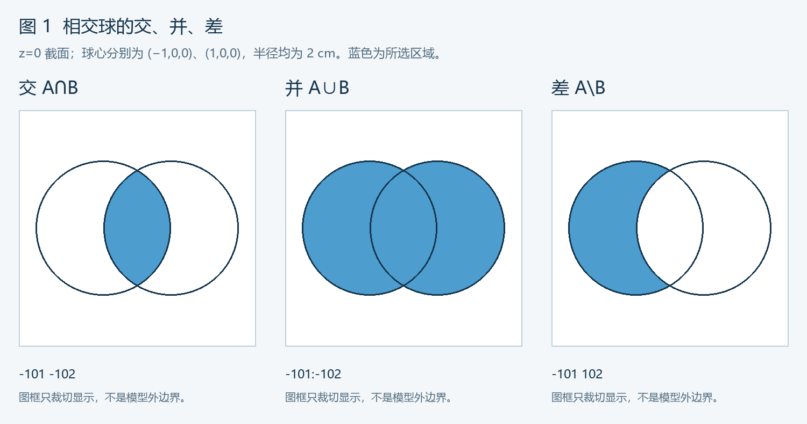
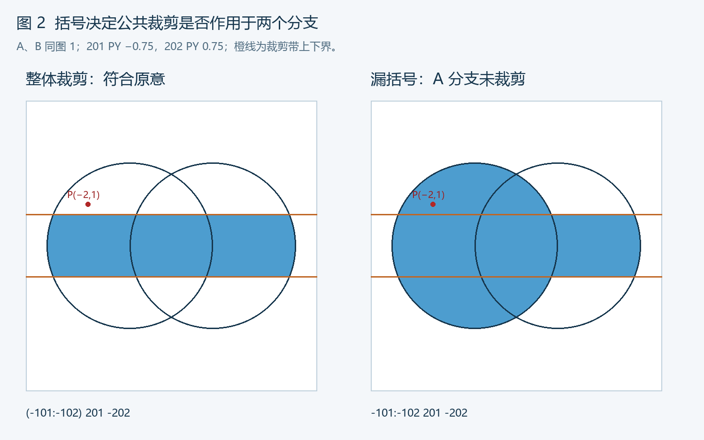
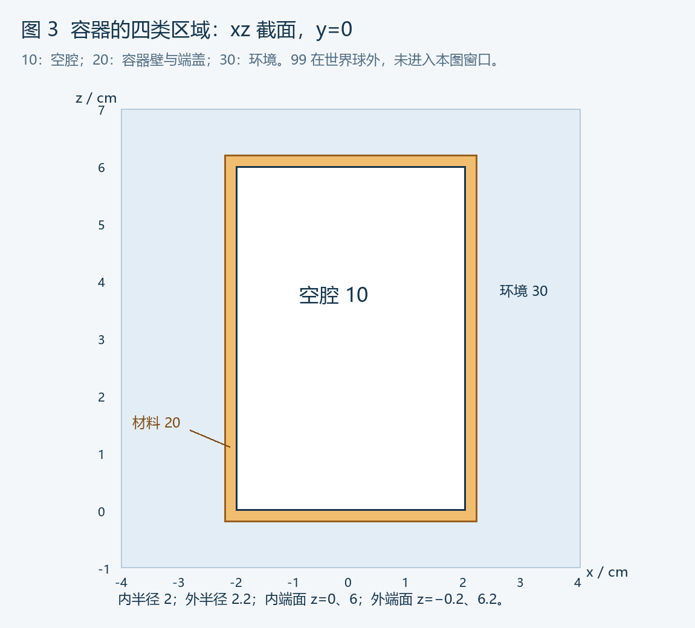

# 第 5 部分：栅元与空间组合

> 适用范围：普通 MCNP 构造实体几何，重点是同一 universe、同一坐标层级的空间分区。涉及变换、晶格和填充时，应先还原坐标与层级。
>
> 前置：[第四部分：曲面与几何边界](./04_曲面与几何边界.md)。长度单位为 cm。除标明“完整输入”的例子外，代码多为局部几何片段，不能独立运行；本文未实际执行 MCNP。

## 查阅索引

| 查什么 | 对应章节 |
|---|---|
| 符号、字段、真空栅元 | 1～2 |
| 交、并、优先级、补 | 3～6 |
| 等价化简与反例 | 7 |
| 球壳、圆柱、长方体及其外部 | 8～10 |
| 空腔、多孔结构、非连通区域 | 11～12 |
| 分层填充、容器完整模型 | 13～14 |
| 环境、终止区与全空间覆盖 | 15 |
| 判点、重叠、遗漏与空区域 | 16 |
| 体积、质量与 tally | 17 |
| 修改依赖和错误速查 | 18～19 |
| 练习、答案、参考资料 | 20～22 |

---

## 1. 语法速查：先区分曲面号和栅元号

| 写法 | 操作对象 | 含义 |
|---|---|---|
| `101` | 曲面 101 | 选择正侧 |
| `-101` | 曲面 101 | 选择负侧 |
| `-101 -102` | 两个侧区域 | 交，同时满足 |
| `-101:-102` | 两个侧区域 | 并，满足至少一个 |
| `#10` | **栅元 10** | 不属于栅元 10 的几何区域 |
| `#(-101 -102)` | 括号中的几何表达式 | 对整个表达式取补 |
| `(-101:-102) -103` | 分组表达式 | 先并，再与 -103 取交 |

**优先级：括号明确分组；组内先补，再交，最后并。**

本课在解释中使用 `A、B、C、U` 表示集合；它们不是可直接填入 MCNP 几何字段的变量。

```text
交：A ∩ B       → MCNP 中用空格
并：A ∪ B       → 用冒号 :
补：A 的外部    → 用 # 配合栅元号或复合表达式
差：A \ B       → A 与 B 的补取交，没有直接的“减法卡”
```

单个带符号曲面选择的是**侧区域**；完整栅元是这些区域的布尔组合。操作顺序与补运算定义见 [MCNP 6.2 手册 Geometry Specification](https://mcnp.lanl.gov/pdf_files/TechReport_2017_LANL_LA-UR-17-29981_WernerArmstrongEtAl.pdf)。

---

## 2. 栅元卡字段与空间条件

### 2.1 普通形式

```text
非真空：[栅元号] [材料号] [密度] [几何表达式] [参数]
真空：  [栅元号] 0               [几何表达式] [参数]
```

例如：

```text
10 1 -1.0 -101 201 -202 imp:p=1
20 0      -102 203 -204 #10 imp:p=1
```

| 项目 | 第一行 | 第二行 |
|---|---|---|
| 栅元号 | 10 | 20 |
| 材料 | 材料 1 | 真空 |
| 密度 | 1.0 g/cm³ | 不填写该字段 |
| 几何 | `-101 201 -202` | `-102 203 -204 #10` |
| 光子重要性 | 1 | 1 |

材料字段和密度不改变布尔表达式的真假；重要性零也不能修复重叠或漏定义。

### 2.2 栅元的几何与物理属性

一个栅元可包含：

- 一个连续区域，或多个不相连的子区域。
- 材料与密度；真空则不填充材料。
- 重要性、温度、变换、所属 universe 等相关参数。

不相连子区域合并为同一栅元时，共用该卡指定的属性；需要不同材料或独立参数时应拆分。仅材料相同，不代表必须合并。

### 2.3 几何条件与完整卡不同

```text
-101 201 -202
```

只是几何字段。它没有栅元号、材料字段和必要设置。

本文的“模板”默认已另行定义所引用曲面；不得把不同示例中同号但不同定义的曲面混到一起。

---

## 3. 交与并：真假判断、集合范围和图示

### 3.1 真值表

| P 属于 A | P 属于 B | A 交 B | A 并 B | A 去掉 B |
|---|---|---|---|---|
| 否 | 否 | 否 | 否 | 否 |
| 否 | 是 | 否 | 是 | 否 |
| 是 | 否 | 否 | 是 | 是 |
| 是 | 是 | 是 | 是 | 否 |

并是“或”，不是“二选一”：同时属于 A 和 B 的重叠部分仍包含在并内，但不会作为两份空间重复计入集合。

### 3.2 两个相交球

```text
101 s -1 0 0 2
102 s  1 0 0 2
```

定义 A=球 101 内部，B=球 102 内部：

| 几何片段 | 对应区域 |
|---|---|
| `-101 -102` | 两个球内部的共同部分 |
| `-101:-102` | 两个球内部的全部并集 |
| `-101 102` | 球 101 内，但在球 102 外 |
| `101 102` | 两个球都在外，不是仅在其中一个外 |
| `101:102` | 至少在一个球外，是两球交集的外部 |



图为 z=0 截面。蓝色表示所选区域，边界圆仅用于定位。

### 3.3 交与并对范围的影响

```text
A ∩ B 是 A 的子集，也是 B 的子集。
A ∪ B 包含 A，也包含 B。
```

因此：

- 用交添加限制，区域不会因此增大。
- 用并添加一个分支，区域不会因此缩小。
- 想从物体中挖孔，应使用交补/差，不应把孔用并加入材料。

### 3.4 凸、非凸与非连通

| 类型 | 特征 | 典型构造 |
|---|---|---|
| 凸区域 | 内部两点间线段仍在区域内 | 球、长方体、有限实心圆柱 |
| 非凸区域 | 存在内部两点，其连线经过区域外 | 有孔物体、L 形区域 |
| 非连通区域 | 区域由不相连的几部分组成 | 两个分离球的并 |

MCNP 的并运算允许非凸和非连通栅元。复杂度增加时，仍应考虑跟踪效率、体积计算与结果可解释性。

---

## 4. 优先级与括号：最常见的合法但错误的几何

### 4.1 交优先于并

```text
-101:-102 201 -202
```

解析为：

```text
(-101) : (-102 201 -202)
```

不是：

```text
(-101:-102) 201 -202
```

若 `201 PY -0.75`、`202 PY 0.75`，前者仅裁剪球 102 分支，球 101 仍完整保留；后者把两球并集一起裁剪到 y=-0.75～0.75。



### 4.2 外包范围必须作用于全部并分支

假设 -900 表示计算外包体内部。想表示“外包体内的 A 或 B”：

```text
-900 (-101:-102)
```

错误意图示例：

```text
-900 -101:-102
```

其 B 分支没有被 -900 限制，可能伸到计算外包体之外。

### 4.3 相邻括号表示交，不是乘法

```text
(-101:-102) (201:-202)
```

表示两个括号区域取交；第二个括号内部仍是并。

不要把括号看成仅仅“注释分组”：它们可以实质改变区域。

### 4.4 阅读顺序

```text
先找最外层冒号 → 划分并分支
每个分支内部 → 读取所有交条件
遇到括号 → 递归拆解
遇到 # → 识别取补对象
```

例如：

```text
(-101 201 -202):(-102 203 -204)
```

是两个分别有完整限制的区域之并。不要把前一个分支的端面限制自动套给后一个分支。

---

## 5. 补运算：#n 与 #(...) 是两种对象

### 5.1 `#10`：栅元 10 的几何补

```text
10 0 -101 201 -202 imp:p=1
20 0 -900 #10 imp:p=1
```

栅元 20 是外包体内、且不属于栅元 10 的部分。

`#10` 不是曲面 10 的外侧，也不复制或反转栅元 10 的材料、密度和重要性。

按本课采用的手册规则，被引用栅元先定义；避免自引用与循环引用。

### 5.2 `#(...)`：复合几何表达式的补

```text
20 0 -900 #(-101 201 -202) imp:p=1
```

这里括号中直接给出几何表达式，无需把它单独建成一个被引用栅元。

### 5.3 单个曲面翻侧直接改符号

```text
-101 的相反侧 → 101
 101 的相反侧 → -101
```

不要为单个曲面使用 `#101`，因为它引用的是栅元 101。

也不要用 `#(101)` 这种单曲面括号取补作为通用写法；手册明确限制该形式，单侧翻转直接用 `-101`。参见 [MCNP 6.3.0 手册第 2.2 节 Complement Operator](https://mcnp.lanl.gov/pdf_files/TechReport_2022_LANL_LA-UR-22-30006Rev.1_KuleszaAdamsEtAl.pdf)。

### 5.4 补集通常不自动局限在“附近”

`#10` 表示不在栅元 10 的几何中，并不只表示紧邻栅元 10 的一薄层。

想得到房间内剩余空间，需要加房间边界；想得到有限壳层，需要加外轮廓。

```text
-900 #10   → 外包体内的剩余空间
#10        → 除栅元10以外的几何范围，可能无限大
```

### 5.5 补的依赖与代价

- 修改被引用栅元，所有 `#该栅元号` 都会联动改变。
- 嵌套补会增加阅读和展开复杂度。
- 多余引用可能引入实际并不邻接的曲面，增加跟踪计算量。
- 部分复杂表达式会影响自动体积/面积计算条件，应检查输出。

对于外包世界的外部，若 `900 SO 10` 已明确给出，直接用 `900` 往往比对全部内部栅元逐个取补更清楚。

---

## 6. 德摩根律：正确求外部和挖孔

### 6.1 两条基本规则

```text
非(A 交 B) = 非A 并 非B
非(A 并 B) = 非A 交 非B
```

操作：**翻转每个侧条件，并交换交与并，保留正确分组。**

### 6.2 交的补

```text
原区域：-101 201 -202
取补：  101:-201:202
```

对于有限圆柱内部，外部包括：径向在外，或者底面下方，或者顶面上方。

如果只是改成：

```text
101 -201 202
```

则要求同时径向在外、低于底面、高于顶面；对于底面低于顶面的正常圆柱，这是空区域。

### 6.3 并的补

```text
原区域：-101:-102
取补：  101 102
```

两球并集的外部，要同时在两个球外。

### 6.4 复杂例子

```text
原区域：(-101 201):(-102 -202)
```

先分别翻转两个分支，再把最外层并换成交：

```text
补区域：(101:-201) (102:202)
```

不要把整个表达式中的所有数字单纯改符号而保留原运算符。

### 6.5 差集

```text
A \ B = A 交 非B
```

若 A=-900，B=`-101 201 -202`：

```text
-900 #(-101 201 -202)
```

等价展开：

```text
-900 (101:-201:202)
```

外包体 -900 保持不变，只对被扣除对象 B 取补。

### 6.6 删除多个对象

```text
U 去掉 (A 并 B) = U 交 非A 交 非B
```

若 A、B 是先定义的栅元 10、20：

```text
-900 #10 #20
```

不是 `-900 (#10:#20)`。后者只要求至少不在一个对象里，通常会保留本来应删掉的空间。

---

## 7. 等价化简与反例表

下表中的 A、B、C 是解释性集合符号。涉及曲面边界的等价性按远离边界的内部点理解，程序边界跟踪另行处理。

| 规则 | 用途 |
|---|---|
| A 交 A = A；A 并 A = A | 删除重复条件 |
| A 交 B = B 交 A | 同层交条件可重排 |
| A 并 B = B 并 A | 并分支可重排 |
| A 交(B 并 C) = (A 交 B)并(A 交 C) | 展开公共外包条件 |
| A 并(A 交 B)=A | 识别被宽分支吞掉的限制 |
| A 交非A=空集 | 发现矛盾条件 |
| A 并非A=全部参考空间 | 发现失效限制 |

典型反例：

| 已知条件 | 错误/冗余表达式 | 实际意义 |
|---|---|---|
| 101 SO 2；102 SO 3 | `-101:-102` | 等于外球内部，不是球壳 |
| 同上 | `-101 -102` | 等于内球内部 |
| 同上 | `101 -102` | 才是 2～3 cm 球壳 |
| 201 PZ 0；202 PZ 6 | `-201 202` | z<0 且 z>6，空集 |
| 同上 | `201:-202` | z>0 或 z<6，对所有非边界点成立，未有效限制高度 |
| 任意普通曲面101 | `-101 101` | 同时两侧，内部点无解 |

化简只保证集合意义，不能借此随意删除被表面源、tally、参数表等引用的对象定义。

---

## 8. 球、球壳和多层球：可直接查用的模板

定义：

```text
101 so 2
102 so 3
103 so 4
900 so 10
```

| 区域 | 几何片段 |
|---|---|
| 内球 r<2 | `-101` |
| 第一层壳 2<r<3 | `101 -102` |
| 第二层壳 3<r<4 | `102 -103` |
| 最外壳之外、世界球以内 | `103 -900` |
| 世界球之外 | `900` |

对应栅元骨架：

```text
10 0 -101 imp:p=1
20 0 101 -102 imp:p=1
30 0 102 -103 imp:p=1
40 0 103 -900 imp:p=1
99 0 900 imp:p=0
```

这里全部用真空展示分区；实际填充材料时需采用非真空字段形式。

**成立条件：**本表曲面同心、半径有序。偏心但完全嵌套时可以构造差区域，但厚度不再均匀；边界相交时应重新判断几何与体积。

球壳体积：

```text
V_shell=4π(Rout³-Rin³)/3
```

不是 `4π(Rout-Rin)³/3`。

---

## 9. 有限圆柱、管壁与轴向裁剪

定义：

```text
101 cz 2
102 cz 2.2
201 pz 0
202 pz 6
```

| 需求 | 几何片段 |
|---|---|
| 内部实心有限圆柱 | `-101 201 -202` |
| 径向管壁，z=0～6 | `101 -102 201 -202` |
| 有限外圆柱之外 | `102:-201:202` |
| 内圆柱之外、但仍在z=0～6 | `101 201 -202` |

第三行是外圆柱**整体外部**，第四行只是限定高度内的径向外部。二者不能互换。

### 9.1 管壁、封闭容器与开口管

- `101 -102 201 -202` 只有径向侧壁，没有覆盖半径 2 内的端盖。
- 封闭容器还需要在上下端构造材料区域。
- 开口管的内孔在开口处与外部环境连通；连通区域仍可因统计需求拆成不同栅元。

### 9.2 偏移轴线

把内外 CZ 分别换成：

```text
101 c/z 3 -2 2
102 c/z 3 -2 2.2
```

上述侧壁表达式仍可使用，前提是两个柱面轴线相同，端面仍对应目标轴向。

### 9.3 倾斜圆柱不能沿用未旋转端面

若轴线不再平行 z，直接保留 PZ 端面通常会得到斜切形状，而非垂直于轴线的圆柱端盖。应使用匹配端平面、RCC 或一致变换。

### 9.4 径向壁厚与端盖厚度分别计算

```text
径向壁厚 = Rout-Rin
底盖厚度 = z_inner_bottom-z_outer_bottom
顶盖厚度 = z_outer_top-z_inner_top
```

不能只增加外半径就认为端盖厚度也已经设置。

---

## 10. 长方体内部、外部和板层

### 10.1 六面定义

```text
101 px -2
102 px 2
103 py -1
104 py 1
105 pz 0
106 pz 6
```

内部：

```text
101 -102 103 -104 105 -106
```

整体外部：

```text
-101:102:-103:104:-105:106
```

外部只需违反任意一条内部条件，因此使用并。把内部六个符号反转后仍用空格取交，会得到矛盾条件，而不是外部。

### 10.2 RPP 形式

```text
601 rpp -2 2 -1 1 0 6
```

```text
内部：-601
外部： 601
```

宏体整体正侧已经表示外部，不应按“所有组成面同时取正侧”重新解释。

### 10.3 多块相接板材

定义 x 边界 0、1、3、6，另有共同有限横向范围 YZ：

```text
101 px 0
102 px 1
103 px 3
104 px 6
201 py -5
202 py 5
301 pz -5
302 pz 5
```

三层材料几何：

```text
第一层：101 -102 201 -202 301 -302
第二层：102 -103 201 -202 301 -302
第三层：103 -104 201 -202 301 -302
```

相邻层共用同一个界面编号，有助于避免同一位置写出两套略有差异的坐标。

### 10.4 物体外部不等于外包世界外部

若 -900 是世界球内部，物体为 -601：

```text
环境：-900 601
终止区：900
```

环境与终止区是不同栅元；`601` 不能同时承担有限环境和全世界外部两种角色。

---

## 11. 挖孔、空腔与多个被扣除对象

### 11.1 只做几何扣除，不会自动填孔

设物体 A=-601，孔 H=-701。物体去孔：

```text
-601 701
```

这只定义剩余材料；孔空间还需归入某个真空、空气或其他材料栅元。若所有栅元都不包含孔，就产生遗漏。

### 11.2 通孔：长方体板中沿 z 的圆柱孔

```text
601 rpp -3 3 -3 3 0 2
701 cz 0.5
```

板材：

```text
10 1 -1.0 -601 701 imp:p=1
```

板范围内的孔：

```text
20 0 -601 -701 imp:p=1
```

其中材料 1、密度 1.0 是教学占位，需要配套实际材料定义。孔栅元使用 -601 裁剪，避免沿圆柱轴向无限伸出。

若采用“整个环境排除板材”的另一种完整分区，孔也可以并入环境，而不单独建立栅元；两种组织方式应选一致的一套。

### 11.3 盲孔：还要限制孔深

在同一板中，孔仅从 z=0 到 z=1，增加：

```text
702 pz 1
```

孔在板内部的几何：

```text
-601 -701 -702
```

其余板材：

```text
-601 (701:702)
```

这里 -601 已提供板的 z=0～2 范围，孔条件只额外限制 z<1。剩余材料包括孔半径之外，以及孔底以下的板内部分。

### 11.4 多孔材料

设实体 A=-601，两个柱孔内部为 -701、-702：

```text
材料：-601 701 702
孔总区：-601 (-701:-702)
```

两个孔有交叠也不会让“孔总区”集合被重复计数。

若把两孔分别作为两个栅元直接定义，交叠部分会同时被两个栅元包含。可采用互斥分配：

```text
孔1：-601 -701
孔2：-601 -702 701
```

这是显式让第二孔扣除第一孔，不是依赖输入行顺序覆盖。

### 11.5 孔伸出物体时

扣孔所用形状可以大于物体，差集 A\H 仍有意义；但孔的独立栅元通常应限制为 A 交 H，不能让整条无限孔柱与外部环境重叠。

### 11.6 空腔的材料不固定

“空腔”是形状描述：

- 材料号 0：真空。
- 给定空气材料和密度：空气腔。
- 给定液体材料和密度：填液腔。

几何相同不代表物理填充相同，名称不会自动设置材料。

---

## 12. 非凸与非连通区域：何时合并、何时拆分

### 12.1 L 形区域

```text
101 rpp 0 4 0 1 0 2
102 rpp 0 1 0 4 0 2
```

两块的并：

```text
-101:-102
```

它形成 L 形，不是两块实体同时各算一份。

```text
V=V1+V2-V_overlap
 =8+8-2=14 cm³
```

如果拆成两个栅元，应使其互斥，例如第二个用 `-102 101`，以免在拐角 1×1×2 的体积内重叠。

### 12.2 两个分离物体共用一个栅元

```text
101 s -3 0 0 1
102 s  3 0 0 1
```

```text
10 1 -1.0 (-101:-102) imp:p=1
```

同一栅元可以表示两块分离的相同填充区域。若需分别调整密度、重要性、温度或统计结果，拆分更清楚。

### 12.3 合并对统计的影响

一个 F4 栅元统计对应该栅元的总体积平均，不会自动分别输出每个并分支。

多个子区域的总平均为：

```text
φ_avg=(V1φ1+V2φ2+...)/(V1+V2+...)
```

只在体积相同等条件下，才等于各平均值的简单算术平均。需要独立空间结果时，优先保留独立栅元或使用合适的统计分组/网格。

### 12.4 几何合并不是材料混合

把两块区域做并，只是合并空间，不会按体积比自动生成均匀混合材料。每个栅元仍采用其指定填充；均匀化需要另行定义成分、密度和适用近似。

---

## 13. 嵌套物体与环境：逐层差分

### 13.1 三层同心结构

本节独立定义：

```text
101 so 5
102 so 3
103 so 1
900 so 10
```

由内到外：

| 区域 | 表达式 |
|---|---|
| 核心，r<1 | `-103` |
| 中间层，1<r<3 | `103 -102` |
| 外层，3<r<5 | `102 -101` |
| 环境，5<r<10 | `101 -900` |
| 世界外部 | `900` |

不能把内球定义为一个栅元，再把完整外球定义为另一个栅元，指望内球自动“挖掉”外球。

### 13.2 多个独立对象的环境

若栅元 10、20 已互斥，且都处于世界内部：

```text
30 0 -900 #10 #20 imp:p=1
99 0 900 imp:p=0
```

环境是世界内部扣除全部对象，不是仅扣除最近的对象。

### 13.3 用补引用时的完整性

设栅元 20 本身是外壳，不包含栅元 10 的内腔。只写：

```text
30 0 -900 #20 imp:p=1
```

会把内腔也划入环境；若内腔已由栅元 10 定义，就发生重叠。正确处理需同时排除 10 与 20，或直接排除完整容器外轮廓。

### 13.4 对象超出世界

环境加了 -900，只能限制环境，不能自动裁剪其他独立栅元。

若某个对象伸到世界球之外，可能与 `99 0 900` 重叠。应扩大世界或按真实需求裁剪对象，不能只改环境表达式。

---

## 14. 完整案例：空腔、容器材料、环境、外部

### 14.1 几何与编号

沿用第四部分的理想圆柱容器：

| 项目 | 数值或定义 |
|---|---|
| 内半径 | 2 cm |
| 外半径 | 2.2 cm |
| 空腔端面 | z=0、6 cm |
| 外轮廓端面 | z=-0.2、6.2 cm |
| 世界边界 | 原点半径 10 cm 的球 |
| 栅元10 | 内空腔，真空 |
| 栅元20 | 外轮廓扣除内空腔，简化水材料 |
| 栅元30 | 世界球内扣除全部容器区域，真空环境 |
| 栅元99 | 世界球外，终止光子跟踪 |

容器使用水仅为教学输入示例，不代表实际结构材料。



### 14.2 完整教学输入

```text
Lesson 05 - closed cylindrical container partition
c cells
10 0 -101 201 -202 imp:p=1
20 1 -1.0 -102 203 -204 #10 imp:p=1
30 0 -900 #10 #20 imp:p=1
99 0 900 imp:p=0

c surfaces
101 cz 2
102 cz 2.2
201 pz 0
202 pz 6
203 pz -0.2
204 pz 6.2
900 so 10

c data
mode p
m1 1001 2 8016 1
sdef par=p pos=0 0 3 erg=1
f4:p 10
nps 100000
```

实际运行前需核对本机版本、默认光子数据和材料数据读取情况。F4 统计的是空腔平均光子响应，不是容器外部剂量率；NPS 不是实际源强。

### 14.3 三个关键表达式

```text
Cavity = -101 201 -202
Outer  = -102 203 -204
Wall   = Outer 交 非Cavity
```

因此材料几何：

```text
-102 203 -204 #10
```

把 #10 展开：

```text
-102 203 -204 (101:-201:202)
```

括号中的三个分支分别允许：径向在空腔外、位于内底面下方、位于内顶面上方；共同外轮廓限制仍须保留。

### 14.4 材料区拆成三个互斥栅元

几何片段：

```text
侧壁：101 -102 201 -202
底盖：-102 203 -201
顶盖：-102 202 -204
```

三部分除共享边界外不重叠，三者并集等于完整材料区。

若由单栅元20改为21、22、23，环境排除列表、tally、参数表和后处理引用也应更新。不要同时保留原20与三块材料栅元。

### 14.5 更直接的环境表达式

容器内腔与材料恰好共同填满外轮廓，所以：

```text
-900 #10 #20
```

可等价为：

```text
-900 (102:-203:204)
```

第二式不再依赖两个内部栅元的编号，但仍依赖外轮廓正确。它并不适用于“内部对象没有共同填满该轮廓”的其他情况。

### 14.6 宏体对照

若另定义：

```text
301 rcc 0 0 0 0 0 6 2
302 rcc 0 0 -0.2 0 0 6.4 2.2
```

则可用：

```text
空腔：-301
材料：-302 301
环境：-900 302
外部：900
```

这是另一套等价几何组织方式，不应将两套相同区域同时作为独立栅元叠加进完整模型。

### 14.7 代表点归属

| 点 cm | 应属于 | 检查目的 |
|---|---:|---|
| (0,0,3) | 10 | 源点在空腔 |
| (2.1,0,3) | 20 | 径向侧壁存在 |
| (0,0,-0.1) | 20 | 底盖存在 |
| (0,0,6.1) | 20 | 顶盖存在 |
| (2.3,0,3) | 30 | 侧面环境 |
| (0,0,6.3) | 30 | 顶部环境 |
| (11,0,0) | 99 | 世界外部 |

完整模型在这些点都应当只命中一个栅元。

---

## 15. 外部区域、全空间覆盖与层级

### 15.1 两个分区条件

对普通单层模型，在远离边界的空间点上，所有栅元应满足：

```text
两两互斥：Ci 交 Cj = 空集，i≠j
共同覆盖：全部Ci的并 = 当前模型的完整空间
```

实际常将世界内部划分为物体和环境，世界外部单独定义为终止区。

边界本身由跟踪算法处理，不通过人为给所有不等式“加等号”消除问题。

### 15.2 外部仍然是一个区域

`IMP:P=0` 表示对应粒子进入后终止跟踪，并非省略外部几何。

正常进入终止区与粒子因几何问题无法定位，是不同情况。

### 15.3 不采用“后写覆盖前写”规则

两个同层栅元重叠，不能通过调整行顺序来合法指定谁优先。应修改集合表达式，使区域本身互斥。

### 15.4 repeated structures 的限定

有 U、LAT、FILL 时，父容器与子 universe 的坐标层级、填充和裁剪关系另有规则。

本课的“只命中一个栅元”应在相应层级解释，不能把父容器和被填入的子栅元当作普通同层重叠。

同样，不应跨变换或层级直接用 #n 猜测“减掉那个物体”；先查引用、坐标和具体版本限制。

---

## 16. 重叠、遗漏、空区域：用命中计数定位

### 16.1 点归属计数

对远离边界的点 P，计算：

```text
K(P)=包含P的同层栅元数量

K=0：遗漏
K=1：该点分区唯一
K≥2：重叠
```

有限判点或随机检查不能证明所有位置都正确，但能给出明确反例。

### 16.2 重叠反例

```text
101 so 2
102 so 3
```

若两个栅元分别是 -101、-102，则 r<2 的点同时命中两者。

若意图为内球加外壳，第二个应为 `101 -102`。

### 16.3 遗漏反例

```text
内区：r<2
外壳：2.2<r<3
环境：r>3
```

2<r<2.2 没有归属。即使这层很薄、试运行没有恰好经过，也仍然是遗漏。

### 16.4 空区域反例

```text
201 pz 0
202 pz 6
几何：-201 202
```

要求 z<0 且 z>6，没有内部点。对应 tally 可能没有贡献，但不能仅凭零统计就断定一定是空区域，还要区分采样不足、粒子不到达等原因。

### 16.5 候选点怎么选

| 点类型 | 目的 |
|---|---|
| 每个区域的明确内部点 | 确认区域存在 |
| 壁厚和端盖中间点 | 检查薄层没有漏掉 |
| 孔交叠区 | 检查多孔栅元是否重叠 |
| 并分支外延处 | 检查公共裁剪括号 |
| 世界内、所有对象外 | 检查环境 |
| 世界外 | 检查终止区与超界对象 |
| 边界两侧的小偏移点 | 检查邻接关系，避开恰好落在边界 |

偏移距离应相对目标尺寸和局部最小特征合理选择，不是把几何面本身移动一个任意小量。

### 16.6 手工判定流程

```text
先算各相关曲面的f值
→ 将各带符号侧条件标为真/假
→ 按括号、补、交、并计算栅元表达式
→ 对全部同层栅元计数
→ 记录出问题的坐标及命中的编号
```

例如优先级反例的点 P=(-2,1,0)，属于球A但不在 y 带内：

```text
(-101:-102) 201 -202 → 假
-101:-102 201 -202   → 真
```

这个点直接证明两个表达式不等价。

### 16.7 检查证据的范围

语法通过、多截面图、代表点、随机采样、体积核对、实际输运分别检查不同方面。

尤其是“没有出现 lost particle”不等于“没有重叠和遗漏”；未访问区域的问题可能暂时不暴露。

---

## 17. 体积、质量与 tally：几何正确还要归一化正确

### 17.1 可直接计算的体积

| 区域 | 体积公式 |
|---|---|
| 球壳 | `4π(Rout³-Rin³)/3` |
| 同轴等高管壁 | `π(Rout²-Rin²)H` |
| 长方体 | `ΔxΔyΔz` |
| 完全嵌套的外轮廓去空腔 | `V_outer-V_cavity` |
| 两区域的并 | `V_A+V_B-V_intersection` |
| 互斥区域的并 | 各体积之和 |

差体积公式 `V_A-V_B` 要求 B 完全处于 A 内；一般差集体积应为 `V_A-V_(A交B)`。

### 17.2 容器体积与分解核对

第14节：

```text
空腔：π×2²×6=24π≈75.3982 cm³
外轮廓：π×2.2²×6.4=30.976π≈97.3140 cm³
材料：6.976π≈21.9158 cm³

侧壁：π(2.2²-2²)×6=5.04π
两端盖合计：2×π×2.2²×0.2=1.936π
两者相加：6.976π
```

完整分区还满足：

```text
V_cavity+V_wall+V_environment=4π×10³/3
```

体积总和符合只是必要检查：局部重叠和等体积遗漏可能相互抵消，不能单凭总和证明分区正确。

### 17.3 质量

```text
m=ρV
```

材料、密度均相同的互斥子区可分别求质量再相加。真空区域没有材料质量，不应对真空套用非零质量加热归一化。

### 17.4 平均值与总量

常见 F4 是体积平均响应，常见 F6 类结果涉及按质量归一化；具体还要看配套卡。

新增/删除孔、改变合并栅元范围，会改变分母及场分布。不能把平均 tally 的变化直接解释为总粒子数或总沉积能量同比变化。

### 17.5 自动体积与用户指定量

复杂并、补或变换可能使自动几何量计算受限；检查输出采用的体积、面积和质量。

若用 VOL、SD 等手动指定相关量，先核对该卡精确含义；几何改变后应更新，但不能靠填写“看起来正确的体积”掩盖错误区域。

补运算对几何量计算和跟踪复杂度的影响，见 [MCNP 6.3.0 手册第2.2节](https://mcnp.lanl.gov/pdf_files/TechReport_2022_LANL_LA-UR-22-30006Rev.1_KuleszaAdamsEtAl.pdf)。

---

## 18. 修改时的依赖检查

| 操作 | 必查关联 |
|---|---|
| 改曲面位置或半径 | 所有几何引用、邻接区、源位置、tally区域 |
| 改栅元10的几何 | 所有 `#10`、统计、体积、质量、外部环境 |
| 栅元20拆为21/22/23 | 删除原20或调整其范围，更新环境排除、参数表与后处理 |
| 多区域合并成一个栅元 | 填充属性是否一致，体积平均是否仍符合目标 |
| 增加孔 | 材料扣除、孔的归属、环境和薄层检查 |
| 重排栅元卡 | #引用的定义顺序、位置式参数表 |
| 改材料号为0 | 删除普通非真空密度字段，保留正确几何 |
| 把物体移到新位置 | 世界包含关系、相邻结构、变换坐标、判点位置 |
| 使用 LIKE...BUT 复制 | 未变换时可能复制到同一位置，不能把新编号当成自动移动 |

补引用具有“几何跟随”作用，但不是所有参数自动跟随：被补栅元材料变化，不等于引用它的环境材料变化。

---

## 19. 错误速查与表达式阅读单

### 19.1 错误速查

| 错误 | 原因 | 修正方向 |
|---|---|---|
| 外壳写成内球并外球 | 并集被外球吞并 | 外球内部交内球外部 |
| 外部只翻符号、不交换运算 | 不符合德摩根律 | 交并互换，保留分组 |
| `#101` 用来翻曲面侧 | #后数字是栅元号 | 单侧直接改变符号 |
| 裁剪条件只跟在最后并分支后 | 交优先于并 | 给全部并分支加公共括号 |
| 扣孔后不定义孔的归属 | 只写材料余区 | 为孔填充或并入环境 |
| 两个重叠孔分别各占一个栅元 | 孔交区重复归属 | 合并孔区或显式互斥分配 |
| 环境只排除壳体、不排除内腔 | #壳体不是#完整轮廓 | 排除全部内部区或完整外轮廓 |
| 对象越出世界 | 环境裁剪不影响对象 | 扩世界或裁剪对象 |
| 用行顺序指定材料优先 | 普通同层栅元不自动覆盖 | 从表达式中删除重叠 |
| 修改后仍用旧体积 | 用户量未联动 | 核对几何与归一化 |

### 19.2 单条几何表达式的阅读单

```text
曲面与栅元引用清单：
最外层并分支：
各分支交条件：
补运算对象与定义来源：
公共外包条件：
预期内部点/外部点：
是否有限、连通、含孔：
与其他栅元的互斥与覆盖关系：
体积、质量和统计依赖：
```

### 19.3 证据优先级

出现几何问题时，保留原文件，记录问题坐标、所在粒子/区域、第一条相关诊断；先检查表达式与边界，不盲目移动曲面或删除布尔条件。

---

## 20. 练习：表达式与反例

以下各题的定义仅在本题或注明的题组内使用。

### 20.1 语法与优先级

1. `-101 -102` 与 `-101:-102` 有何区别？
2. `#10` 和 `-10` 的对象分别是什么？
3. 将 `-101:-102 201 -202` 按默认顺序加括号。
4. 想让 -900 裁剪 A=-101、B=-102 的全部并集，写出表达式。
5. 求 `-101 201 -202` 的补，用显式侧条件表示。
6. 求 `(-101 201):(-102 -202)` 的补。
7. 世界内扣除栅元10和20，为什么用 `-900 #10 #20`，而不是 `-900 (#10:#20)`？
8. `#10` 是否继承栅元10的材料或重要性？

### 20.2 模板构造

9. 101 SO 2、102 SO 3：写球壳；判断 `-101:-102` 实际是什么。
10. 101 CZ 2、102 CZ 2.2、201 PZ 0、202 PZ 6：写有限管壁与整个有限外圆柱的外部。
11. 601 RPP -3 3 -3 3 0 2、701 CZ 0.5：写板材去通孔和板内孔区。
12. 第11题新增702 PZ 1：孔仅到z=1，写盲孔与剩余板材。
13. A=-601 中挖两孔 -701、-702：写材料与总孔区。
14. 两孔相交且要分成两个栅元，第二孔如何排除第一孔？
15. 世界 -900 中有先定义的栅元10、20：写环境和世界外部终止区。
16. 若20仅是壳体，环境写成 `-900 #20`，可能与哪个区域重叠？

### 20.3 识错与核对

17. 为什么给内部球和完整外球各建一个栅元会重叠？
18. 201 PZ 0、202 PZ 6：`-201 202` 与 `201:-202` 分别是什么范围？
19. L形由 RPP 0 4 0 1 0 2 与 RPP 0 1 0 4 0 2 的并形成，体积多少？若拆两栅元如何避免拐角重叠？
20. 容器世界为SO10，内空腔R=2、z=0～6，外轮廓R=2.2、z=-0.2～6.2：求材料体积。
21. 第14节模型中，点 (0,0,6.1)、(2.3,0,3)、(11,0,0) 各属于哪个栅元？
22. 同一栅元中的两个分离子区，体积1和3，平均响应分别2和6。总体积平均是多少？
23. 为什么体积总和正确、没有lost particle，仍不能证明分区无误？
24. 栅元20拆为21、22、23后，原环境 `-900 #10 #20` 需要怎样处理？

---

## 21. 答案速查

| 题 | 答案或关键点 |
|---:|---|
| 1 | 前者交，两个条件都满足；后者并，至少一个满足 |
| 2 | #10取栅元10的几何补；-10选择曲面10负侧 |
| 3 | `(-101):(-102 201 -202)` |
| 4 | `-900 (-101:-102)` |
| 5 | `101:-201:202` |
| 6 | `(101:-201) (102:202)` |
| 7 | 删除A并B须同时不在A且不在B；并两个补会保留不该保留的点 |
| 8 | 不继承；它只引用几何的补 |
| 9 | 球壳 `101 -102`；内球并外球等于外球内部 |
| 10 | 管壁 `101 -102 201 -202`；有限外圆柱外部 `102:-201:202` |
| 11 | 板材 `-601 701`；孔 `-601 -701` |
| 12 | 盲孔 `-601 -701 -702`；板材 `-601 (701:702)` |
| 13 | 材料 `-601 701 702`；总孔区 `-601 (-701:-702)` |
| 14 | 第一孔 `-601 -701`，第二孔 `-601 -702 701` |
| 15 | 环境 `-900 #10 #20`；外部 `900`，再按目标粒子设置重要性零 |
| 16 | 壳体内腔；若内腔已有独立栅元，就重复归属 |
| 17 | 内球点同时属于两个完整球内部；外层应扣掉内球 |
| 18 | 前者空集；后者对所有非边界点成立，未有效限制z |
| 19 | 14 cm³；第二块扣除第一块，例如 `-102 101` |
| 20 | `π(2.2²×6.4-2²×6)=6.976π≈21.9158 cm³` |
| 21 | 依次20、30、99 |
| 22 | `(1×2+3×6)/4=5`，不是4 |
| 23 | 局部重叠与遗漏可能抵消，未被访问/检查的区域仍可能有错 |
| 24 | 若只保留三块新材料区，环境需排除10、21、22、23，或改用完整外轮廓的显式补 |

---

## 22. 完成标准与参考资料

### 22.1 完成标准

能独立完成以下五项即可进入材料课程：

1. 将一个混合交并补表达式还原成集合关系，并写出正确补集。
2. 为球壳、管壁、孔区和环境写出互斥的几何片段。
3. 区分 #后的栅元引用和带符号曲面引用。
4. 对第14节容器模型说明每个空间点应归属哪类区域。
5. 用判点、截面和体积核对定位重叠、遗漏、空区域及归一化问题。

下一部分《材料、密度与核数据库》将重点学习材料卡、核素标识、原子/质量份额、密度换算、数据表及温度匹配。

### 22.2 参考资料

- [MCNP 官方理论与用户手册索引](https://mcnp.lanl.gov/manual.html)：选择实际版本核对。
- [MCNP 6.2 用户手册](https://mcnp.lanl.gov/pdf_files/TechReport_2017_LANL_LA-UR-17-29981_WernerArmstrongEtAl.pdf)：Geometry Specification 中的交、并、补、优先级与括号。
- [MCNP 6.3.0 Theory & User Manual](https://mcnp.lanl.gov/pdf_files/TechReport_2022_LANL_LA-UR-22-30006Rev.1_KuleszaAdamsEtAl.pdf)：第2.2节补运算与代价，第5.2节栅元卡。
- [MCNP 6.3.1 Theory & User Manual](https://mcnp.lanl.gov/pdf_files/TechReport_2024_LANL_LA-UR-24-24602Rev.1_KuleszaAdamsEtAl.pdf)：当前模型采用的栅元、宏体、填充及变换规则。
- [An MCNP6 Primer，2024](https://mcnp.lanl.gov/pdf_files/Book_MonteCarlo_2024_ShultisBahadori_AnMCNPPrimer.pdf)：Geometry Specifications 的入门示例。

本文配图为集合与截面的教学示意，判点和体积为独立数学核对；不构成 MCNP 运行记录。
