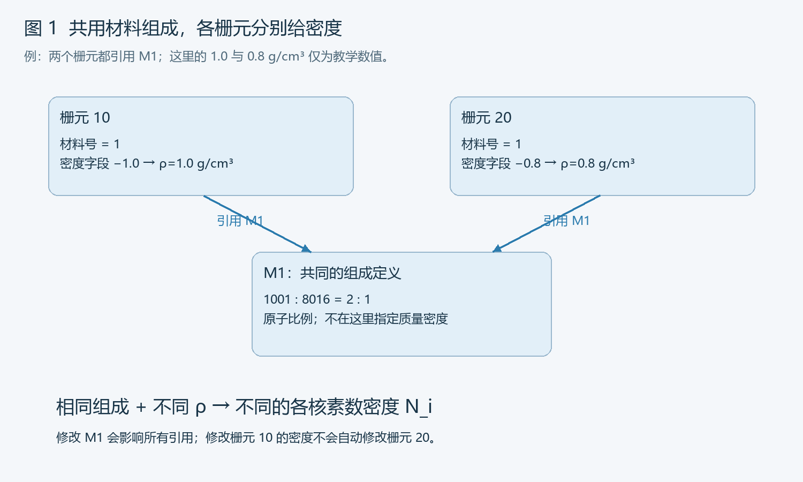
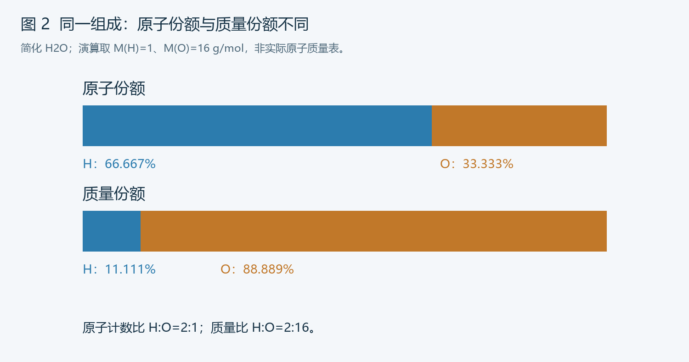
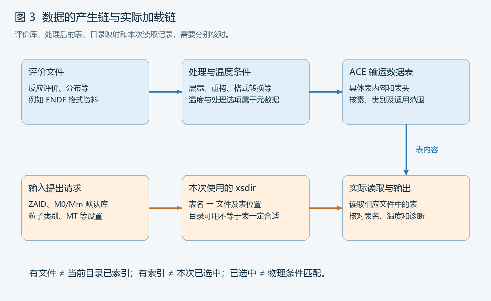

# 第 6 部分：材料密度与核数据库

> 范围：常见 MCNP 6 系列材料输入与数据选择。前置：[第二部分的物理量与单位](./2_必要的物理基础与单位.md)、[第五部分的栅元](./05_栅元与空间组合.md)。
>
> 约定：ρ 为质量密度，N 为数密度，x 为原子份额，w 为质量份额，M 为摩尔质量。本课统一采用 cm、g、mol；手算指定的整数摩尔质量仅为教学近似。输入片段不等于完整模型，未实际运行 MCNP。

## 查阅索引

| 查什么 | 章节 |
|---|---|
| 组成、密度、核数据分别放哪里 | 1～2 |
| 核素号、元素号、ZAID | 3 |
| 原子/质量比例、归一化及转换 | 4～5 |
| 质量密度、数密度、化学计量 | 6～7 |
| 同位素展开与混合物 | 8～9 |
| 孔隙、气体、温度与密度 | 10～11 |
| 评价库、ACE、xsdir、选择优先级 | 12～15 |
| 温度数据、TMP、MT | 16～17 |
| 完整材料审阅案例与修改 | 18～19 |
| 核对流程和故障速查 | 20～21 |
| 公式、练习及答案 | 22～24 |
| 资料与完成标准 | 25 |

---

## 1. 材料模型的三个层面

| 层面 | 回答的问题 | 常见输入位置 |
|---|---|---|
| 组成 | 有哪些元素/核素，各占多少 | `M1` 等材料卡 |
| 密度与状态 | 单位体积含多少物质，处于何种状态 | 栅元密度；相关温度、气体等设置 |
| 输运数据 | 用哪套相互作用数据，在哪个能量与温度范围 | ZAID后缀、库选项、MT、数据目录及物理设置 |

```text
材料组成 → 确定各组分相对比例
栅元密度 → 确定单位体积的总量
二者结合 → 各核素数密度 N_i
核数据   → 各组分微观相互作用数据 σ_i(E)
宏观相互作用系数 Σ(E)=Σ_i[N_i σ_i(E)]
```

其中右侧 Σ_i 是求和，左侧 Σ(E) 是宏观截面。

**材料名称不是定义。** “钢”“混凝土”“塑料”还需要具体组成、密度、含水/填料等条件。同一材料号可以被多个栅元引用，但各栅元密度可不同。

---

## 2. M 卡与栅元密度：字段速查

### 2.1 基本形式

```text
Mm ZAID1 fraction1 ZAID2 fraction2 ... [材料选项]
```

例如：

```text
m1 1001 2 8016 1
```

表示材料1的氢-1与氧-16原子比例为2:1；不是密度2和1，也不是两个独立材料。

对应某个非真空栅元：

```text
10 1 -1.0 -101 imp:p=1
```

这里第二项1引用M1，-1.0表示质量密度1.0 g/cm³。几何仍由-101等条件定义。

### 2.2 两套正负号

| 位置 | 正值 | 负值 |
|---|---|---|
| 栅元密度字段 | 总原子数密度，atoms/(barn·cm) | 质量密度，g/cm³，取其绝对值 |
| M卡组分份额 | 原子比例 | 质量比例，取其绝对值 |

同一M卡不要混用正原子份额和负质量份额。栅元密度符号与材料比例符号独立，不能照抄或同时翻转。

### 2.3 同一种组成，不同密度

```text
10 1 -1.0 -101 imp:p=1
20 1 -0.8 101 -102 imp:p=1
```

二者共用M1，但密度不同。改M1会影响两处组成；改栅元10密度不会自动改20。



### 2.4 真空与默认设置

```text
99 0 900 imp:p=0
```

材料号0表示真空，普通真空栅元不填写密度字段。

`M0` 在支持的版本中用于设置材料的默认库等选项，不是创建“真空材料0”的组成卡。真空与重要性零也不是同一概念。

### 2.5 多组分续行

```text
m1 1001 2
     8016 1
```

第二行前五列为空格，是M1的续行。材料卡放在数据段；不要在一张材料卡内部插结构空行。

材料输入和库选项规则可核对 [MCNP 6.3.0 手册第5.6.1节](https://mcnp.lanl.gov/pdf_files/TechReport_2022_LANL_LA-UR-22-30006Rev.1_KuleszaAdamsEtAl.pdf)。

---

## 3. 核素标识、元素标识和 ZAID

### 3.1 常见基态标识

对常见基态核素，主体常用：

```text
ZA = 1000Z + A
```

| 主体 | Z | A | 含义 |
|---:|---:|---:|---|
| 1001 | 1 | 1 | 氢-1 |
| 1002 | 1 | 2 | 氢-2 |
| 5010 | 5 | 10 | 硼-10 |
| 5011 | 5 | 11 | 硼-11 |
| 6012 | 6 | 12 | 碳-12 |
| 8016 | 8 | 16 | 氧-16 |
| 13027 | 13 | 27 | 铝-27 |
| 26056 | 26 | 56 | 铁-56 |

A是质量数，不是精确原子质量，也不是数据库版本。

### 3.2 AAA=000：元素形式

```text
1000 → 氢元素形式
6000 → 碳元素形式
8000 → 氧元素形式
26000 → 铁元素形式
```

要区分两种情况：

- **光原子/电子数据：**通常按元素组织，元素形式常见。
- **中子数据：**是否提供天然元素表取决于实际库；没有对应元素表时，应按合适同位素组成展开。

不能假设`26000`会在所有中子库中自动展开成天然铁，也不能把`26056`当成天然铁的完整替代。

### 3.3 完整表标识

经典写法可概括为：

```text
ZZZAAA.abx
```

例如：

```text
1001.80c
```

| 部分 | 作用 |
|---|---|
| 1001 | 目标核素主体 |
| 80 | 具体表的标识部分 |
| c | 数据类别，这里为连续能量中子表 |

ZAID是标识字符串，不是一个可以进行小数运算的实数。改`.80c`为`.81c`不是给核素增加0.01，也不保证温度只增加某个固定量。

### 3.4 亚稳态与特殊编码

对于亚稳态核素和历史数据包，主体可能包含状态编码或特殊约定。不能对所有标识都机械用“除1000取Z、余数取A”恢复核素。

读到不符合基态规律的主体时，查数据包说明、xsdir及表头，核对核素和核状态；不要自行将其改成看起来更熟悉的整数。

### 3.5 主体、表名、物理文件名不同

```text
核素主体：1001
完整表名：1001.80c
实际文件：由目录条目指向的文件及表位置确定
```

物理文件名不一定等于完整表名；一个文件也可能包含多张表。判断加载了什么，以目录映射和输出记录为准。

---

## 4. 原子比例、质量比例与归一化

### 4.1 原子比例

```text
m1 1001 2 8016 1
```

归一化后：

```text
x_H=2/(2+1)=2/3
x_O=1/(2+1)=1/3
```

M卡允许相对数值，不要求输入前已加和为1。因此`2:1`与`0.6666667:0.3333333`在相应精度下表示同一原子比例。

将同一M卡所有份额同时乘10，归一化组成不变；这不能把密度提高10倍。

### 4.2 质量比例

为便于手算，本节取H摩尔质量1、O摩尔质量16：

```text
H2O的H:O质量比=2:16
w_H=2/18=1/9
w_O=16/18=8/9
```

对应近似质量比例可写为：

```text
m1 1001 -0.1111111111 8016 -0.8888888889
```

这里的近似质量比例只在指定摩尔质量假设下与2:1原子比例严格对应。MCNP使用其实际原子量数据转换时，应据此重新计算，不能把整数近似当成精确材料数据。



### 4.3 百分比的分母

| 表述 | 分母 |
|---|---|
| 20 atom% | 目标原子数/相应总原子数 |
| 20 wt% | 目标质量/相应总质量 |
| 20 vol% | 目标体积/相应总体积 |
| 某元素同位素占20% | 常以该元素原子数为分母，仍需确认 |
| 某添加剂占20% | 是整个化合物还是其中元素，必须确认 |

“含硼5%”缺少份额类型和分母，不能直接变成M卡。

### 4.4 自动归一化不能修复漏组分

原数据Fe占0.8、Cr占0.2，漏了Cr而只留下Fe 0.8，程序归一化后将得到100%Fe，不会自动补回缺失组分。

类似地，份额和为0.98可能来自舍入，也可能漏掉2%的组分；先确认原因，不能统一“补到1”处理。

### 4.5 零份额、重复组分和符号

- 不需要的组分优先明确删除，而不是用大量零项掩盖材料实际组成。
- 相同核素出现多次时，先判断是否同一表、不同温度表或特殊处理；不要未经核对全部相加。
- 普通组成列表保持份额类型一致，负号仅是质量比例约定，不是物理负质量。

---

## 5. 原子份额与质量份额互换

### 5.1 原子份额转质量份额

```text
w_i = x_i M_i / Σ_j(x_j M_j)
```

已给原子相对数a_i时，也可直接用：

```text
w_i = a_i M_i / Σ_j(a_j M_j)
```

### 5.2 质量份额转原子份额

```text
x_i = (w_i/M_i) / Σ_j(w_j/M_j)
```

如果给的是质量百分数，全部先除100或作为同尺度相对数处理；不要把某些项写成百分数，另一些项写成0～1小数。

### 5.3 平均摩尔质量必须与份额定义一致

以“每摩尔原子”为计数基准：

```text
M_bar = Σ_i x_i M_i
      = 1 / Σ_i(w_i/M_i)
```

质量份额下不能使用`Σw_i M_i`代替上述表达式。

### 5.4 合金演算

假设Al、Fe各占50%质量，仅为演算取M_Al=27、M_Fe=56：

```text
x_Al=(0.5/27)/(0.5/27+0.5/56)=56/83≈0.674699
x_Fe=27/83≈0.325301
```

质量各一半，不代表原子数各一半。中子材料中还需进一步确定Fe的同位素组成，不能只在这里完成份额转换就忽略数据目标。

### 5.5 反向核对

转换后检查：

```text
Σx_i≈1，Σw_i≈1
按同一组M_i转换回来，应恢复原始比例
```

若不能恢复，优先检查份额类型、摩尔质量、元素/核素层级与舍入。

---

## 6. 质量密度、总数密度与部分数密度

### 6.1 质量密度

```text
ρ=质量/体积
1 g/cm³=1000 kg/m³
```

给定总体积V时，质量m=ρV；给定实测质量和几何体积时，也可反求用于模型的体密度。

### 6.2 从质量份额求各组分数密度

```text
N_i[atoms/cm³] = ρ w_i N_A / M_i
N_total = Σ_i N_i
```

其中`N_A=6.02214076×10^23 mol^-1`。

### 6.3 从原子份额求数密度

```text
M_bar = Σ_i x_i M_i
N_total = ρ N_A/M_bar
N_i = x_i N_total
```

组分必须是同一种计数层级：不要把水分子和氧原子直接当成同类“原子组分”相加。

### 6.4 MCNP数密度单位

```text
n_i[atoms/(barn·cm)] = N_i[atoms/cm³] ×10^-24
n_total = Σ_i n_i
```

反算质量密度：

```text
ρ = (10^24/N_A) Σ_i(n_i M_i)
```

常见非真空栅元中，正密度字段填写n_total，不是某一个核素的n_i，也不是未换单位的atoms/cm³数值。

### 6.5 绝对数密度不能只写在M卡后就结束

可以把各核素n_i作为正相对数列在M卡，使比例正确；但M卡会归一化，绝对密度尺度仍需要在栅元中给出。

```text
M卡：决定 n_i/n_total
栅元正密度：给出 n_total
```

如果漏掉总密度或填入错误单位，M卡中看起来正确的一组n_i并不能自动补救。

### 6.6 密度对输运的直接影响

组成与温度数据不变时，各核素N_i随ρ同比变化，宏观系数随之变化：

```text
Σ(E)=Σ_i[N_i σ_i(E)]
```

但全模型的散射、泄漏、沉积等结果一般不按ρ简单线性缩放；需要重新输运或在明确近似下估算。

---

## 7. 化学式、分子数密度与水的完整手算

### 7.1 化学计量的一般形式

化学式中各组分原子计数为ν_i：

```text
M_formula = Σ_i ν_i M_i
N_formula = ρ N_A/M_formula
N_i = ν_i N_formula
N_total = (Σ_iν_i) N_formula
```

对晶体等材料，formula是计量单元，不一定代表独立分子。

### 7.2 简化水

取ρ=1 g/cm³，H=1、O=16 g/mol：

```text
M_formula=18 g/mol
N_H2O=6.02214076E23/18=3.34563376E22 molecules/cm³
N_H=6.69126751E22 atoms/cm³
N_O=3.34563376E22 atoms/cm³
N_total=1.00369013E23 atoms/cm³
```

MCNP单位：

```text
n_H≈0.0669126751
n_O≈0.0334563376
n_total≈0.1003690127 atoms/(barn·cm)
```

这三种量不同：分子数密度、某元素部分数密度、总原子数密度。

### 7.3 两种密度输入的对应

普通栅元密度字段：

```text
-1.0          → 指定1 g/cm³
+0.1003690127 → 在上述整数摩尔质量近似下对应的总原子数密度
```

正数前的`+`通常可省略。

它们在本节数学假设下对应同一密度；MCNP用实际AWR换算时会出现与整数近似不同的细小差别，应使用同一质量数据来源完成正式转换。

### 7.4 把 -1.0 改成 +1.0 的后果

不是保持密度不变，而是改为1 atom/(barn·cm)。在上述简化水组成下，等效质量密度约为9.9632 g/cm³，是原来的约9.96倍。

这是可能通过语法解析、却改变物理模型的典型错误。

### 7.5 水密度与组成不是固定常数

本课ρ=1、仅H-1/O-16均为教学简化。实际水的温度、压力、同位素组成和溶质可能不同；需要按项目条件确定，不把教学近似称为某温压下的精确水数据。

---

## 8. 元素到同位素：分母与转换顺序

### 8.1 元素原子份额展开

元素E在材料中的原子份额为x_E，元素内部各同位素原子丰度为a_j：

```text
Σ_j a_j=1
x_j=x_E a_j
```

例如简化H2O中，假设氧的同位素原子比例为O-16:O-18=0.99:0.01：

```text
m1 1001 2 8016 0.99 8018 0.01
```

整个材料内：x_H=2/3，x_O16=0.33，x_O18≈0.00333333。该氧比例为假设，不是通用天然丰度。

### 8.2 元素质量份额不能直接乘原子丰度

若元素质量份额为w_E，同位素原子丰度为a_j，应先得到元素内部同位素质量份额：

```text
b_j = a_j M_j / Σ_k(a_k M_k)
w_j = w_E b_j
```

`w_E×a_j`一般不是正确的同位素质量份额。

### 8.3 硼的演算

假设B-10、B-11原子比例为0.2:0.8，仅取摩尔质量10和11：

```text
M_bar=10.8
w_B10=0.2×10/10.8≈0.185185
w_B11≈0.814815
```

20 atom%的B-10不等于20 wt%。实际丰度按材料证书或选用数据来源确认。

### 8.4 分母必须写全

“B-10占20%”可能指硼元素内部，而不是整个聚合物材料。

若材料总硼原子份额为0.01，硼内部B-10原子份额0.2，则整个材料的B-10原子份额为0.002。

### 8.5 简化和替代要说明

忽略微量同位素、用单一核素代表元素、将缺数据核素替换为其他目标，都属于建模选择。应记录对目标反应与响应的影响依据，不能只因缺表就自动替换。

---

## 9. 混合材料：先分清“混什么”和“按什么比例”

### 9.1 化合物质量份额展开到元素/核素

混合物中组分材料k的质量份额为W_k，该材料内部组分i的质量份额为w_(i,k)：

```text
w_i = Σ_k[W_k w_(i,k)]
```

例如“20 wt%水+80 wt%二氧化硅”，不是直接写H=0.2、Si=0.8。

取H=1、O=16、Si=28的教学摩尔质量：

```text
水内：H质量份额2/18，O为16/18
SiO2内：Si质量份额28/60，O为32/60

总H：0.2×2/18=0.0222222
总Si：0.8×28/60=0.3733333
总O：0.2×16/18+0.8×32/60=0.6044444
```

总质量份额和为1。若用于中子输运，再按目标同位素组成继续展开。

### 9.2 按体积混合

各组分体积分数v_k、密度ρ_k，且满足体积可加近似：

```text
Σv_k=1
ρ_mix=Σ_k(v_kρ_k)
W_k=v_kρ_k/ρ_mix
```

然后按9.1节转换组成。不能直接用体积分数作为M卡的质量份额。

### 9.3 按质量混合的密度

在组分体积可加近似下：

```text
1/ρ_mix=Σ_k(W_k/ρ_k)
```

不是`ρ_mix=ΣW_kρ_k`。

例如两种组分各占50%质量，密度1和4 g/cm³：

```text
ρ_mix=1/(0.5/1+0.5/4)=1.6 g/cm³
```

若各占50%体积，ρ_mix则为2.5 g/cm³。两种配比的质量组成也不同。

### 9.4 体积非加和时

溶液、反应产物、复合材料压实与孔隙可能使简单密度混合公式失效。优先使用相应条件下的实测/可靠混合物密度，并记录体积可加是否只是近似。

### 9.5 ppm、wt%与干湿基

```text
质量ppm：w=ppm×10^-6
原子ppm：x=ppm×10^-6
1 wt%=0.01质量份额
```

还要注明：

- 添加量相对整个混合物，还是相对基材质量。
- 化合物添加量，还是其中某元素添加量。
- 湿基含水率，还是干基含水率。

若“水质量/干固体质量”=r，则总混合物中水的质量份额是`r/(1+r)`，不是r。

---

## 10. 孔隙率、堆积密度与显式几何

### 10.1 密度类型

| 类型 | 主要含义 |
|---|---|
| 致密固体密度/理论密度 | 不包含相应宏观孔隙的材料尺度 |
| 体密度/堆积密度 | 总质量除以包含孔隙的总体积 |
| 组分真实密度 | 用于区分各相和计算配比 |

材料名相同，粉末、泡沫、实心件的体密度可以不同。选用值应与模型几何尺度匹配。参见 [PNNL材料组成汇编Rev.2的密度说明](https://www.pnnl.gov/main/publications/external/technical_reports/PNNL-15870Rev2.pdf)。

### 10.2 均匀化孔隙近似

孔隙体积分数ε，固体密度ρ_s、孔中气体密度ρ_g：

```text
ρ_bulk=(1-ε)ρ_s+ερ_g
```

若孔内质量可忽略：

```text
ρ_bulk≈(1-ε)ρ_s
```

例如ρ_s=2.7、ε=0.3，则ρ_bulk≈1.89 g/cm³。忽略孔内质量时固体内部的组分相对比例不变，总单位体积原子数量降低。

### 10.3 显式孔与均匀化不要重复扣减

| 建模方式 | 密度怎么用 |
|---|---|
| 显式画出孔和固体 | 固体栅元使用对应固体密度；孔另填真空/气体 |
| 整体均匀化 | 在包含孔的总体积中使用合适体密度及平均组成 |

已经显式挖孔，又把剩余固体密度乘(1-ε)，通常会把孔隙影响算两次。

### 10.4 相同总质量不保证相同输运

大孔道、分层、颗粒自屏蔽、明显的材料界面和局部探测响应，可能使均匀化与显式几何结果不同。

使用体密度均匀化前，需判断目标尺度和物理过程是否允许该近似；质量守恒只是其中一项核对。

---

## 11. 气体和热膨胀：状态如何影响密度

### 11.1 理想气体近似

```text
ρ = pM/(RT)
```

一套一致单位：p为Pa，M为kg/mol，R为J/(mol·K)，T为K，结果为kg/m³。

以M=0.028 kg/mol、绝对压力10^5 Pa、300 K为教学例：

```text
ρ≈1.12254 kg/m³≈0.00112254 g/cm³
```

压力应为绝对压力，不能把表压直接代入；非理想气体需采用相应状态方程或可靠密度数据。

### 11.2 气体体积分数与原子份额

理想气体混合物的体积比例与分子摩尔比例可对应，但M卡正份额是按原子计数。

若气体中含不同分子式，先从分子数展开为原子数，再填材料。不能对含N2、CO2等组分的配方直接把分子比例全部当元素原子比例。

### 11.3 GAS选项的边界

M卡的`GAS`选项与电子阻止本领的相关气体状态/密度效应处理有关；它不是气体状态方程，也不替你计算栅元密度。

同样，`ESTEP`等是相关输运控制选项，不是材料比例或密度。具体用途查对应版本手册。

### 11.4 热膨胀的质量约束

若物体总质量不变：

```text
ρ_new=ρ_old×V_old/V_new
```

若各向同性线性尺寸统一乘s：

```text
V_new=s³V_old
ρ_new=ρ_old/s³
```

只改温度字段不会自动修改全部几何尺寸和密度；是否考虑热膨胀要由模型目的决定。

---

## 12. 评价库、处理库、目录和程序版本

### 12.1 四种“版本”不能混为一谈

| 对象 | 例子/内容 | 决定什么 |
|---|---|---|
| 软件版本 | MCNP具体版本 | 支持的功能、算法、输入约定 |
| 评价数据库 | ENDF/B、JEFF、JENDL等及版本 | 核反应评价与分布等基础信息 |
| 处理后的输运数据包 | 由处理程序生成的ACE表及说明 | 温度、处理选项、格式和适用范围 |
| 本次加载配置 | 当前xsdir、路径、输入与覆盖规则 | 实际选中并读入哪张表 |

安装新MCNP，不代表数据自动换成最新评价；下载评价文件，也不等于已经安装可直接用于当前输入的输运表。

### 12.2 从评价到输运

```text
实验与理论等依据
→ 评价数据
→ 重构、展宽等适用处理
→ ACE等输运数据
→ MCNP按当前配置加载
```

具体处理视数据类别而定，不要求所有表使用完全相同的步骤。NNDC提供评价库及处理后ACE资料，可见 [ENDF库](https://www.nndc.bnl.gov/endf-library/) 和 [ACE文件说明](https://www.nndc.bnl.gov/endf-b7.1/acefiles.html)。

### 12.3 常见类别字母

| 后缀类别 | 常见含义 |
|---|---|
| c | 连续能量中子数据 |
| p | 光原子/光子相互作用数据 |
| e | 相应电子数据 |
| t | 热中子束缚散射数据 |
| u | 光核数据 |

这是识读表，不是完整类别清单。p与u不同：光原子过程和光核过程不是同一套数据。

### 12.4 同一类别也可能差很多

两张都以c结束的表，可能具有不同：

- 核素/核状态。
- 评价来源与修订。
- 处理温度。
- 能量范围与反应内容。
- 概率表、加热数据等处理。

不能仅凭“都是连续能量表”认定可随意互换。

### 12.5 编号不跨体系通用

M1的1是本输入的材料号；ENDF中的MAT等评价文件标识是另一套编号。反应MT号也不是本输入的热散射材料号。应结合所在文件与字段解释。

---

## 13. xsdir：从表名定位到实际数据

### 13.1 索引而非全部数据内容

xsdir用于目录映射和相关信息，不等于所有反应截面的数值库。



### 13.2 一条目录记录要看什么

常见目录条目包含：

| 内容 | 检查目的 |
|---|---|
| 完整表名 | 是否与输入请求匹配 |
| AWR | 原子量比信息是否对应目标 |
| 物理文件及访问路径信息 | 实际从哪里读取 |
| 文件类型、地址、长度等 | 如何定位文件中的表 |
| 温度字段 | 相应中子表的kT，常以MeV给出 |
| 类别特有标记 | 例如相关概率表等信息 |

不要把表地址或长度误当成温度；不同目录格式、扩展和续行规则应查版本说明。

### 13.3 AWR不是质量数

```text
AWR = 相应原子质量 / 中子质量
```

它不是整数A，也不是直接以g/mol为单位的M。用于转换时要采用与程序一致的质量约定与数据来源。

这也是手算使用整数摩尔质量、程序使用实际表中AWR时，数密度或份额最后几位可能不同的原因。

### 13.4 表名与物理文件名不一致是允许的

同一个物理文件可能存多张表，目录记录指向其中的地址与长度；文件名也可以采用数据包自己的命名方案。

因此：

- 搜到一个相似文件名，不证明输入表可用。
- 改文件名或目录表名，不会改变文件内部的评价、温度和物理内容。
- 复制一行目录记录，不等于产生了一张新温度的数据表。

### 13.5 本次运行用的是哪份目录

检查执行选项、消息块、环境/数据搜索路径和软件输出。机器上可能存在多份xsdir，打开其中任意一份并不能证明它正被使用。

DATAPATH、目录文件选项和路径解析需按本机版本核实。缺表时先确认实际目录与路径，再判断是否缺文件。

官方加载流程和目录字段可参考 [LANL：How to Use Non-Default Nuclear Data Files with MCNP](https://mcnp.lanl.gov/pdf_files/TechReport_2025_LANL_LA-UR-25-26264_Kleedtke.pdf)。

---

## 14. 数据表选择：显式后缀与默认层级

### 14.1 常见选择链

对相应数据类别、且未使用MX等额外替代机制的普通材料选择，可按以下层次核对：

```text
M卡中该组分的完整同类表标识
→ 该材料Mm的相应库选项
→ M0的相应全局默认
→ 当前数据目录的默认匹配
```

例如NLIB管理相应中子默认表，PLIB管理光原子默认表，PNLIB管理光核默认表，ELIB管理相应电子默认表。它们不是对同一个数据类别的同义词。

### 14.2 一个有意展示覆盖关系的片段

以下80c、70c仅用于演示已存在表时的选择关系，不保证本机具备这些表，也不是建议任意混库：

```text
m0 nlib=80c
m1 1001 2 8016.70c 1 nlib=80c
```

在这类普通中子选择中：

| 组分 | 选择依据 |
|---|---|
| 1001 | 没有显式c后缀，采用M1的NLIB=80c |
| 8016.70c | 显式同类别表优先于M1的80c |

把M0改为另一默认，并不会自动覆盖8016.70c，也不会覆盖M1已经明确给出的NLIB。

### 14.3 后缀的类别必须匹配

某组分写了p类后缀，不意味着它已完整指定对应中子c表。程序对不同类别分别选择，可能仍需NLIB等默认。

查库时应记录“为哪个粒子和哪类过程选了哪张表”，而不是只记录一串后缀。

### 14.4 不写后缀的风险

```text
m1 1001 2 8016 1
```

这份组成定义可以清楚，但最终数据可能依赖本次目录默认及条目顺序。换电脑、目录或安装配置后，实际选表可能改变。

默认匹配不等于自动挑选最新评价、最近温度或最合适的数据。可复现模型应记录实际加载表，而不只保存无后缀M卡。

### 14.5 MX等替代机制

遇到`MXm`等卡，需要检查它是否对材料组分的相应粒子数据请求进行了替代。

这类机制可能使实际使用表与M卡直读结果不同；不熟悉时保留完整卡并查对应版本，不能按普通层级猜完就结束。

---

## 15. 后缀、温度与混库：哪些结论不能靠猜

### 15.1 数字不是自解释版本号

不能从`.80c`中的80直接推出“ENDF/B-VIII.0”，也不能把`.81c`理解为固定加1 K。

教材、发行包或自定义数据的命名约定可能不同，应通过数据包说明、xsdir、表头和输出核实。

一个具体例子：[2024版An MCNP6 Primer](https://mcnp.lanl.gov/pdf_files/Book_MonteCarlo_2024_ShultisBahadori_AnMCNPPrimer.pdf) 在其使用的数据背景下，将80c说明为ENDF/B-VII.1编译数据。这个对应关系不能扩展为所有数据包的通用编号算法。

### 15.2 选择库时核对六项

```text
目标核素/核状态
数据类别
评价来源与修订
处理温度
能量范围与所需反应/次级粒子内容
处理质量、已知勘误与适用验证
```

较新评价可以包含改进，但不等于每个应用在任何目标量上都自动最准确。选择需要依据，并与验证目标相符。

### 15.3 混用评价不等于必然错误

某些材料可能为不同核素选用不同评价来源，原因包括适用性、可用性或验证依据。

问题是有无明确记录与核对；不能只因缺某个后缀就随意找一张表替代，也不能以“所有后缀数字一样”作为一致性证明。

### 15.4 能量范围与高能模型

不同表的能量范围不同，超出范围的处理还可能涉及相应物理模型和设置。不要给所有库统一套一个能量上限，也不要仅因源能量较低就忽略后续反应数据是否完整。

### 15.5 换库与增加历史数

增加历史数主要改变抽样精度；换库可能改变相互作用数据及结果期望。

比较库差异时，先控制几何、组成、密度、源、温度和统计定义，再结合不确定性解释差异，不能把一切变化都归于库名。

---

## 16. 温度：密度、c表、TMP和t表分别核对

### 16.1 四项分开

| 项目 | 作用 | 是否仅改TMP就完成 |
|---|---|---|
| ρ与几何 | 热膨胀、状态和单位体积物质量 | 否 |
| 温度处理后的核数据 | 相应温度下的截面等 | 不能如此默认 |
| TMP | 常见自由气体热运动处理的栅元温度 | 只针对其定义的处理 |
| MT关联t表 | 束缚热散射律及相应温度 | 需单独核对 |

具体版本可能支持插值、在线展宽等额外方法，仍需明确相关选项和数据条件，不能凭一个TMP数值认定全部完成。

### 16.2 TMP用kT而不是直接温度T

```text
k_B≈8.617333262×10^-11 MeV/K
kT[MeV]=k_B×T[K]
T[K]=t[℃]+273.15
```

| T | kT，MeV |
|---:|---:|
| 293.15 K | 2.52617E-8 |
| 300 K | 2.58520E-8 |
| 600 K | 5.17040E-8 |

常见栅元内联形式使用`TMP=...`；若采用数据段参数表，注意它按栅元输入顺序对应，不是按材料号对应。不要与同类内联设置不加判断地重复定义。

### 16.3 只改TMP的局限

在常见用法中，TMP负责相关自由气体处理；不能自动把所有吸收共振、散射共振及束缚热散射数据全部重新生成成该温度。

如果需要完整温度匹配，应选择合适温度表或使用该版本支持、并满足数据要求的温度处理方法。

### 16.4 在线展宽也不是万能补丁

例如某些版本有`OTFDB`等相关功能。是否支持目标核素、哪些表、如何指定、能覆盖哪些温度效应，应查专门说明。

它不意味着材料密度和几何、所有t表也随之自动正确。相关功能见 [MCNP 6.3.0手册第5.6及5.7章](https://mcnp.lanl.gov/pdf_files/TechReport_2022_LANL_LA-UR-22-30006Rev.1_KuleszaAdamsEtAl.pdf)。

### 16.5 一个材料号的多温度使用

同一M卡被多栅元引用，各栅元可有不同ρ和TMP；但材料卡中显式指定的表通常仍是同一套请求。

如果不同栅元需要不同温度的预处理表或不同热散射表，常需要拆成不同材料号，或使用经过核实的专门温度处理方式，不能只复制TMP。

---

## 17. MT与束缚热散射

### 17.1 什么时候要关注

低能中子的散射可能受分子结合、晶体结构和材料温度影响。相同元素处于水、聚合物、石墨等不同环境，不代表可以共用同一种束缚散射律。

是否需要该处理及数据适用范围，应根据材料、能区和目标量判断。

### 17.2 与材料号关联

```text
M7 ...
MT7 ...
```

MT7与材料7关联，不是“栅元7的温度卡”。引用M7的各栅元都要结合这套材料数据检查。

### 17.3 一个有明确出处的示例

2024版Primer在其指定数据背景下给出水的组合，以下改为原子比例形式便于识读：

```text
m21 1001.80c 2 8016.80c 1
mt21 lwtr.20t
```

该教材把lwtr.20t用于约293.6 K的轻水热散射处理。运行前仍需确认本机存在相应表、版本支持、核素与材料状态适用；这不是任意安装都可直接运行的保证。

### 17.4 核对顺序

1. 材料内是否确实包含相应目标核素。
2. 束缚状态是否对应实际物质。
3. t表温度与模型条件是否匹配。
4. 相应核数据、TMP和ρ是否一致。
5. 输出是否显示实际加载和使用了所需处理，有无相关诊断。

水有氢，不意味着所有含氢材料都应配轻水表；材料卡改号时，MT关联也需同步检查。

### 17.5 两种“MT”不是同一含义

| 出现场景 | 含义 |
|---|---|
| MCNP输入`MT21` | 材料21的热散射关联卡 |
| 评价核数据中的反应MT号，如102 | 反应通道编号等核数据约定 |

不要据反应MT=102去创建材料MT102；二者编号体系不同。

---

## 18. 完整审阅案例：相同组成、两种密度

### 18.1 完整教学输入

```text
Lesson 06 - shared composition and different densities
c cells
10 1 -1.0 -101 imp:p=1
20 1 -0.8 101 -102 imp:p=1
30 0 102 -900 imp:p=1
99 0 900 imp:p=0

c surfaces
101 so 2
102 so 3
900 so 10

c data
mode p
m1 1001 2 8016 1
sdef par=p pos=0 0 0 erg=1
f4:p 30
nps 100000
```

这是简化H/O组成的光子模型；ρ=1和0.8是教学设定，不指定真实水的温压状态。未写数据后缀，运行需要确认本机实际默认数据与相关输出。本例未在本机运行。

### 18.2 应读出的材料关系

| 区域 | 材料号 | 组成 | 质量密度 |
|---|---:|---|---:|
| r<2 | 1 | H-1:O-16原子比2:1 | 1.0 g/cm³ |
| 2<r<3 | 1 | 同上 | 0.8 g/cm³ |
| 3<r<10 | 0 | 真空 | 不填材料密度 |
| r>10 | 0 | 真空、光子终止区 | 不填材料密度 |

修改M1会影响两个非真空区域；若只想改变外层组成，应定义并引用另一材料号。

### 18.3 数密度手算

仍取H=1、O=16：

| 区域 | n_H | n_O | n_total，atoms/(barn·cm) |
|---|---:|---:|---:|
| 内球ρ=1 | 0.0669126751 | 0.0334563376 | 0.1003690127 |
| 外层ρ=0.8 | 0.0535301401 | 0.0267650700 | 0.0802952101 |

两层的原子比例相同，部分数密度不相同。

### 18.4 体积与质量手算

```text
V_inner=4π×2³/3=32π/3≈33.5103 cm³
V_shell=4π(3³-2³)/3=76π/3≈79.5870 cm³

m_inner=1×V_inner≈33.5103 g
m_shell=0.8×V_shell≈63.6696 g
m_total≈97.1799 g
```

这能核对密度是否被应用到正确区域；总质量正确仍不能单独证明空间分布正确。

### 18.5 改为正数密度的条件

例如将外层密度字段由-0.8改为上述0.0802952101，必须明确该数由本节近似摩尔质量计算。

正式模型若要求与质量密度输入一致，应按实际质量/AWR数据换算并核对输出，而不机械复制手算最后几位。

### 18.6 从光子问题改成中子问题

不能只把MODE P改成MODE N就结束。还要检查：

- 源粒子类型和目标能谱。
- 中子目标核素及可用c表。
- 低能区是否需要合适MT和温度处理。
- 相应粒子的重要性、tally、物理选项。
- 是否需要耦合次级光子及其相应数据。

这里不提供一套未经环境核实的中子库后缀。

---

## 19. 材料修改的依赖清单

| 修改 | 联动核对 |
|---|---|
| 同一M卡增加/删除组分 | 比例类型、归一化、元素/核素展开、数据可用性 |
| 只改一个栅元密度 | 该区域数密度、质量、宏观系数和响应 |
| M1改号M7 | 所有栅元材料引用、MT1→MT7及其他实际引用 |
| 同一组成需要不同温度表 | 是否拆材料号，相关MT、TMP、密度和数据选择 |
| 原子份额换质量份额 | 用同一组摩尔质量转换，不是只改正负号 |
| 增加化合物添加剂 | 先展开化合物成分，确认总混合物分母 |
| 修改孔隙率 | 显式孔与均匀化方案一致，避免重复降密度 |
| 换默认库 | 检查显式同类后缀、Mm默认、M0、MX和目录覆盖 |
| 更换数据包/目录 | 表名、温度、目标、文件映射与输出记录 |
| 固体改为气体 | 密度/状态方程、组成、温度及相关输运选项 |

对于共享材料号，优先先列出全部使用位置，再决定修改原M卡还是复制成新材料。不要用全局替换数字的方法改材料号。

---

## 20. 如何核查一份材料输入

### 20.1 输入审阅顺序

```text
列出非真空栅元
→ 对应材料号与密度字段
→ 展开每张M卡全部续行
→ 识别原子/质量比例并归一化
→ 核对元素、核素与同位素分母
→ 反算部分数密度及总质量
→ 按粒子类别追踪数据表选择
→ 核对温度、MT及额外替代机制
```

### 20.2 本机数据的核对顺序

1. 确认本次使用的目录文件和搜索路径。
2. 查请求目标与对应类别是否有完整条目。
3. 查目录指向的文件是否可读，地址/类型等是否与数据包一致。
4. 核对表头、数据说明、温度、能区与勘误。
5. 实际运行后核对加载记录和材料相关表，不只检查“没有缺库报错”。

本课没有扫描或修改你的本机核数据目录，因此不宣称某个具体后缀已经可用。

### 20.3 输出中核对什么

| 对象 | 需要确认 |
|---|---|
| 材料组成 | 实际原子/质量比例是否与输入意图一致 |
| 密度 | 每个栅元的质量密度与总/部分数密度 |
| 几何量 | 体积和质量是否符合当前模型 |
| 加载数据 | 完整表名、目标、类别和相关温度 |
| 热散射 | 对应材料、目标与温度是否按预期使用 |
| 诊断 | 缺表、替代、温度/物理处理相关信息 |

具体输出表名和编号可能随版本与输出选项变化，不把某个旧版本的表号当成唯一定位方法。

### 20.4 四项一致性

```text
Σx_i≈1，Σw_i≈1
Σn_i=n_total
按同一质量数据由n_i反算ρ，应与栅元ρ一致
ρV应与目标区域质量相符
```

差异来自舍入、质量数据来源还是模型错误，需要区分。输入有很多小数位，不代表材料实测精度也达到同样位数。

---

## 21. 常见故障与误读速查

| 现象/做法 | 优先检查 |
|---|---|
| 材料卡存在但栅元仍是真空 | 栅元材料字段是否仍为0 |
| 数据表找不到 | 请求目标/类别/后缀，本次目录、文件路径与权限 |
| 只改NLIB却发现某组分未换 | 是否已有显式同类后缀或替代设置 |
| 换电脑结果或读取表变了 | 无后缀输入是否依赖不同目录默认 |
| 密度或结果差约10倍 | 是否把-1改为+1、分子数密度当原子总数密度 |
| 中子结果对某元素异常敏感 | 同位素组成、核状态、微量吸收组分、库与温度 |
| M卡份额加倍却结果基本不变 | 相对份额统一放大后仍归一化，绝对密度未变 |
| 配方wt%直接改为正数 | 原子/质量类型转换被省略 |
| 1000或26000无中子表 | 该库是否提供天然元素目标，是否应按同位素展开 |
| 只改TMP就称完成高温模型 | c表、t表、密度、几何和在线处理是否匹配 |
| 给所有含氢材料配同一水t表 | 化学束缚状态不一定匹配 |
| 孔隙模型质量偏低 | 是否显式挖孔后又降低剩余固体密度 |
| 添加剂元素份额不对 | 化合物含量与元素含量、干湿基和总量分母 |
| 把ENDF下载文件直接当已安装ACE表 | 数据处理、目录映射与实际加载环节是否完成 |

不要通过“把后缀改到能运行为止”修复缺表。可运行性与物理适用性是两项检查。

---

## 22. 公式与字段速查

### 22.1 份额与数密度

| 已知量 | 所求量 | 公式 |
|---|---|---|
| 原子份额x_i | 质量份额 | `w_i=x_i M_i/Σ(x_j M_j)` |
| 质量份额w_i | 原子份额 | `x_i=(w_i/M_i)/Σ(w_j/M_j)` |
| 原子份额 | 原子基准平均摩尔质量 | `M_bar=Σx_iM_i` |
| 质量份额 | 同上 | `M_bar=1/Σ(w_i/M_i)` |
| ρ、w_i | 部分数密度 | `N_i=ρw_iN_A/M_i` |
| ρ、x_i | 总数密度 | `N_total=ρN_A/M_bar` |
| N_i，atoms/cm³ | n_i，atoms/(barn·cm) | `n_i=N_i×10^-24` |
| n_i | 质量密度 | `ρ=(10^24/N_A)Σn_iM_i` |

便于手算的形式，ρ用g/cm³、M_i用g/mol：

```text
n_i=0.602214076×ρw_i/M_i
n_total=0.602214076×ρ/M_bar
```

### 22.2 混合、孔隙与温度

```text
化合物/材料质量混合：w_i=Σ_k W_k w_(i,k)
体积可加、给体积分数：ρ_mix=Σv_kρ_k
体积可加、给质量份额：1/ρ_mix=ΣW_k/ρ_k
忽略孔内质量：ρ_bulk≈(1-ε)ρ_s
固定质量：ρ_new=ρ_old V_old/V_new
温度字段：kT[MeV]≈8.617333262E-11×T[K]
```

### 22.3 识读卡名

| 写法 | 对象 |
|---|---|
| M7 | 材料7的组成及材料选项 |
| MT7 | 材料7的相应热散射关联 |
| M0 | 支持版本中的材料全局默认选项 |
| NLIB | 相应中子默认库标识 |
| PLIB | 相应光原子默认库标识 |
| PNLIB | 相应光核默认库标识 |
| TMP | 栅元温度/相应自由气体处理设置 |
| MX | 相应材料组分的数据替代机制，需按具体卡核对 |

---

## 23. 练习

各题未另行说明时，摩尔质量取题目给定近似值；不要求本机有任何具体后缀。

1. M卡中正数与栅元密度字段中正数分别表示什么？
2. `M1 1001 2 8016 1`中的2和1是否指定了密度？
3. 将该M卡所有份额乘100，是否把物质量增加100倍？
4. 26056与26000分别表示什么？26000是否总能用于中子输运？
5. 为什么不能把所有ZAID的整数主体都用基态公式机械解码？
6. H:O原子比2:1，取摩尔质量1和16，求质量份额。
7. 质量各半的Al/Fe，取27和56，求原子份额。
8. 给质量份额时，平均摩尔质量为什么不是Σw_iM_i？写出正确公式。
9. ρ=2 g/cm³，纯核素M=20 g/mol，求atoms/cm³及atoms/(barn·cm)。
10. 简化水ρ=1、M=18，为什么总原子数密度是分子数密度的3倍？
11. 将栅元密度-1改成+1，能否认为只改了一个无物理影响的符号？
12. M卡后列出各核素绝对n_i，能否不在栅元中确定总密度？
13. 材料总硼原子份额0.01，硼内部B-10原子份额0.2，整个材料B-10原子份额是多少？
14. 取B-10/B-11摩尔质量10/11，原子份额0.2/0.8，求B-10质量份额。
15. 两种组分质量各半、密度1与4，在体积可加近似下，混合密度是多少？若体积各半呢？
16. 干基水/固体质量比为0.1，湿基水质量份额是多少？
17. 固体ρ=2.7、孔隙率0.3、孔内质量忽略，均匀化ρ是多少？显式挖孔后能否再把固体ρ降到该值？
18. 三个方向长度都增大1%，总质量不变，新密度是原来的几倍？
19. 软件版本、评价库版本、数据表后缀是否同一个概念？
20. 完整表名与ACE文件名是否必须相同？xsdir里有一条记录是否足以证明本次已加载？
21. 普通中子选择中，M1有`8016.70c`，同时M1的NLIB=80c，氧表一般按哪个请求？
22. 为什么`.80c`不能仅凭数字解释为ENDF/B-VIII.0？
23. 300 K、600 K分别对应多少MeV的kT？
24. `MT21`与评价文件的反应MT=102有何不同？
25. 只把TMP从300 K对应数值改到600 K，哪些设置仍需核对？
26. M1同时被两个区域引用，只想改第二个区域的组成，应怎样组织材料号？
27. 把20 wt%水+80 wt%SiO2展开为元素质量份额，取H=1、O=16、Si=28。
28. 同一材料数据在另一机器能运行，但本机缺表，应依次检查哪些层面？
29. 第18节外层密度从0.8改成0.4，组成不变，部分数密度和层质量怎样变？tally是否一定减半？
30. 为什么输出显示已读入某张表，仍不能证明材料与实际需求相符？

---

## 24. 答案速查

| 题 | 答案/要点 |
|---:|---|
| 1 | M卡正数是原子比例；栅元正密度是总原子数密度atoms/(barn·cm) |
| 2 | 不指定密度，只指定原子比例 |
| 3 | 不会；归一化组成不变，栅元密度未改 |
| 4 | 铁-56与铁元素形式；是否有天然元素中子表取决于实际库 |
| 5 | 亚稳态、特殊目标和历史编码可能有例外，须查表 |
| 6 | H为1/9≈0.111111；O为8/9≈0.888889 |
| 7 | Al为56/83≈0.674699；Fe为27/83≈0.325301 |
| 8 | 质量份额需先除各摩尔质量获得原子计数权重；`M_bar=1/Σ(w_i/M_i)` |
| 9 | `N=6.02214076E22 atoms/cm³`；`n=0.0602214076 atoms/(barn·cm)` |
| 10 | 每个H2O计量单元含3个原子，不能把计量单元数当原子总数 |
| 11 | 不能，密度类型与数值尺度改变 |
| 12 | 不能；M卡只保留比例，绝对尺度仍由栅元密度确定 |
| 13 | 0.002 |
| 14 | `0.2×10/10.8≈0.185185` |
| 15 | 质量各半得1.6 g/cm³；体积各半得2.5 g/cm³ |
| 16 | `0.1/1.1≈0.0909091`，即约9.09% |
| 17 | 1.89 g/cm³；显式孔配固体真实密度，不能无理由重复降密度 |
| 18 | `1/1.01³≈0.970590`倍 |
| 19 | 不是，分别涉及软件、评价来源和具体表标识 |
| 20 | 不必须；还需确认当前目录、选择层级、物理文件及实际输出 |
| 21 | 对匹配的c类请求，显式8016.70c优先；需核对其他替代机制 |
| 22 | 数字标签依数据包约定，不是罗马数字版号的编码算法 |
| 23 | 约2.58520E-8、5.17040E-8 MeV |
| 24 | 前者关联材料21的热散射；后者是核反应编号体系 |
| 25 | c表温度、MT/t表、密度、几何、额外温度处理及输出 |
| 26 | 保留第一处用M1，另建M2等并只让第二处引用；检查相关MT和选项 |
| 27 | H≈0.0222222；O≈0.6044444；Si≈0.3733333 |
| 28 | 软件功能/输入、当前目录及默认、请求类别与表、文件路径与可读性、数据物理适用性 |
| 29 | 数密度与该层质量减半；全模型tally不保证减半 |
| 30 | 核素、组成、密度、温度、束缚状态、能区或目标响应仍可能不符 |

---

## 25. 材料记录模板、完成标准与资料

### 25.1 一种材料保存一份记录

```text
材料号及名称：
使用栅元：
配方来源、版本、状态条件：
原始比例类型和分母：
元素/同位素组成及丰度依据：
转换使用的质量数据：
各栅元密度、温度及其依据：
显式几何/均匀化及孔隙假设：
完整加载表名、数据包与处理说明：
当前目录及路径、必要的文件版本标识：
M0/Mm默认、显式后缀、MX等覆盖：
MT与相关温度处理：
体积、质量、数密度核对：
实际运行记录与未确认项：
```

### 25.2 完成标准

能完成：

1. 将M卡组成、栅元密度和数据选择分别解释。
2. 正确转换原子/质量份额、总/部分数密度，并反算核对。
3. 展开化合物、同位素与混合配方，说明分母和近似。
4. 区分评价库、处理表、xsdir与本次加载结果。
5. 追踪默认覆盖，核对温度、MT及数据适用范围。

下一部分进入《粒子源与输运设置》，学习源的位置、空间、方向、能谱与抽样分布，以及相关控制。

### 25.3 参考资料

- [MCNP官方手册索引](https://mcnp.lanl.gov/manual.html)：选择实际软件版本。
- [MCNP 6.3.0 Theory & User Manual](https://mcnp.lanl.gov/pdf_files/TechReport_2022_LANL_LA-UR-22-30006Rev.1_KuleszaAdamsEtAl.pdf)：第5.6节M/MT/MX及在线展宽相关卡；温度与目录附录。
- [MCNP 6.3.1 Theory & User Manual](https://mcnp.lanl.gov/pdf_files/TechReport_2024_LANL_LA-UR-24-24602Rev.1_KuleszaAdamsEtAl.pdf)：材料、数据表标识及当前版本规则。
- [PNNL-15870 Rev.2 材料组成汇编](https://www.pnnl.gov/main/publications/external/technical_reports/PNNL-15870Rev2.pdf)：元素/同位素、份额、数密度及密度精度。
- [An MCNP6 Primer，2024](https://mcnp.lanl.gov/pdf_files/Book_MonteCarlo_2024_ShultisBahadori_AnMCNPPrimer.pdf)：材料与轻水热散射例子，注意其数据包背景。
- [LANL：How to Use Non-Default Nuclear Data Files with MCNP](https://mcnp.lanl.gov/pdf_files/TechReport_2025_LANL_LA-UR-25-26264_Kleedtke.pdf)：目录字段、文件映射和非默认数据。
- [NNDC：ENDF评价数据库](https://www.nndc.bnl.gov/endf-library/)：评价数据与格式的背景资料。
- [NNDC：ENDF/B-VII.1的ACE文件说明](https://www.nndc.bnl.gov/endf-b7.1/acefiles.html)：处理程序、温度与数据修订说明的实例，不作为本课推荐安装版本。

文中手算、配图及教学组成由本课自行组织，未把典型密度、假设配方或整数摩尔质量作为正式项目数据。
