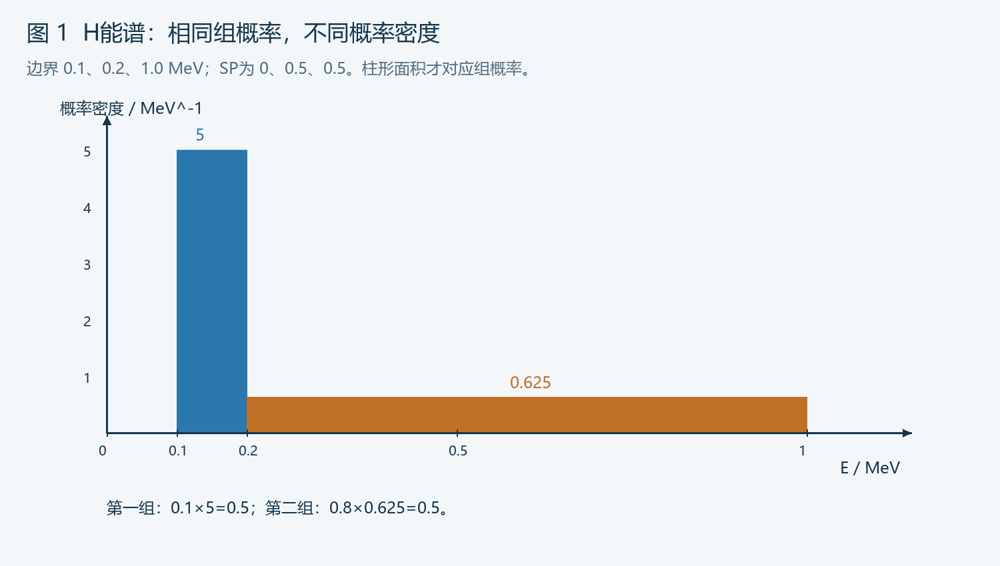
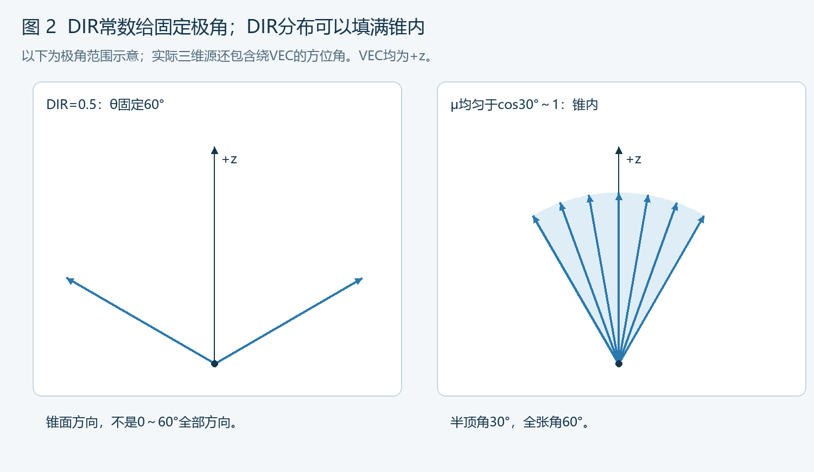
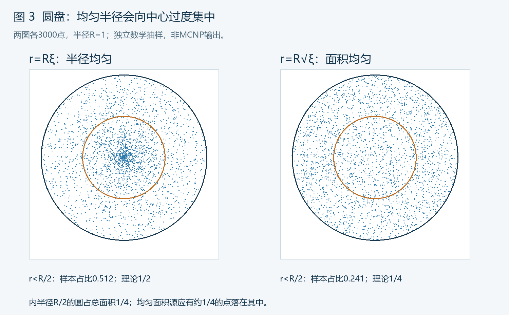

# 第 7 部分：粒子源与输运设置

> 范围：常见 MCNP 6 系列固定源问题。重点是读懂并审核源和输运设置；临界源、文件源和相关多粒子事件仅识别用途。
>
> 前置：[几何与区域](./05_栅元与空间组合.md)、[材料与核数据](./06_材料密度与核数据库.md)。长度cm、能量MeV、物理时间shake。局部源片段需配合完整几何、材料与控制；本文未实际运行MCNP。

## 查阅索引

| 查什么 | 章节 |
|---|---|
| 源的属性、SDEF字段 | 1～2 |
| SI/SP类型、离散与连续能谱 | 3～4 |
| 方向余弦、立体角、锥形源 | 5～7 |
| 均匀抽样、点线面体源模板 | 8～11 |
| CEL、拒绝抽样、SUR | 12～13 |
| 多源、依赖分布、时间分布 | 14～15 |
| WGT、SB、真实源强与归一化 | 16 |
| MODE、IMP、CUT、运行控制 | 17～20 |
| 完整案例、核查、错误速查 | 21～23 |
| 资料与后续衔接 | 24 |

---

## 1. 源不是只有“位置和能量”

一个源可表示位置、方向、能量、时间、粒子类型及其他变量的联合分布。

| 属性 | 需要确定 | 常见字段 |
|---|---|---|
| 粒子 | 发射哪种粒子 | PAR |
| 空间 | 点、线、面、体及相应密度 | POS、X/Y/Z、RAD、AXS、EXT等 |
| 方向 | 各向同性、平行束、锥内分布、表面余弦分布 | VEC、DIR、SUR、NRM |
| 能量 | 单能、离散能线、连续谱 | ERG及分布卡 |
| 时间 | 初始发射时间及脉冲分布 | TME |
| 归一化 | 每历史表示什么、初始权重 | WGT及源率定义 |
| 相关性 | 不同位置是否有不同能谱/方向 | DS及依赖分布 |

“均匀圆盘源”只说明空间，不说明发射方向；“单能点源”仍未说明方向。

本课常用SDEF。其他机制包括SSR文件表面源、KCODE临界源、用户源等，不能把任意源问题都按同一SDEF模板解释。见 [MCNP 6.3.0手册第5.8节](https://mcnp.lanl.gov/pdf_files/TechReport_2022_LANL_LA-UR-22-30006Rev.1_KuleszaAdamsEtAl.pdf)。

---

## 2. SDEF字段速查

```text
sdef par=p pos=0 0 0 erg=1
```

这是简单的原点1 MeV光子点源；没有表面源或其他方向设置干预时，常见默认方向为各向同性。

| 字段 | 含义 | 单位/重点 |
|---|---|---|
| PAR | 源粒子类型 | P为光子，N为中子，E为电子 |
| POS | 空间抽样参考点或点源位置 | 三个坐标，cm；不总是所有源粒子的实际位置 |
| X、Y、Z | 笛卡尔位置变量 | 可固定或引用分布 |
| ERG | 源粒子能量 | 常见连续能量问题用MeV |
| VEC | 飞行方向的参考向量 | 与DIR配合，不等于空间形状轴 |
| DIR | 飞行方向相对VEC的余弦μ | 不是角度，范围[-1,1] |
| AXS | 相关空间抽样的参考轴 | 如圆柱轴线 |
| RAD | 空间径向变量 | cm；含义取决于球形/圆柱/表面源形式 |
| EXT | 圆柱体源时为沿AXS的轴向位移 | 常用cm；特殊表面形式的含义另查 |
| CEL | 起始栅元及相关位置接受条件 | 栅元号或分布；不能单凭它假设自动全体积均匀 |
| SUR | 源表面 | 非零时涉及表面源规则与默认方向 |
| NRM | 表面法线符号选择 | 核对实际法线与射出方向 |
| TME | 初始物理时间 | shake，1 shake=10^-8 s |
| WGT | 初始源粒子权重 | 常见默认1；不是NPS |
| CCC | 相应cookie-cutter位置裁剪 | 指定接受区域，需核对用法 |
| EFF | 位置拒绝抽样效率判据 | 不是探测器效率，也不自动扩大抽样范围 |
| ARA | 某些平面源与点探测器直接贡献所需面积 | 特殊用途，不是通用源强 |
| TR | 源变换 | 核对对应变换及坐标/方向处理 |

### 三种字段形式

```text
ERG=1          → 常数
ERG=D1         → 引用分布1
ERG=FCEL=D2    → 能量依赖源栅元，需继续查DS2等
```

分布编号是源分布体系，不是材料号或tally号。普通用法中，每个源变量使用各自分布编号；不要未经核实把同一个Dn同时复用于多个不同变量。

---

## 3. SI/SP：值、组概率、概率密度

### 3.1 SI类型

| SI选项 | 数值表示什么 | 对应SP要读什么 |
|---|---|---|
| L | 离散值，例如能线、栅元号、位置向量 | 各值的概率/相对权重 |
| H | 单调递增的区间边界 | 各区间的概率；常规首占位项为0 |
| A | 定义概率密度的自变量点 | 各点密度，按相应规则插值 |
| S | 其他分布的编号 | 分布之间的选择规则 |

普通SP选项D表示相应L/H的离散值或区间概率，C表示相应累计概率；省略选项的含义与SI类型有关。使用显式L、H、A更容易审核。

### 3.2 离散列表L

```text
sdef par=p pos=0 0 0 erg=d1
si1 l 0.1 1.0
sp1 d 0.3 0.7
```

发射0.1 MeV的概率为0.3，1.0 MeV为0.7。没有0.1～1.0之间的连续能量。

相对权重3和7也能定义相同比例；统一放大SP相对值不会自动改变实际源发射率。

### 3.3 直方图H

```text
sdef par=p pos=0 0 0 erg=d1
si1 h 0.1 0.2 1.0
sp1 d 0 0.5 0.5
```

| 区间MeV | 组概率 | 组宽MeV | 组内均匀密度，MeV^-1 |
|---|---:|---:|---:|
| 0.1～0.2 | 0.5 | 0.1 | 5 |
| 0.2～1.0 | 0.5 | 0.8 | 0.625 |

先按组概率选组，再在所选组内均匀抽样。SP首0是H形式的占位，不是一条0 MeV能线。

### 3.4 点值密度A

```text
si1 a 0.1 0.5 1.0
sp1   0   1   0
```

表示在三个能量点给出相对密度，形成按相应规则插值的连续谱。这里SP里的1不是“0.5 MeV的离散概率为1”。

### 3.5 内置函数

```text
sp1 -21 1
```

负的函数编号不是负概率。这一例在适用空间变量上表示幂律，相应密度与r^1成正比；球体均匀体积采样常用指数2。

其他Maxwell、Watt、指数等内置函数有各自参数和单位，需查表。不要把所有SP负号都当作同一种函数。

### 3.6 个数检查

```text
L：n个离散值 → 对应n个概率
H：n+1个边界 → n个区间概率，常规SP前面再有占位0
A：n个点 → 对应n个密度值
```

概率和可未归一化，但取值类型、个数和相对大小必须正确。详见 [MCNP6 Source Primer](https://mcnp.lanl.gov/pdf_files/TechReport_2020_LANL_LA-UR-18-21377Rev.1_CurrieRising.pdf) 与对应版本SI/SP章节。

---

## 4. 导入能谱：先识别原表纵轴

### 4.1 三种表不能混用

| 原始表 | 转成H区间概率的方法 |
|---|---|
| 每组粒子数/组积分强度q_i | `p_i=q_i/Σq_j` |
| 每单位能量密度f_i，组内近似常数 | `p_i∝f_iΔE_i` |
| 离散能线产额y_i | 用L，`p_i=y_i/Σy_j` |

在不同宽度的能组上，直接把谱密度当SP组概率，会改变能谱。



### 4.2 改能量单位时

```text
100 keV=0.1 MeV
1 eV=1.0E-6 MeV
```

能量组积分值不因横轴单位改变而改变；每keV密度改为每MeV密度，数值需乘1000，以保持积分。

### 4.3 平均能量不是所有响应的等效能量

```text
离散谱：E_mean=Σp_iE_i
H组内均匀：E_mean=Σp_i(Elo_i+Ehi_i)/2
```

相同平均能量不保证相同穿透、反应率、剂量响应或脉冲谱。用单能平均值替代实际谱属于另一个近似，需要依据。

### 4.4 能谱裁切后的源率

删除某些能线/能组后，如果SP重新归一化，输入模拟的是保留部分的条件分布。

实际发射率也应与保留的粒子集合匹配；不能一边删去大量谱贡献，一边仍无说明地乘原全谱源率。

### 4.5 产额不一定是概率

每次衰变可能产生多个目标光子，所有能线产额和可以大于1。L分布给出的每个源光子能量概率与每衰变产额是不同层次。

对每历史一个独立目标粒子的模型：

```text
S_total=A Σy_i
p_i=y_i/Σy_j
```

相关多粒子衰变事件需要其他处理，不能由这个混合能谱自动恢复符合计数、时间相关或事件相关性。

---

## 5. VEC与DIR：方向余弦

### 5.1 定义

```text
μ=cosθ
```

θ是粒子初始飞行方向与VEC之间的夹角。常见源方向抽样中，围绕VEC的方位角按相应默认均匀抽样。

| DIR | 极角θ | 空间含义 |
|---:|---:|---|
| 1 | 0° | 与VEC同向 |
| 0.5 | 60° | 固定极角的锥面方向，不是0～60°锥内均匀 |
| 0 | 90° | 垂直于VEC的方向集合 |
| -1 | 180° | 与VEC反向 |

`DIR=30`不是30°，而是超出余弦合法范围的数值。

### 5.2 平行束

```text
sdef par=p pos=0 0 -5 erg=1 vec=0 0 1 dir=1
```

所有源粒子沿+z。若把POS改为一个面上的分布而保持此方向，就得到有限截面的平行束；仅有点位置时是理想铅笔束。

### 5.3 参考向量不等于源强

VEC的方向决定参考轴，其模不用于设置发射率。使用清楚的单位向量便于检查；零向量不能定义方向。

例如目标方向从A指向B，先求`u=(B-A)/|B-A|`，再结合DIR=1。不要直接把B坐标当成方向向量。

### 5.4 AXS与VEC各管不同对象

```text
AXS → 空间形状的轴
VEC → 飞行方向的参考轴
```

圆盘法向可以沿z，而粒子可以朝斜方向发射。两者相同是某个模型的条件，不是语法必然。

---

## 6. 各向同性、均匀极角与表面余弦分布

### 6.1 各向同性：对立体角均匀

```text
dΩ=dφ dμ，μ=cosθ
μ~Uniform[-1,1]
φ~Uniform[0,2π)
```

等角度间隔并不对应等立体角。把θ在0～π均匀抽样，不是三维各向同性。

### 6.2 各向同性的DIR直方图表示

在适用的体源方向语境下：

```text
sdef par=p pos=0 0 0 erg=1 vec=0 0 1 dir=d1
si1 h -1 1
sp1 d 0 1
```

也可在不受其他设置影响的简单体/点源中省略VEC和DIR，采用相应默认各向同性；审核复杂输入时仍须检查SUR和其他相关条件。

### 6.3 前半球均匀立体角

```text
si1 h 0 1
sp1 d 0 1
```

与VEC参考方向配合，使μ在0～1均匀。它不是表面余弦分布。

### 6.4 表面余弦分布

对于相关表面源形式，常见默认方向以所选法线为参考：

```text
p(μ)=2μ，0<μ<1
```

与前半球各向同性`p(μ)=1`相比，它更偏向法线方向。

同样的“方向未写”，体源默认与表面源默认可能不同。参见 [MCNP 6.2 SDEF方向说明](https://mcnp.lanl.gov/pdf_files/TechReport_2017_LANL_LA-UR-17-29981_WernerArmstrongEtAl.pdf)。

### 6.5 抽样核对量

| 分布 | 典型核对 |
|---|---|
| 全空间各向同性 | 正/负半球各约50%，平均μ≈0 |
| 前半球均匀立体角 | 平均μ≈1/2 |
| 法线方向余弦分布 | 平均μ≈2/3 |
| 平行束 | μ=1 |

这些是相应分布的数学期望，不是任何小样本都必须精确达到的数。

---

## 7. 锥形源：固定锥面与整个锥内

### 7.1 固定极角

```text
sdef par=p pos=0 0 0 erg=1 vec=0 0 1 dir=0.5
```

所有方向与+z成60°，方位角变化；它是锥面上的方向集合，不填满锥内。

### 7.2 半顶角30°、锥内均匀立体角

```text
sdef par=p pos=0 0 0 erg=1 vec=0 0 1 dir=d1
si1 h 0.8660254038 1
sp1 d 0 1
```

μ在cos30°～1均匀。半顶角是从轴到边缘，不是整个张角；全张角为60°。



### 7.3 圆锥占全空间的比例

```text
Ω_cone=2π(1-cosα)
f=Ω_cone/(4π)=(1-cosα)/2
```

α=30°时，f≈0.0669873。

### 7.4 物理锥源与限制各向同性源不同

上面SP写法定义的是锥内条件分布，默认单位权重时按一个锥内源粒子解释。

若真实源向4π发射，却只模拟前锥，需要明确是否只研究该子源贡献、是否乘相应发射率Sf，以及被省略方向能否散射回目标。

仅保留前锥不能自动代表完整各向同性源；后方环境存在返回散射时，省略的粒子可能有贡献。

### 7.5 实体准直器不等于直接改方向

将源方向设为前锥，不会自动包含真实准直器的吸收、散射、泄漏和次级辐射。若这些影响属于目标，应显式建模或采用有依据的等效源。

---

## 8. 均匀抽样：要对面积或体积均匀

### 8.1 圆盘面积

```text
dA=2πr dr
p(r)=2r/R²，0<r<R
r=R sqrt(ξ)
```

如果r在0～R均匀，中心附近的单位面积会被过度抽样。

### 8.2 球体体积

```text
dV=4πr²dr
p(r)=3r²/R³
r=R ξ^(1/3)
```

球壳a<r<b的均匀体积抽样：

```text
r=[a³+ξ(b³-a³)]^(1/3)
```

### 8.3 圆环/圆柱的径向抽样

圆环或相应等高圆柱壳a<r<b：

```text
r=[a²+ξ(b²-a²)]^(1/2)
```

### 8.4 MCNP幂律形式

| 空间目标 | 适用的径向SP形式 |
|---|---|
| 圆盘面积均匀、圆柱体积径向均匀 | `SPn -21 1` |
| 球体/球壳体积均匀 | `SPn -21 2` |
| 区间坐标均匀 | H区间概率，或相应`-21 0`形式 |

这些形式依赖SDEF所选空间几何。球体源不要混入AXS、X/Y/Z而意外变成另一种采样形式。



图为独立数学抽样示意，不是MCNP运行输出。

---

## 9. 点源、点源集合与笛卡尔源

### 9.1 固定点

```text
sdef par=p pos=2 -1 3 erg=1
```

源点需位于期望的有效区域；普通点源不要无意放在材料交界或零重要性区。

### 9.2 两个离散点

```text
sdef par=p pos=d1 erg=1
si1 l -2 0 0  2 0 0
sp1 d 0.25 0.75
```

POS为向量，SI列出两个三元组，不是六个标量位置。两个位置概率分别为0.25、0.75。

### 9.3 线源：沿x均匀

```text
sdef par=p x=d1 y=0 z=0 erg=1
si1 h -2 2
sp1 d 0 1
```

源点x在-2～2 cm均匀；y、z固定。方向在未被其他设置改变的此类体/退化源中为相应默认各向同性，不等于沿线方向飞行。

### 9.4 矩形面源：z=-5，沿+z平行束

```text
sdef par=p x=d1 y=d2 z=-5 erg=1 vec=0 0 1 dir=1
si1 h -1 1
sp1 d 0 1
si2 h -2 2
sp2 d 0 1
```

空间范围2×4 cm²。这里用笛卡尔退化体源表示平面上的源位置，没有指定SUR；若该面恰为栅元边界，应采用相应边界源规则核对，而不是继续默认普通内部源。

### 9.5 长方体内均匀

```text
sdef par=p x=d1 y=d2 z=d3 erg=1
si1 h -1 1
sp1 d 0 1
si2 h -2 2
sp2 d 0 1
si3 h 0 3
sp3 d 0 1
```

三个坐标独立、区间均匀，得到体积均匀。该盒必须处于预期源区内，或进一步采用有依据的位置裁剪。

### 9.6 POS不总是“统一加到XYZ上的位移”

POS、XYZ、AXS等共同决定源位置的几何形式。不要把不同模板的所有字段叠加，假设POS一定会像普通编程变量那样给每个坐标自动平移。

复杂平移或旋转用清楚的全局坐标定义或经核实的源变换。

---

## 10. 圆盘与圆环源

### 10.1 圆盘面积均匀、沿+z发射

```text
sdef par=p pos=0 0 -5 axs=0 0 1 ext=0 rad=d1
     erg=1 vec=0 0 1 dir=1
si1 h 0 1
sp1 -21 1
```

| 条件 | 意义 |
|---|---|
| POS | 圆盘中心(0,0,-5) |
| AXS | 圆盘法向/退化圆柱轴为z |
| EXT=0 | 沿轴位置固定，不扩展为有厚度的体源 |
| RAD=D1 | 半径0～1 cm |
| SP1 -21 1 | 对圆盘面积均匀 |
| VEC、DIR | 飞行方向沿+z，与空间形状独立指定 |

这张圆盘本身没有实体材料或准直器。

### 10.2 圆环面积均匀

只把径向区间改成：

```text
si1 h 1 2
sp1 -21 1
```

得到内半径1、外半径2的圆环面积源，不是r在1～2均匀的源。

### 10.3 固定RAD

在相应圆柱抽样形式下，RAD固定为非零、EXT固定，会把位置放在圆周上，不是填满圆盘。

### 10.4 平行束、发散束与聚焦束

- 所有位置共用同一VEC且DIR=1：平行束。
- 点源加锥内方向分布：发散点束。
- 一个面上所有位置要指向同一焦点：方向依赖位置，不能只设置一个固定VEC=1 0 0。

依赖关系必须由适合的源机制、分布或经过验证的用户源处理，不能把几个独立变量误称为聚焦束。

---

## 11. 圆柱体、球体与球壳体源

### 11.1 有限圆柱体积均匀

```text
sdef par=p pos=0 0 0 axs=0 0 1 rad=d1 ext=d2 erg=1
si1 h 0 2
sp1 -21 1
si2 h 0 6
sp2 d 0 1
```

R=2 cm、z=0～6 cm；径向按r加权、轴向均匀、绕轴角度按相应默认均匀。

EXT上下界是相对POS沿AXS的位移，不一定是全局z坐标。若POS=(0,0,10)，同一EXT会把轴向范围移到z=10～16。

### 11.2 球体体积均匀

```text
sdef par=p pos=2 -1 0 rad=d1 erg=1
si1 h 0 3
sp1 -21 2
```

球心(2,-1,0)、R=3。不加入AXS或XYZ，保持这一球形体源形式。

源点到球心的空间方向，与粒子初始飞行方向是不同随机量；球体位置均匀不代表所有粒子都径向朝外。

### 11.3 球壳体积均匀

```text
si1 h 2 3
sp1 -21 2
```

与球形SDEF配合，抽样2～3 cm球壳体积。若RAD固定为3，源位置落在半径3的球面上，不是整个球壳体积。

### 11.4 快速分布核对

| 源形状 | 正确均匀分布的累计比例 |
|---|---|
| 半径R圆盘/等高圆柱 | P(r<R/2)=1/4 |
| 半径R球体 | P(r<R/2)=1/8 |
| 轴向均匀0～H | P(z<H/2)=1/2 |

球与圆柱的径向指数来自体积元差异，见 [MCNP 6.3.0 SDEF体源说明](https://mcnp.lanl.gov/pdf_files/TechReport_2022_LANL_LA-UR-22-30006Rev.1_KuleszaAdamsEtAl.pdf)。

---

## 12. CEL与拒绝抽样：区域号不是空间抽样方案

### 12.1 常见思路

```text
先在一个简单包络体抽位置
→ 检查点是否在目标源区域
→ 不满足时重新抽位置
```

CEL和CCC等字段的具体接受条件依用法而定，阅读时必须把位置抽样和接受区域一起看。

仅写`CEL=10`不能替代完整审核，不能由此推断“已经按栅元10所有体积均匀发射”。

### 12.2 包络体必须覆盖完整源区域

如果源区本应有两块，但包络只覆盖一块，拒绝抽样无法生成另一块的源点。

包络过大则拒绝次数多。效率近似与接受体积占包络体积比例有关，但位置分布非均匀时不能只用体积比估算。

### 12.3 条件分布与源率

拒绝掉不在目标区域内的点，相当于保留条件分布。通常不能把接受率当成探测效率，也不能在未核对归一化时再次乘接受率。

例如均匀包络裁成某目标体积，目的是定义一个目标体内的源，而不一定是“包络内总源只有某比例有效”的另一个物理问题。

### 12.4 EFF的用途

EFF是相应位置抽样效率的判据，不是源强、物理发射概率或探测器效率。

效率过低应先查包络、目标栅元、坐标、变换和几何，而非只把EFF阈值调小让报错消失。

### 12.5 多个源区的选择概率

若每区单位体积发射率q_k、体积V_k：

```text
S_k=q_k V_k
p_k=S_k/ΣS_j
```

若按单位质量给发射率a_k，则`S_k=a_kρ_kV_k`。

每个源区概率相等，只对应总强度相等，不自动对应等体积发射密度。SP的相关体积选项也需按其定义读取。

---

## 13. SUR表面源：位置和默认方向都要检查

### 13.1 平面源模板

假设曲面501是`PX 0`，希望在其上半径1 cm圆盘内均匀发射、沿+x：

```text
sdef par=p sur=501 pos=0 0 0 rad=d1 erg=1
     vec=1 0 0 dir=1
si1 h 0 1
sp1 -21 1
```

POS在平面上，RAD在该平面内定义空间范围；表面编号需在完整曲面段中定义。

### 13.2 默认法线不等于总朝向目标

SUR、NRM会参与默认法线方向；DIR未写时可能使用相应余弦分布。

用显式VEC和DIR指定方向时，要核对它们与表面法线、相邻栅元及终止区的关系。

### 13.3 源点在几何交界上

真正的表面源按其机制处理。普通体/点源恰好落在界面则可能引入定位歧义，不宜通过随意移动一个极小量掩盖未弄清的源定义。

### 13.4 F5与DXTRAN的专门限制

离散方向、退化面源及特殊方向分布，与点探测器直接贡献或DXTRAN组合时有专门条件。

ARA不是通用归一化补丁；不能只加一个面积值就认定所有组合有效。先查对应限制，必要时用更直接的表面/体积统计核对。见 [MCNP 6.3.0源定义注意事项](https://mcnp.lanl.gov/pdf_files/TechReport_2022_LANL_LA-UR-22-30006Rev.1_KuleszaAdamsEtAl.pdf)。

---

## 14. 多源与依赖分布DS

### 14.1 独立分布会生成所有组合

若位置独立选A/B，能量独立选0.1/1 MeV，就可能产生四种位置—能量组合。

如果实际是“A只发0.1，B只发1”，独立设置会定义错误的联合分布，即使位置概率和总体能谱各自看起来正确。

### 14.2 两个点、各自一种能量

以下为依赖语法示例，栅元10必须包含(-2,0,0)，20必须包含(2,0,0)：

```text
sdef par=p cel=d1 pos=fcel=d2 erg=fcel=d3
si1 l 10 20
sp1 d 0.4 0.6
ds2 s 11 12
si11 l -2 0 0
sp11 d 1
si12 l 2 0 0
sp12 d 1
ds3 s 21 22
si21 l 0.1
sp21 d 1
si22 l 1.0
sp22 d 1
```

引用关系：

```text
CEL=D1 → 40%选10，60%选20
POS=FCEL=D2 → DS2依CEL选择位置分布11或12
ERG=FCEL=D3 → DS3依CEL选择能量分布21或22
```

这套例子生成两类点源，不是在两个栅元全部体积中均匀采样。

### 14.3 依赖机制的限制

不能把任意变量关系都直接写成F变量。允许的依赖、层级、采样次序及变量复用有规则；特别是POS与其他位置字段之间存在约束。

复杂输入应画引用链，不照搬“位置依赖能量”的口头想法。参见 [MCNP6 Source Primer](https://mcnp.lanl.gov/pdf_files/TechReport_2020_LANL_LA-UR-18-21377Rev.1_CurrieRising.pdf)。

---

## 15. TME、脉冲和时间归一化

### 15.1 初始时间

```text
TME=0 → 源发射时间原点
TME=2 → 20 ns
```

发射后飞行时间继续累加。TME不是计算耗时，也不说明NPS对应多少秒。

### 15.2 20 ns均匀脉冲

```text
sdef par=p pos=0 0 0 erg=1 tme=d1
si1 h 0 2
sp1 d 0 1
```

源发射时间在0～2 shakes均匀，仍按相应源事件归一化；实际一脉冲粒子数需另行确定。

### 15.3 每脉冲与每秒

```text
每源粒子响应 × 每脉冲粒子数 → 每脉冲响应
在线性条件及相应时间积分定义下，再结合重复频率 → 时间平均率
```

时间窗内的累计量若要改成窗平均率，还需除以以秒表示的组宽。不要把脉冲累计、脉冲峰值、窗口平均和长期平均率混成一个量。

### 15.4 时间截断的参照

核对源初始时间、输运物理时间原点、时间组和CUT时间限额之间的关系，不默认所有时间控制都从“每粒子出生后重新计时”。

---

## 16. WGT、SB与真实源强

### 16.1 默认单位源历史

普通固定源、WGT=1且未额外换算时，常见tally按每个源粒子响应解释。

```text
实际率量 = 每源粒子响应 × 匹配的目标粒子发射率S
```

若输入或后处理已经用WGT、乘子等包含源率，不要再重复乘S。

### 16.2 WGT不是位置概率

WGT是初始统计权重，常见源形式中作为显式值给出；不应把它与SP概率、SB抽样概率、NPS或实际活度混用。

改变权重对普通线性统计的贡献有相应影响，但脉冲高度/事件统计还要查专门权重处理，不能把全部tally都按同一种缩放法解释。

### 16.3 SP与SB

```text
SP → 目标物理分布p
SB → 为提高效率而采用的抽样分布q
相应权重修正 → 补偿p/q
```

示例：物理上各向同性，但增加前半球抽样：

```text
sdef par=p pos=0 0 0 erg=1 vec=0 0 1 dir=d1
si1 h -1 0 1
sp1 d 0 0.5 0.5
sb1 d 0 0.2 0.8
```

| 半球 | 物理概率p | 抽样概率q | 对应因子p/q |
|---|---:|---:|---:|
| 后 | 0.5 | 0.2 | 2.5 |
| 前 | 0.5 | 0.8 | 0.625 |

平均权重因子为`0.2×2.5+0.8×0.625=1`。这是有修正的偏置，不是把物理源改成80%朝前。

### 16.4 不能任意切掉物理支持

某区间p>0却设q=0，通常无法靠有限权重恢复其贡献。除非有严格依据证明省略不影响目标，否则不能把“只朝目标发射”当作普遍无偏提速技巧。

### 16.5 偏置不保证所有结果都更好

朝某目标区域偏置可能改善对应统计，也可能恶化其他区域的误差或产生少量大权重贡献。按目标tally和完整统计诊断评价，不仅看运行速度。

---

## 17. MODE：输运粒子集合，不是源粒子清单

| 写法 | 常见用途 |
|---|---|
| MODE P | 光子输运 |
| MODE N | 中子输运 |
| MODE N P | 中子与光子耦合问题 |
| MODE P E | 显式光子—电子输运 |
| MODE N P E | 相应中子、光子、电子耦合 |

PAR决定源发射什么；MODE决定模型输运哪些粒子。MODE N P可以配中子源，并统计产生的光子，不代表源必须同时按某个比例发射N和P。

### 17.1 耦合需要数据与物理设置

添加MODE粒子符号不等于自动启用任意高能反应、衰变链或全部次级粒子产生机制。还需核对：

- 能区、目标材料和可用数据。
- 相关次级产生与物理模型选项。
- 各粒子重要性、截断和tally。
- 目标是否需要事件相关或时间相关处理。

### 17.2 显式电子输运的目的

薄层、小目标、材料界面或电子逃逸可能需要显式电子输运。若只关心宏观场，可能采用另一种合适近似。

MODE P与MODE P E不应仅凭名称判断谁对所有问题都更好；应结合加热/沉积估计方法、粒子输运及验证条件选择。

### 17.3 源与tally的粒子必须对应目标

```text
MODE N P
SDEF PAR=N ...
F4:P ...
```

表示中子源条件下统计光子场的一类问题，不是因为F4:P就把源变成了光子。

---

## 18. IMP：区域终止、分裂与轮盘

### 18.1 基本含义

```text
IMP:P=1 → 相应区域光子重要性为1
IMP:P=0 → 进入该区域的相应粒子终止跟踪
```

重要性不是材料密度、物理存在概率或探测效率。零重要性区域也不是一层真实完全吸收材料。

### 18.2 相邻重要性比

重要性从低到高，常通过分裂增加计算粒子分支并降低各分支权重；从高到低，常通过轮盘减少分支并对幸存粒子修正权重。

正确使用时目标是改变统计效率，不是按比例改变真实场。

### 18.3 粒子种类分开

某区域中子的终止设置不自动等于光子也应终止。耦合模型需核对各粒子完整设置与默认规则。

特别是屏蔽后方仍可能由其他粒子产生目标响应，不应未分析就截掉其输运路径。

### 18.4 位置式参数表

若栅元按10、20、99排列，可在采用相应数据段形式时写：

```text
imp:p 1 1 0
```

对应输入顺序，不是栅元编号下标。若已在栅元卡定义同类参数，避免再写冲突的同名表。

### 18.5 源区检查

源粒子应从符合预期的有效区域开始。不要把源区设成零重要性后，再因“统计为零”而盲目提高NPS。

---

## 19. CUT、ELPT与PHYS：物理近似和数值控制

### 19.1 CUT不是只有一个能量数

常见CUT卡是位置式参数，前部包括时间和能量控制，后续还可能涉及权重等。不要把其他文件的一串数字整体复制后猜含义。

光子示例：

```text
cut:p j 0.01
```

这里J保留第一个时间字段的默认，0.01位于能量字段，表示10 keV阈值。

若误写`CUT:P 0.01`，0.01落在首位置，不能按“10 keV”解释。

### 19.2 能量截断的影响

低于相关能量阈值后不再按原方式继续显式输运；剩余能量怎样处理取决于粒子与算法。

它可能影响：

- 低能通量和能谱。
- 材料附近的二次响应。
- 薄层/界面能量沉积。
- 后续能量转化和返回贡献。

不能仅因为tally不显示低能组，就认定可以无影响地截掉相应粒子；它们可能参与目标响应。

### 19.3 最低能量与数据能力

源能量、数据有效范围、软件/模型最低支持能量和用户CUT需相互匹配。降低CUT并不自动补充低能物理和数据。

相关光子截断用法可参见 [MCNP6发布说明中的CUT:P示例](https://mcnp-green.lanl.gov/pdf_files/TechReport_2013_LANL_LA-UR-13-22934Rev.1_GoorleyJamesEtAl.pdf)，实际限制以本机版本与数据为准。

### 19.4 时间截断

CUT的物理时间字段使用相应时间单位，不能当作计算机运行分钟数。

截掉晚到粒子可能改变脉冲尾部或时间积分响应。比较前应确认源TME、飞行时间、目标窗口和截断的统一参照。

### 19.5 ELPT与局部截断

某些用法允许按栅元设置能量下限，如ELPT相关设置。其与全局CUT的组合规则需查对应粒子和版本；不能认为局部较低值一定能覆盖更高的全局限制。

### 19.6 PHYS卡

PHYS类卡可能控制适用能量、物理处理、次级粒子产生或输运算法等。不同粒子的字段顺序不同，且可能随版本变化。

审核时按每一位置查定义、默认值和适用条件；不要把`PHYS:N`的数字套到`PHYS:P`，也不要用“全部设0”表示“使用默认”。默认位置通常应按规则省略或使用J。

---

## 20. NPS、CTME与复现

| 对象 | 控制内容 | 与源物理量的区别 |
|---|---|---|
| NPS | 常见固定源历史数上限 | 不是每秒发射率、活度或物理时间 |
| CTME | 程序定义的计算时间上限，常用min | 不是输运物理时间，不能由此直接换算真实源率 |
| RAND等随机数控制 | 抽样序列与相关设置 | 不改变目标物理分布 |
| PRDMP等输出/保存设置 | 输出与继续运行信息 | 不替代统计收敛判据 |

### 20.1 历史数与精度

充分采样、方差有限且统计行为良好时，误差常近似按1/√N下降。复杂罕见事件中需实际检查，而不是只按公式决定结束。

### 20.2 时间限制不是精准闹钟

CTME按相应版本定义的计算时间控制；并行计时、检查时机和收尾会影响实际结束时刻，不应不加核对就称为精确挂钟限时。

NPS与时间等控制同时存在时，可能在达到NPS前按其他条件结束。检查实际完成历史数。

### 20.3 复现记录

保存输入、软件版本、核数据、随机数设置、并行方式和关键输出。

相同序列的重复运行不能简单当作独立样本来降低误差；跨版本/平台也不保证逐位相同。

---

## 21. 完整案例：真空圆盘平行束穿过平面

### 21.1 模型定义

| 项目 | 设定 |
|---|---|
| 空间 | 原点半径10 cm的真空世界球 |
| 统计平面 | z=0，作为上下真空区共同边界 |
| 源位置 | 中心(0,0,-5)，半径1 cm圆盘面积均匀 |
| 飞行方向 | +z平行束 |
| 源能量 | 0.1 MeV占30%，1 MeV占70% |
| 初始权重 | 默认1 |
| 统计 | 平面F1及两个能组 |

圆盘z=-5不是模型的栅元边界，使用退化圆柱体源位置形式；z=0平面才是被统计的公共边界。

### 21.2 完整教学输入

```text
Lesson 07 - disk beam crossing a plane in vacuum
c cells
10 0 -900 -101 imp:p=1
20 0 -900 101 imp:p=1
99 0 900 imp:p=0

c surfaces
101 pz 0
900 so 10

c data
mode p
sdef par=p pos=0 0 -5 axs=0 0 1 ext=0 rad=d1
     erg=d2 vec=0 0 1 dir=1
si1 h 0 1
sp1 -21 1
si2 l 0.1 1.0
sp2 d 0.3 0.7
f1:p 101
e1 0.5 2.0
nps 100000
```

这里没有材料，专用于检查几何、源和计分关系。输入未在本机运行。

### 21.3 可手算的检查

```text
源位置：x²+y²≤1，z=-5
距原点≤sqrt(26)<10 → 全部在世界球内
所有方向沿+z → 每条真空轨迹穿过z=0一次
无碰撞 → 到达平面时能量仍为0.1或1 MeV
```

默认单位源历史下，理想总F1参考值为1次穿越/源粒子；两个能组的期望贡献为0.3和0.7。有限样本组比例会波动。

这不是MCNP实测输出，也不是单位面积通量；F1结果不应直接改名为F2或F4通量。

### 21.4 源本身的数学核对

```text
圆盘r<0.5 cm的比例应约1/4
平均r²应为R²/2=0.5 cm²
平均能量=0.3×0.1+0.7×1=0.73 MeV
方向余弦(U,V,W)=(0,0,1)
```

### 21.5 修改后应检查什么

| 修改 | 预期或检查点 |
|---|---|
| RAD范围从0～1改为0～2 | 面积增4倍；若源率不变，单位面积发射密度下降 |
| SP1改为径向均匀 | 中心过度集中，已不再是均匀面积源 |
| DIR改为-1 | 飞向-z，不再按原路径穿过z=0 |
| DIR改为0.5 | 形成固定极角，不是原平行束 |
| 改能量SP | 分组贡献和平均能量改变 |
| 加入材料 | 可能散射、吸收，F1不再必然等于1 |
| 改为F5 | 需核对离散方向源直接贡献限制，不能直接继承本例判断 |

---

## 22. 如何检查真实源采样

### 22.1 源属性表

```text
每历史的物理对象：
PAR和MODE：
空间形式、坐标系与接受区域：
方向参考、极角/方位角定义：
能谱数据类型及单位：
初始时间与物理原点：
位置—方向—能量相关性：
SP物理分布、SB抽样分布及WGT：
每源粒子/每脉冲/每衰变/每秒的换算：
输运与结束控制：
```

### 22.2 位置检查

- 全部源点是否落在预期区域，而非仅参考点POS正确。
- 空间边界、径向累计比例、均值和对称性是否符合目标。
- CEL/CCC是否误裁掉区域；拒绝效率是否异常。
- 是否因源变换把点移到模型外或错误材料中。

### 22.3 方向检查

- 参考向量与模型坐标一致。
- 方向余弦模长约为1。
- μ的范围、平均值及前后半球比例符合相应分布。
- 固定μ、锥内分布、面余弦分布没有互相替代。

### 22.4 能谱与时间检查

- 能线频率、组概率或密度积分与原始数据一致。
- H首占位、组宽和单位转换正确。
- 能量与位置的条件分布被保留。
- 初始时间、飞行时间和时间窗一致。

### 22.5 可用证据

按版本可使用源相关打印、粒子跟踪记录/PTRAC、几何显示和专门诊断，提取初始位置、能量、方向、时间与权重进行检查。

先用少量历史诊断格式和位置，再用适当样本判断分布。仅几何图正确不能证明源采样正确，独立数学抽样也不能证明程序实际采用了同样设置。

---

## 23. 常见错误速查

| 错误/现象 | 检查或修正 |
|---|---|
| 把DIR=30当30° | DIR为余弦；30°对应约0.8660254 |
| DIR=0.5称为60°锥内均匀 | 实际固定极角60°；锥内需分布 |
| θ均匀当三维各向同性 | 应对μ和方位角按立体角关系抽样 |
| 圆盘r均匀当面积均匀 | 正确径向密度与r成正比 |
| 球体用SP -21 1 | 均匀体积通常需要r²，核对SDEF形式 |
| AXS正确就认为射向轴线 | AXS控制空间，飞行方向另查VEC/DIR |
| 只看POS就判断源位置 | POS可能是采样参考中心，检查RAD/EXT/XYZ等 |
| 单独CEL就认定全体积均匀 | 查空间采样机制与接受条件 |
| H谱密度直接填SP D | 先按组宽积分成组概率 |
| L与H同样读法 | L为离散值，H为区间边界 |
| 两个点与两个能量各自独立 | 可能产生错误位置—能量组合，查DS |
| 缺省方向都叫各向同性 | SUR表面形式可能默认余弦分布 |
| EFF称为探测效率 | 它是位置抽样相关效率判据 |
| 截锥后仍无说明乘全空间源率 | 重新核对源集合、锥比例及省略方向贡献 |
| SB某区间设0却物理SP非零 | 检查支持域丢失，通常不能恢复完整响应 |
| CUT:P 0.01当10 keV | 首字段是时间，能量字段位置不同 |
| 提高NPS当增强源强 | 历史数不是物理源率 |
| 源点位于IMP=0 | 查几何、位置与对应粒子重要性 |
| 直接复制PHYS整行数值 | 按粒子、版本和每个位置核对 |

---

## 24. 参考资料与后续衔接

下一部分《Tally统计与计算目标》将系统讲解统计类型、能量/时间分组、响应换算与统计区域的选择。

### 24.1 参考资料

- [MCNP官方手册索引](https://mcnp.lanl.gov/manual.html)：选择实际版本。
- [MCNP 6.3.0 Theory & User Manual](https://mcnp.lanl.gov/pdf_files/TechReport_2022_LANL_LA-UR-22-30006Rev.1_KuleszaAdamsEtAl.pdf)：第5.8节源、SI/SP/SB/DS及源的专门限制。
- [MCNP 6.3.1 Theory & User Manual](https://mcnp.lanl.gov/pdf_files/TechReport_2024_LANL_LA-UR-24-24602Rev.1_KuleszaAdamsEtAl.pdf)：MODE、重要性、物理选项、截断与运行控制。
- [MCNP6 Source Primer，Release 1.0](https://mcnp.lanl.gov/pdf_files/TechReport_2020_LANL_LA-UR-18-21377Rev.1_CurrieRising.pdf)：源形状、方向、依赖分布及典型输入。
- [An MCNP6 Primer，2024](https://mcnp.lanl.gov/pdf_files/Book_MonteCarlo_2024_ShultisBahadori_AnMCNPPrimer.pdf)：源定义、体积抽样和方差缩减入门。
- [MCNP 6.2用户手册](https://mcnp.lanl.gov/pdf_files/TechReport_2017_LANL_LA-UR-17-29981_WernerArmstrongEtAl.pdf)：源方向默认、物理与输入细节。

配图和概率/几何计算为本课教学推导或独立数学抽样，不是MCNP运行截图或输出记录。
