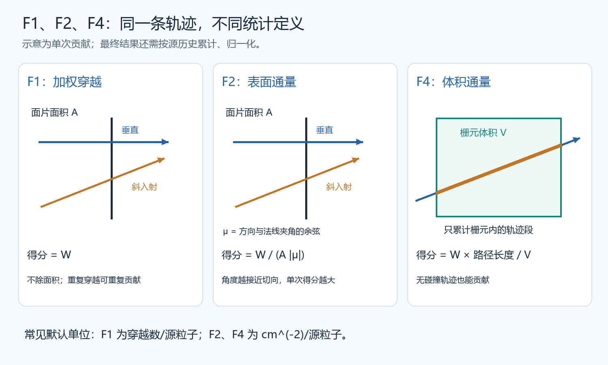
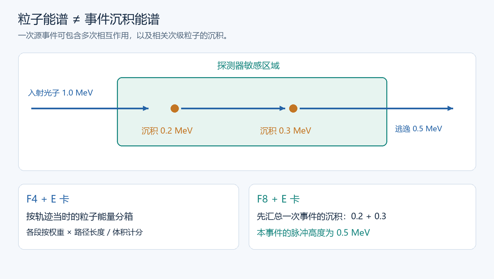
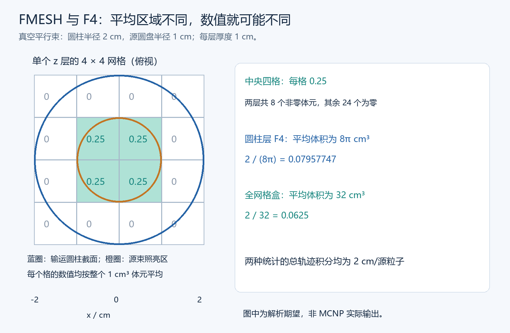

# 第 8 部分：Tally统计与计算目标

> 范围：MCNP 6 系列常见固定源统计。片段中的栅元、曲面、材料编号必须替换为实际模型编号。完整案例给出解析预期，未实际运行 MCNP；特殊粒子、脉冲符合、临界源归一化与高级方差缩减需查所用版本手册。
>
> 前置：[材料、密度与核数据库](./06_材料密度与核数据库.md)、[粒子源与输运设置](./07_粒子源与输运设置.md)。本文的“每源粒子”指通常单位初始权重、未另行加入物理源强的固定源归一化。

## 查阅索引

| 内容 | 章节 |
|---|---|
| 按计算目标选 tally、编号与单位 | 1～3 |
| 穿越、表面通量、体积通量、点探测器 | 4～7 |
| 加热、能量沉积、脉冲高度谱 | 8～10 |
| 能量、时间、角度分组 | 11～13 |
| 合并区域、面积/体积/质量除数 | 14～15 |
| FM 反应率、DE/DF 响应折叠 | 16～17 |
| 网格定义、网格结果解读 | 18～19 |
| 源强、剂量、功率、计数率换算 | 20～21 |
| 完整解析对照模型 | 22 |
| 输出读取、计算目标与错误速查 | 23～25 |
| 手册与资料 | 26 |

## 1. 先确定要什么物理量，再选 tally

一个明确的统计目标至少包含：**粒子种类、统计对象、物理量、分组方式、物理归一化**。

例如：“求光子在栅元 20 内、0.1～2 MeV 范围的体积平均通量率，源强为每秒一百万个光子。”这里每个条件都会影响输入或后处理。

| 计算目标 | 优先考虑 | 主要输出含义 | 不能直接当成什么 |
|---|---|---|---|
| 通过一个边界的粒子数量 | F1 | 加权穿越数/源粒子 | 唯一粒子数、天然的净流、探测计数 |
| 一个面上的平均标量通量 | F2 | 面平均通量响应/源粒子 | 一般情况下的 F1 除以面积 |
| 一个区域内的平均标量通量 | F4 | 体积平均通量响应/源粒子 | 点通量、区域内粒子总数 |
| 某空间点的通量 | F5 | 点位置的通量估计 | 有限尺寸探测器的计数 |
| 区域单位质量的加热响应 | F6 | MeV/g/源粒子 | 任意条件下的真实局部吸收剂量 |
| 一次事件在探测器中留下多少能量 | F8 | 沉积能分布，脉冲/源粒子 | 穿过探测器的粒子能谱 |
| 探测器总沉积能 | *F8 | MeV/源粒子 | 已除质量的剂量 |
| 空间通量分布图 | FMESH | 各网格体元平均通量 | 自动划分的几何或材料 |
| 指定反应的发生率 | F4 配 FM | 截面、密度等加权的响应 | 只要写了 FM 就必然是总反应率 |
| 某种剂量当量或防护量 | 通量配 DE/DF 等 | 指定响应系数折叠结果 | 与响应系数定义无关的“通用剂量” |

**同一粒子场可以同时有多种正确结果。** 数值是否能比较，取决于它们的空间平均、能量范围、粒子范围、权重和单位是否一致。

## 2. 读懂 tally 卡与编号

### 2.1 编号最后一位决定常规 tally 类型

```text
F4:P 20
F14:P 30
F24:N 40
```

三张都是 F4 类型：分别统计栅元 20 的光子、栅元 30 的光子、栅元 40 的中子。

| 组成 | 例子 | 含义 |
|---|---|---|
| 卡名与统计号 | F14 | 第 14 号 tally，类型为 F4 |
| 粒子后缀 | :P | 光子；`:N` 为中子，`:E` 为电子 |
| 对象编号 | 30 | 此处是栅元编号 |
| 配套卡 | E14、FM14、DE14、DF14 | 都作用于第 14 号统计 |

`F14:P 30` 的 `14`、`P`、`30` 分别属于三个不同概念。不要把统计编号当成栅元编号。

```text
F14:P 30
E14 0.1 0.5 1.0 2.0
FC14 Photon fluence averaged over cell 30
```

`FC14` 是结果说明，建议写明区域、响应和单位；它不会改变物理计算。

### 2.2 对象是面、体还是坐标

| 类型 | 常见对象 |
|---|---|
| F1、F2 | 曲面编号，必要时还需曲面分段 |
| F4、F6、F7、F8 | 栅元编号 |
| F5 | 探测点坐标及估计器参数 |
| FMESH | 独立网格的坐标边界与分段 |

F1 中的 `20` 是曲面 20；F4 中的 `20` 是栅元 20。两者即使编号相同，也没有自动对应关系。

同一输入中的统计号应唯一；`F14` 与 `FMESH14` 也不要重复占用编号。前述配套卡必须跟随实际统计号。

## 3. 默认结果单位与“每源粒子”

### 3.1 固定源统计的基本形式

设第 \(h\) 个源历史对某个统计箱的总贡献为 \(X_h\)，共有 \(N\) 个源历史：

\[
\overline X=\frac{1}{N}\sum_{h=1}^{N}X_h.
\]

一个源历史可能包含散射、次级粒子和分裂后的多个分支；它们并不分别成为分母中的独立源历史。

标准输出已经完成相应的每源历史归一化，**不要再除一次 NPS**。

### 3.2 通量与注量的用语

MCNP 通常把 F2/F4/F5 称为 flux tally。固定源计算在尚未乘以物理源强时，数值单位通常是：

\[
\mathrm{cm^{-2}/source}.
\]

可以把它理解为“每发射一个源粒子在该位置产生的注量贡献”。乘源强 \(S\,[\mathrm{source/s}]\) 后，得到：

\[
\dot\Phi=S\Phi_1,
\qquad [\dot\Phi]=\mathrm{cm^{-2}s^{-1}}.
\]

“flux”这个输出名称本身并不能证明结果已经带有每秒单位。

### 3.3 常见默认单位

| 统计 | 常见默认单位，尚未加入物理源强 |
|---|---|
| F1 | 加权穿越数/源粒子 |
| F2、F4、F5、通量 FMESH | cm⁻²/源粒子 |
| *F1 | MeV/源粒子 |
| *F2、*F4、*F5 | MeV·cm⁻²/源粒子 |
| F6 | MeV·g⁻¹/源粒子 |
| F8 | 脉冲/源粒子，按沉积能分组 |
| *F8 | MeV/源粒子 |

表中不含 FM、DE/DF、SD、能量/时间分箱后人为求密度等修改。最终单位必须根据**完整卡组**重新判断。

## 4. F1：穿越曲面的总流统计

```text
F1:P 101
```

统计光子穿过曲面 101 的贡献。基本得分为穿越时粒子权重 \(W\)：

\[
F1\sim\frac{1}{N}\sum_{\mathrm{crossings}}W.
\]

### 4.1 三个关键性质

- 默认不除以面积；单位不是 cm⁻²。
- 同一粒子反复穿过同一曲面，会反复贡献。
- 未分方向时通常累计两种穿越方向，不能直接称为“净泄漏”。

因此，F1 可以超过 1。原因可能包括重复穿越、次级粒子产生或物理增殖；不能只凭超过 1 就判断输入错误。

### 4.2 什么时候适合计算泄漏

若外包络是闭合边界，粒子一旦向外穿过即终止，不会返入，那么该边界上的向外穿越与泄漏对应关系较清楚。

若边界两侧都在输运，必须区分进入与离开。只求某开口的通过量时，也应限制到该开口，不能把无限平面所有有效穿越都算成窗口通过量。

### 4.3 穿越不等于探测计数

穿过探测器前表面的光子可能完全不相互作用；一个光子也可能多次进出。要算实际探测计数，需定义沉积能阈值、计数窗口及探测器响应，通常从 F8 或专门的响应模型入手。

## 5. F2：面平均标量通量

```text
F2:P 101
```

设有效统计面积为 \(A\)，粒子方向与曲面法线夹角的余弦为 \(\mu\)，基本得分：

\[
F2\sim\frac{1}{N}\sum_{\mathrm{crossings}}
\frac{W}{A|\mu|}.
\]

### 5.1 为什么不能普遍用 F1/A 代替

| 同一权重粒子 | F1 单次得分 | F2 单次得分 |
|---|---|---|
| 垂直穿面，\(|\mu|=1\) | \(W\) | \(W/A\) |
| 与法线夹角 60°，\(|\mu|=0.5\) | \(W\) | \(2W/A\) |

只有满足相应方向条件时，两者才有简单比例。近切向穿越时 F2 单次得分可能很大，统计波动也可能明显。

### 5.2 面积范围必须明确

几何曲面与实际有效面片不是同一个概念。例如 `PZ 0` 是无限平面；模型中与若干栅元相交的区域才可能构成实际统计面片。

当同一曲面跨越多个开口、多个材料区域或重复结构时，要确认输出使用的有效面积。需要局部面片时，可通过几何划分或 tally 分段等方法实现；单独改面积除数不会限制穿越位置。

## 6. F4：栅元体积平均通量

```text
F4:P 20
```

粒子在栅元内走过一段长度 \(\ell\) 就可贡献得分，不要求这段轨迹发生碰撞：

\[
F4\sim\frac{1}{NV}\sum_{\mathrm{tracks}}W\ell.
\]

其中 \(V\) 是统计体积。单位关系：

\[
\frac{\mathrm{cm}}{\mathrm{cm^3}}=\mathrm{cm^{-2}}.
\]

### 6.1 常见误解

| 说法 | 正确理解 |
|---|---|
| 栅元里没发生碰撞，所以没有 F4 得分 | 真空中也可用路径长度统计通量 |
| F4 是栅元中心的通量 | 是全栅元的体积平均 |
| 把栅元变大，只是统计更稳定 | 同时改变了被平均的物理区域 |
| F4 乘体积就是区域内粒子数 | 得到路径长度积分响应，单位 cm/源粒子 |
| 换成更小的探测栅元一定更准 | 空间分辨率提高，方差和模型敏感性也可能提高 |

### 6.2 空间平均与材料平均

F4 的平均对象是指定空间，不是自动按材料质量加权。想得到材料内平均通量，必须让统计区域与该材料区域相符；把周围空气、空腔一起合并会改变平均值。



上图公式是估计器的单次贡献示意；实际结果还要按源历史累计与归一化。F1/F2/F4/F5 的基础定义可对照 [2024 MCNP6 入门资料第 3.6 节](https://mcnp.lanl.gov/pdf_files/Book_MonteCarlo_2024_ShultisBahadori_AnMCNPPrimer.pdf)。

## 7. F5：点探测器估计器

```text
F5:P 0 0 100 0
```

常见形式为：

```text
F5:P x y z r0
```

| 参数 | 含义 |
|---|---|
| x、y、z | 探测点坐标，cm |
| r0 | 点探测器排除球相关参数，cm |

F5 会利用源事件和碰撞事件，估计粒子沿相关方向到达探测点的贡献；它不依赖粒子恰好穿过一个数学点。

### 7.1 r0 不是实体探测器半径

- 探测点在真空中时，常可使用 `r0=0`。
- 探测点位于材料中时，近点贡献需要适当处理；排除球应符合估计器对局部材料均匀性等条件。
- 不能为了“增加计数”随意放大 r0，也不能让排除球任意跨越不同材料。

### 7.2 与 F4 小球的区别

F5 给出点估计；小球 F4 给出有限体积平均。场变化明显时，两者可能合理地不同。

F5 输出若列出 direct contribution，先确认该项与 total 的关系，不要把已经包含在总量中的直接项再加一遍。

对定向离散源、某些反射边界、DXTRAN 组合和特殊粒子，应检查 F5 的适用性；不能把它当成任何模型都能直接替换 F4 的“加速版”。

## 8. F6：单位质量加热与剂量

```text
F6:P 20
```

常见 F6 加热估计器根据通量、相应截面和加热数据计算响应，再按质量归一化。常见单位：

\[
\mathrm{MeV/g/source}.
\]

### 8.1 加热、kerma、吸收剂量的关系

| 量 | 关注内容 |
|---|---|
| 能量转移/kerma 相关量 | 不带电粒子把能量转移给带电次级粒子 |
| 吸收剂量 | 能量实际沉积在指定物质中的单位质量能量 |
| 剂量当量或其他防护量 | 在定义规定下进一步考虑辐射品质或器官等因素 |

光子 F6 的局部加热处理与实际吸收剂量是否接近，受带电粒子平衡、电子射程、界面和统计区域尺寸影响。在薄层、空腔、材料界面附近，把 F6 直接解释为精确局部吸收剂量可能失效。

电子输运是否显式进行、截断能量如何处理、加热数据是否完备，都会影响能量归属。仅把 `MODE P` 改成 `MODE P E`，并不能保证原来的 F6 含义自动变成所需的全部沉积能响应。

### 8.2 什么时候需要更细的沉积模型

若研究电子逃逸、探测器微小敏感体积、界面剂量或事件沉积能谱，应考虑适当的耦合输运与沉积估计器，并检查各粒子贡献能否相加、是否重复计入。

**能换算成 Gy，只说明量纲允许；是否代表所需剂量，取决于估计器及其物理近似。**

## 9. F8 与 *F8：脉冲高度及沉积能

### 9.1 F8 统计事件沉积能

```text
F8:P 20
E8 0 1E-5 0.01 0.1 0.3 0.5 0.7 1.0 1.5
```

F8 把一次源历史及其相关分支在指定探测区域中的能量沉积汇总，分配到对应脉冲高度箱。它不是每发生一次碰撞就独立输出一个脉冲。

例如：一个源光子及其次级粒子在探测器内依次沉积 0.2 MeV 和 0.3 MeV，随后剩余能量逃逸。若这些沉积属于同一次统计事件，则脉冲高度对应 **0.5 MeV**。

F8 的能量箱表示**沉积能**；F4 的能量箱表示**输运粒子的能量**。即使 E 卡写了相同数列，两个谱也不是同一种谱。



### 9.2 零能量和极低能量箱

F8 常设置零和接近零的边界，用于区分无有效沉积、数值附近贡献与实际脉冲。`E8 0 1E-5 ...` 中的 `1E-5` 是示例边界，不是普适阈值。

不能把包含零沉积事件的 total 直接当成探测效率；效率应按实际能量阈值及计数窗口积分。低能量端还要检查本版本 F8 对零分数、特殊负分数和非模拟权重处理的说明。

### 9.3 *F8 统计沉积能量

```text
*F18:P 20
```

`18` 最后一位为 8，因此是另一组 F8 类型统计；星号形式给出能量加权结果，常见单位为 MeV/源粒子。

若 \(E_{\mathrm{dep},1}\) 是全部相关沉积能的每源粒子结果，质量为 \(m\,[g]\)：

\[
D_1=\frac{E_{\mathrm{dep},1}}{m}
\times1.602176634\times10^{-10}
\quad[\mathrm{Gy/source}].
\]

这里除的是**对应敏感体积的质量**。不要除探测器整个外壳质量，也不要重复除已经归一化过的质量。

### 9.4 电子、展宽与计数电路

- 传统光子/电子脉冲高度处理中，F8 的粒子后缀不能简单照搬 F4 的“只筛某粒子贡献”理解；实际沉积贡献与耦合输运及该类 F8 的规定有关。
- 电子逃逸会改变能谱；未显式输运电子时的局部处理必须与研究目标相符。
- `FTn GEB` 可用于规定的高斯能量展宽；参数应来自探测器标定，并核对版本公式和单位。
- 能量展宽不等于完整电子学模型，不自动包含死时间、堆积、触发效率或符合窗口。
- F8 对分裂、轮盘、权重偏置等方法有专门限制，不能直接复制适用于通量 tally 的全部方差缩减设置。

特殊 F8、加号形式和沉积估计器的适用粒子及限制，以 [MCNP 6.2 用户手册的 tally 与特殊处理条目](https://mcnp.lanl.gov/pdf_files/TechReport_2017_LANL_LA-UR-17-29981_WernerArmstrongEtAl.pdf)及所用新版本手册为准。

## 10. 星号、加号和 F7：不能只凭名称推断

| 写法 | 应识别的含义 |
|---|---|
| F4 | 路径长度通量统计 |
| *F4 | 能量加权通量统计 |
| F6 | 规定的单位质量加热估计 |
| *F6 | 单位为 jerks/g/源粒子；1 jerk = 10⁹ J，不能套用“默认结果再乘 E” |
| +F6 | 另一类碰撞加热/沉积统计处理，适用性与 F6 不同 |
| F7 | 裂变加热相关统计，需要理解其能量归属 |
| F8 | 脉冲高度分布 |
| *F8 | 能量沉积响应 |
| +F8 | 电荷沉积等特定用途，不能解释为“更完整的 F8” |

星号对常见 F1/F2/F4/F5 表示能量加权，但并非所有 tally 都遵循同一套单位变化。查阅旧输入时，应保留 `*`、`+` 等前缀；遗漏一个符号就可能改变物理量。

## 11. E 卡：能量分组与谱的单位

### 11.1 E 卡通常列出各箱上边界

```text
F4:N 20
E4 1E-6 1E-3 0.1 1.0 20.0
```

在通常的正能量分组含义下，对应从低能端到各上边界的连续能量箱，单位 MeV。实际最低可输运能量还受库和 CUT 等设置控制。

| 上边界 / MeV | 对应能区 |
|---|---|
| 1E-6 | 低能端至 1E-6 |
| 1E-3 | 1E-6～1E-3 |
| 0.1 | 1E-3～0.1 |
| 1.0 | 0.1～1.0 |
| 20.0 | 1.0～20.0 |

需要“0.1～1 MeV”时，应选择相应箱求和；不能把第一箱的上边界误当成全谱下限。最后一个边界以上也不是自动增加的“所有剩余能量箱”，应明确覆盖所需能区并核对输出 total 的范围。

单能源恰好落在分箱边界时，归箱应依据程序边界规则；为比较谱峰，通常把关注的单能线放在箱内更直观。

### 11.2 默认分组结果是箱积分

普通 E 分组的 F4 结果 \(\Phi_g\) 单位仍为 cm⁻²/源粒子，不自动变为每 MeV。

若需要绘制能量微分谱的箱平均值：

\[
\left(\frac{d\Phi}{dE}\right)_g
\approx\frac{\Phi_g}{E_{g+1}-E_g}.
\]

若按自然对数能量宽度表示：

\[
\left(\frac{d\Phi}{d\ln E}\right)_g
\approx\frac{\Phi_g}{\ln(E_{g+1}/E_g)}.
\]

以 \(\log_{10}E\) 作密度时，分母应改用 \(\log_{10}(E_{g+1}/E_g)\)。三种纵轴不能混用。

**横轴设成对数坐标，不会自动把箱积分变成每单位对数能宽的谱。**

### 11.3 单位换算要同时改横纵轴

\(1\,\mathrm{MeV}=10^6\,\mathrm{eV}\)。若横轴从 MeV 改为 eV：

\[
\frac{d\Phi}{dE_{\mathrm{eV}}}
=10^{-6}\frac{d\Phi}{dE_{\mathrm{MeV}}}.
\]

箱积分 \(\Phi_g\) 本身不变。只有能量密度纵轴需要同步换算。

### 11.4 E、EM、DE/DF、SI/SP 不同

| 卡 | 功能 |
|---|---|
| SI/SP | 决定源粒子如何抽样 |
| En | 决定第 n 个 tally 的输出能区 |
| EMn | 对输出能量箱施加规定的乘子 |
| DEn/DFn | 定义能量依赖响应函数 |

改变 E 卡不会改变源能谱或材料截面。改变 EM 可能改变数值及单位，读取他人谱时应一起找出。

## 12. T 卡：时间分组

```text
F4:P 20
T4 1 10 100
```

MCNP 常用时间单位是 shake：

\[
1\,\mathrm{shake}=10^{-8}\,s.
\]

上述上边界依次为 10 ns、100 ns、1 μs。实际时间基准包括源起始时间与飞行时间；源若有时间分布，也会进入时间结果。

### 12.1 时间箱积分不等于瞬时率

一个时间箱中的通量结果通常是该时间窗的累计贡献/源粒子。若要该窗内平均值，需除以真实时间宽度：

\[
\langle\dot\Phi\rangle_g
=\frac{\Phi_g N_{\mathrm{pulse}}}{\Delta t_g}.
\]

这里 \(N_{\mathrm{pulse}}\) 是单脉冲源粒子数，\(\Delta t_g\) 使用秒。它与“每秒重复多少次脉冲”的长期平均归一化是两个层次。

### 12.2 一个脉冲与连续源不能混算

| 目标 | 典型归一化 |
|---|---|
| 一次脉冲后的时间响应 | 每源粒子结果 × 每脉冲粒子数 |
| 某时间箱的脉冲内平均率 | 再除该时间箱宽度 |
| 重复脉冲长期平均率 | 每脉冲积分响应 × 重复频率 |

若相邻脉冲的响应尾部重叠，时间波形还涉及移位叠加，不能只按单脉冲横轴直接解释。

## 13. C 卡：穿越方向与净流

对支持余弦分组的统计，例如 F1：

```text
F1:P 101
C1 0 1
```

按与曲面法线的方向余弦分成负向、正向两组。曲面 101 若是 `PZ 0`，正法线指向 +z；正向穿越与负向穿越因此可按 z 方向辨别。

\[
J_{\mathrm{net}}=J_+-J_-.
\]

此处 \(J_+\) 与 \(J_-\) 都是各自方向的非负加权穿越量；上述净值符号是相对于选定法线。

对闭合球面，正法线通常向球外；但对平面包围的盒子，“离开整个盒子”不一定都对应各面的正方向，必须逐面判断。

标量通量与净流不同：各向同性场的净流可以为零，而 F2/F4 标量通量仍大于零。

不要给所有 tally 机械增加 C 卡。不同估计器支持的分组有规定；F8 的脉冲高度含义也不同于穿越角分布。

## 14. 多对象与合并对象

```text
F4:P 10 20
```

分别列出两个栅元的结果。

```text
F14:P (10 20)
```

把两个栅元作为一个合并统计对象。标准通量合并按总轨迹贡献与总统计体积归一化：

\[
\Phi_{10+20}
=\frac{V_{10}\Phi_{10}+V_{20}\Phi_{20}}
{V_{10}+V_{20}}.
\]

例如体积分别为 1 cm³ 与 9 cm³，平均通量分别为 10 与 0，合并结果为 1，不是 5。

| 量 | 常见合并思路 |
|---|---|
| 体积平均通量 | 按体积加权 |
| 单位质量沉积能 | 按质量加权 |
| 不相交边界的穿越量 | 按定义累加，防止内部边界重复 |
| 两个探测器各自触发概率 | 不能自动当成“至少一个触发”的概率 |

探测器 A、B 可能在同一历史中都有沉积。两者计数相加是计数总和，不等于符合、反符合或事件并集效率；这些目标需要相关事件处理。

### 14.1 分段、标记与重复结构的阅读入口

| 看到的语法 | 应识别的作用 |
|---|---|
| `FSn` | 用指定曲面把 tally 对象分段；增加统计维度，不是重新创建材料栅元 |
| `CFn`、`SFn` | 根据栅元/曲面标记等规则区分贡献，用于追踪某些路径条件 |
| `U=`、`<` 及带方括号的重复结构路径 | 指定 universe、嵌套层级或格点中的实际统计位置 |
| 输出中的 segment、flag、multiplier 等小标题 | 额外统计维度；同一能量行可能在多个子表重复出现 |

分段后的除数可能需要分别给出；若只给全对象体积，不能假设程序已得到每段的正确体积。路径标记也不自动等于“某粒子的首次穿越”或完整的事件符合规则。遇到这些卡，应先画出统计对象与筛选条件，再解释结果，不能只抄一个 F 卡。

## 15. SD、VOL 与归一化除数

### 15.1 SD 改的是除数

```text
F4:P 20
SD4 100
```

把对应 tally 对象的归一化除数设为 100。若本来应除实际体积 100 cm³，此值可表达相同归一化；若实际体积不是 100，统计意义就改变。

| 类型 | 常见默认除数含义 |
|---|---|
| F2 | 面积 |
| F4 | 体积 |
| F6/F7 | 质量 |

例如：

```text
F4:P 20
SD4 1
```

这不会把栅元 20 的几何体积变为 1 cm³。它把路径长度总贡献除以 1；结果通常应按区域积分通量响应理解，单位 cm/源粒子，不能继续无条件标成体积平均 cm⁻²/源粒子。

SD 中的数据按统计对象/分段等顺序对应，**不是写“栅元编号 + 除数”的列表**。复杂统计需查对应展开顺序。

### 15.2 VOL 与 SD 的用途不同

`VOL` 提供或覆盖栅元体积信息，可能影响依赖体积的多个量；`SDn` 针对特定 tally 的除数。二者不能混作同义写法。

当几何改变后，应重新计算对应面积、体积和质量。错误除数可能给出相对误差很小、却整体偏离一个固定倍数的结果。

几何曲面面积无法自动得到或重复结构体积难以识别时，要核对输出中实际使用的除数，而不是只看输入是否成功结束。

## 16. FM：常数乘子、截面与反应率

### 16.1 单一常数乘子

```text
F4:P 20
FM4 1.0E6
```

若这个常数被定义为源强 10⁶/s，数值可解释为对应通量率。但程序不会替你记录所有外部单位约定；后处理不能再次乘同一个源强。

为了保留“每源粒子”的通用结果，也可以不在输入中加源强，统一在后处理中换算。两种方式都可，关键是全模型采用明确约定。

### 16.2 截面响应的基本形式

常见形式：

```text
FMn C m R
```

| 符号 | 含义 |
|---|---|
| n | tally 编号 |
| C | 常数，某些符号约定还控制密度乘法 |
| m | 用于取响应截面的材料卡编号 |
| R | 反应标识，可为 ENDF 反应号或 MCNP 特殊响应号 |

FM 引用材料，是为取得规定的响应数据；**不会把统计栅元实际填成该材料**。

### 16.3 从通量到反应率的量纲

对均匀材料中的一种反应：

\[
q_{R,1}=n\int\Phi_1(E)\sigma_R(E)\,dE,
\]

其中：

- \(n\)：原子数密度；
- \(\sigma_R\)：相应材料/核素组成下的微观反应截面；
- \(q_{R,1}\)：单位体积、每源粒子的反应响应。

若 \(n\) 使用 atoms/(barn·cm)，截面使用 barn，则已匹配 10⁻²⁴ 的单位约定，不能再重复乘一次 barn→cm²。

标准适用场景下，FM 常数为负可要求乘以统计栅元原子密度。例如对均匀、确实填充材料 1 的中子栅元：

```text
F4:N 20
FM4 -1 1 102
```

在对应库包含该反应的前提下，`102` 为中子辐射俘获反应；这一常见组合得到俘获反应率密度型响应。若要区域总反应数，再乘对应体积；若要每秒反应数，再乘物理源强。

使用这段时须满足：栅元材料、响应材料和核素组成一致或有明确的响应设计；密度与截面基准一致；反应号在当前粒子和库中有效。多材料合并、非均匀密度及特殊响应不能直接套这个单栅元解释。

### 16.4 FM 常见单位陷阱

| 错误 | 后果 |
|---|---|
| 只乘微观截面就称总反应率 | 漏掉数密度与体积 |
| 已由负 C 引入密度，又乘一次密度 | 重复密度因子 |
| atoms/cm³ 与 barn 直接相乘 | 漏掉 10⁻²⁴ |
| 输出已按源强乘过，又在表格中乘 | 重复源强 |
| 把材料 `MTm` 热散射卡当成反应号 | 混淆核数据卡与反应标识 |

FM 的负常数、材料与特殊反应号规定，见 [MCNP 6.3.0 手册的 FM tally multiplier 条目](https://mcnp.lanl.gov/pdf_files/TechReport_2022_LANL_LA-UR-22-30006Rev.1_KuleszaAdamsEtAl.pdf)。

## 17. DE/DF：能量依赖响应函数

目标响应通常写为：

\[
R_1=\int\Phi_1(E)h(E)\,dE.
\]

DE 给出响应能量点，DF 给出对应系数。它们定义响应函数，而 E 卡定义输出能区。

### 17.1 一段只演示单位的输入

```text
F4:P 20
DE4 LIN 0.1 1.0
DF4 LIN 2.0 4.0
```

**这里 2.0 和 4.0 是人为教学数值，不是可用于实际剂量计算的系数。**

若人为规定 DF 单位为 pSv·cm²，F4 原始单位为 cm⁻²/源粒子，折叠后结果单位为 pSv/源粒子。

`LIN` 显式指定相应线性插值方式；其他插值选项及默认规则以版本为准。DE 能量需按要求递增，DE 与 DF 点数要对应；DF 响应值本身不要求单调。

### 17.2 系数必须同时匹配这些定义

| 条件 | 需要确认的内容 |
|---|---|
| 辐射种类 | 中子、光子等，不能通用替代 |
| 目标量 | 吸收剂量、周围剂量当量、有效剂量等 |
| 照射/入射条件 | 系数是否针对规定几何或方向分布 |
| 能量单位 | MeV、keV、eV 是否与 DE 一致 |
| 响应单位 | Sv·cm²、pSv·cm² 等 |
| 适用范围 | 低高能端是否覆盖本模型粒子谱 |
| 文献与版本 | 系数来源和采用的定义 |

“dose”字样不足以确定物理量。相同粒子谱乘不同定义的系数，可得到不同但各自有定义的防护量。

### 17.3 折叠与粗分组的区别

MCNP 在得分时利用能量依赖响应；事后用粗能群中心值计算：

\[
R_1\approx\sum_g\Phi_g h(E_{\mathrm{mid},g})
\]

只是近似。若组内谱或响应变化快，偏差可能明显。E 卡分得很细也不能弥补 DF 数据本身错误。

响应表外行为需查手册，不能默认超出范围的系数自动为零。对数插值还要求满足相应正值条件；包含零或负数时不能机械使用。

DE/DF 并非所有 tally 都可原样组合；尤其不要直接把通量响应写法移植给 F8 脉冲高度谱。

## 18. FMESH：把统计网格叠加到几何上

### 18.1 一个 4×4×2 的 XYZ 网格

```text
FMESH14:P GEOM=XYZ ORIGIN=-2 -2 0
     IMESH=2 IINTS=4
     JMESH=2 JINTS=4
     KMESH=2 KINTS=2
```

| 参数 | 本例含义 |
|---|---|
| FMESH14:P | 编号 14 的光子网格通量统计 |
| GEOM=XYZ | 笛卡尔网格 |
| ORIGIN | 三方向的起始边界为 -2、-2、0 |
| IMESH、JMESH、KMESH | 相应方向粗网格终点坐标 |
| IINTS、JINTS、KINTS | 对应粗区间内均匀细分的数量 |

本例范围：x∈[-2,2]、y∈[-2,2]、z∈[0,2] cm。XYZ 终点按坐标解释，**不是在 ORIGIN 上再加一个长度**。

每个方向分别细分 4、4、2 段，共 32 个 1 cm³ 网格。

### 18.2 多个粗区间

```text
IMESH=-1 1 2
IINTS=1 4 1
```

若 x 起点为 -2，则粗区间依次是 [-2,-1]、[-1,1]、[1,2]，各细分为 1、4、1 段；总共 6 段。IINTS 中不是各区间的累计细分数。

### 18.3 网格不会改模型

- 网格不创建栅元，不赋材料，不提供输运边界。
- 一个网格体元可以跨多个材料或同时包含真空。
- 普通常规体积归一化下，是对相应网格体积平均；不能自动解释为“只对网格内那块材料平均”。
- 想得到某材料内平均响应，需要适当的几何统计或版本支持的筛选/归一化处理。
- FMESH 与用于权窗等功能的网格不是同一张卡，不能因都叫 mesh 就混用。

圆柱网格使用不同坐标含义和角度约定；应查 GEOM、轴向、径向与角向参数，不能把 XYZ 模板直接改名字使用。

### 18.4 网格能谱与结果文件

网格可用其支持的 `EMESH`/`EINTS` 等参数规定能量划分。它有自己的分组语法，不应默认 `E14` 与所有常规 tally 的分组写法可直接等价套用。

网格结果通常在 meshtal 等对应输出中读取；输出格式、文件名和其他导出选项随版本及运行设置而变。绘图前核对轴顺序、坐标边界、能量箱与结果列，不要仅凭一列数猜测空间排列。

基础 FMESH 概念与体积平均示意可参见 [LANL 医学物理应用讲义中的 mesh tally 部分](https://mcnpx.lanl.gov/pdf_files/TechReport_2007_LANL_LA-UR-07-6618_Goorley.pdf)；具体输入依所用 MCNP 6 手册。

## 19. 网格图的物理含义与分辨率

### 19.1 网格越细不代表结果越可靠

若三个方向各细化 2 倍，空间体元数增加 8 倍；相同源历史下，每个小体元通常得到更少有效贡献。

| 选择 | 主要影响 |
|---|---|
| 粗网格 | 平滑热点与界面，平均意义更强 |
| 细网格 | 分辨局部变化，但可能高方差或大量零箱 |
| 增加能量组 | 可看谱变化，同时分散统计贡献 |
| 增加时间组 | 可看时间过程，尾部箱可能很难收敛 |

网格中的最大值对网格尺寸敏感；在强梯度场里，“最大网格平均值”不是一个与体元大小无关的点最大值。

### 19.2 读图时同时看相对误差

- 零值可能表示确实无贡献，也可能只是当前历史数未采到稀有事件。
- 对数色标不能直接显示零；应使用单独的掩码或标识，不要把零随意改成一个很小的数并当作测得值。
- 不同工况对比图要统一颜色范围、空间坐标和归一化。
- 热点单体元的高值可能由少量大权重贡献主导，需看误差与收敛表现。

### 19.3 从网格重新计算区域平均

对完整体元组成的区域：

\[
\Phi_\Omega=\frac{\sum_k\Phi_k V_k}{\sum_kV_k}.
\]

体元不等大时不能简单算术平均。若区域切过体元，使用相交体积加权还隐含体元内场分布近似，不能恢复体元内未知细节。

同一粒子历史可给多个网格贡献，因此网格间结果可能相关；合并均值容易，正确合并误差通常还需要协方差信息。不能把所有体元误差当作独立误差直接开方相加。

## 20. 源强、活度与每次衰变

### 20.1 通量率换算

若 F4 结果：

\[
\Phi_1=2.5\times10^{-7}\ \mathrm{cm^{-2}/source},
\]

物理源强为 \(S=4.0\times10^6\ \mathrm{source/s}\)，则：

\[
\dot\Phi=1.0\ \mathrm{cm^{-2}s^{-1}}.
\]

NPS 是模拟历史数，不是物理源强。计算一千万历史并不表示源每秒发射一千万粒子。

### 20.2 活度不是自动等于粒子发射率

若活度为 \(A\,[\mathrm{Bq}]\)，每次衰变所选粒子平均产额为 \(Y\)：

\[
S=AY.
\]

如果只模拟若干光子线，且 SI/SP 已把这些线的强度归一化为条件概率，那么物理源强应取这些线的**总光子发射率**。

例如教学源：两条选中光子线每次衰变平均产额分别为 0.6 与 0.3，则总产额 0.9，条件抽样概率为 2/3 与 1/3；单位权重的每光子结果应乘 \(0.9A\)，不是直接乘 \(A\)。

如果通过源权重已经保留了 0.9 这一产额，则归一化约定改变，不能再重复乘。多粒子相关事件的脉冲高度/符合响应还不能仅靠独立单光子相加恢复。

### 20.3 三项同时记录

在结果表中记录：

1. 一个源历史代表什么：一个光子、一个中子还是一个规定事件。
2. 源初始权重及任何偏置补偿。
3. 源强是否已经写进 WGT、FM 或其他乘子。

## 21. 剂量率、沉积功率与计数率换算

### 21.1 MeV/g → Gy

\[
1\ \mathrm{MeV}=1.602176634\times10^{-13}\ \mathrm J,
\]

\[
1\ \mathrm{MeV/g}=1.602176634\times10^{-10}\ \mathrm{Gy}.
\]

若单位质量响应为 \(H_1\,[\mathrm{MeV/g/source}]\)：

\[
\dot D=H_1S\times1.602176634\times10^{-10}
\quad[\mathrm{Gy/s}].
\]

转换 Gy/h 再乘 3600；转换 μGy/h 再乘 10⁶。Gy 与 Sv 不能仅因同为 J/kg 就直接当成同一个物理量。

### 21.2 总沉积能 → 功率

若 *F8 总沉积能为 \(E_1\,[\mathrm{MeV/source}]\)：

\[
P=E_1S\times1.602176634\times10^{-13}\quad[\mathrm W].
\]

这是所统计区域的沉积功率，不自动等于整个系统的源功率。若使用 F6，应先按其定义乘对应质量获得总能量响应，再核对其物理近似。

### 21.3 DE/DF 的 pSv → μSv/h

若折叠结果为 \(H_1\,[\mathrm{pSv/source}]\)：

\[
\dot H[\mathrm{\mu Sv/h}]
=H_1S\times3600\times10^{-6}.
\]

若 DF 实际单位为 Sv·cm²，转换因子完全不同。应从原系数单位推导，而不是记住一个与系数无关的乘数。

### 21.4 F8 → 理想计数率

设有效沉积能窗口内 F8 脉冲概率之和为 \(\varepsilon\)：

\[
C_{\mathrm{ideal}}=S\varepsilon.
\]

这适用于与模拟历史定义一致、计数事件得到适当处理的理想响应。实际计数还可能受电子学阈值、死时间、堆积等影响。

全能峰效率需定义峰窗口、是否已做能量展宽以及分母是全部源发射粒子还是入射探测器粒子。两种分母得到的是不同效率。

## 22. 完整案例：同一束流的 F1、F2、F4 与 FMESH

### 22.1 几何和计算目标

- 整个输运空间为真空圆柱：半径 2 cm，z 从 -6 到 6 cm。
- 两个平面 z=0、z=2 将圆柱分成三个真空栅元。
- 源位于 z=-5 的半径 1 cm 圆盘，按面积均匀发射 1 MeV 光子。
- 所有光子沿 +z，权重为 1，无散射与吸收。
- 求 z=0 面的穿越量和面平均通量、0<z<2 圆柱层的平均通量，以及同一高度范围的直角网格通量。

### 22.2 完整输入

```text
Vacuum parallel disk beam: compare tally averaging
10 0 -900 -101 imp:p=1
20 0 -900 101 -102 imp:p=1
30 0 -900 102 imp:p=1
99 0 900 imp:p=0

101 pz 0
102 pz 2
900 rcc 0 0 -6 0 0 12 2

mode p
sdef par=p pos=0 0 -5 axs=0 0 1 ext=0 rad=d1
     erg=1 vec=0 0 1 dir=1
si1 h 0 1
sp1 -21 1
f1:p 101
fc1 Crossings of plane z=0
f2:p 101
sd2 12.5663706143592
fc2 Surface fluence averaged over disk radius 2 cm
f4:p 20
sd4 25.1327412287183
fc4 Volume fluence averaged over cylinder layer
fmesh14:p geom=xyz origin=-2 -2 0
     imesh=2 iints=4
     jmesh=2 jints=4
     kmesh=2 kints=2
nps 100000
```

`SP1 -21 1` 使半径概率密度正比于 r，从而在圆盘面积上均匀；`DIR=1` 表示沿 VEC 方向。这里不用材料卡，因为全部栅元为真空。

`SD2` 显式给出面片面积 \(4\pi\)，`SD4` 显式给出栅元体积 \(8\pi\)。它们仅适用于本例几何，修改半径或层厚后必须同步更新。

### 22.3 F1 的解析预期

每个源光子穿过 z=0 一次：

\[
F1=1\quad[\mathrm{crossing/source}].
\]

### 22.4 F2 的解析预期

全部光子垂直入射，统计面是半径 2 cm 的整个圆盘：

\[
A=\pi(2)^2=4\pi\ \mathrm{cm^2},
\]

\[
F2=\frac{1}{4\pi}
\approx0.07957747\ \mathrm{cm^{-2}/source}.
\]

源圆盘半径为 1 cm，并不表示 F2 自动只除 \(\pi\) cm²。未照亮的面片仍属于本例指定的平均范围。

### 22.5 F4 的解析预期

每个源光子在栅元 20 中走过 2 cm：

\[
V=4\pi\times2=8\pi\ \mathrm{cm^3},
\]

\[
F4=\frac{2}{8\pi}
=0.07957747\ \mathrm{cm^{-2}/source}.
\]

这里 F2 与 F4 相等，是这套平行、无衰减束流及对应平均范围的结果；不能推广成一般恒等关系。

### 22.6 FMESH 的解析预期

网格每个 z 层有 4×4 个 1 cm² 的横向小方格。半径 1 cm 的源圆盘分布在中央四个方格内，每个方格得到四分之一的发射概率。

每个相关体元厚 1 cm、体积 1 cm³：

\[
\Phi_{\mathrm{central}}=\frac{(1/4)\times1}{1}
=0.25\ \mathrm{cm^{-2}/source}.
\]

两个 z 层共 8 个非零体元，其余 24 个体元在理想模型下为零。



全网格体积为 4×4×2=32 cm³，因此全盒平均：

\[
\Phi_{\mathrm{box}}=\frac{8\times0.25\times1}{32}
=0.0625\ \mathrm{cm^{-2}/source}.
\]

它小于圆柱层 F4，因为盒子额外包含圆柱外的角部体积。两个结果平均范围不同。

两种空间统计对应的路径长度积分一致：

\[
F4\times8\pi=2,
\qquad\sum_k\Phi_kV_k=8\times0.25=2
\quad[\mathrm{cm/source}].
\]

这些是解析预期，不是已执行的 MCNP 输出。有限历史下中央各网格会波动；本例 F1 与整区路径统计则具有特别简单的历史贡献，不能据此期待一般屏蔽模型也有同样的统计表现。

## 23. 从输出判断结果到底是什么

### 23.1 推荐读取顺序

1. **统计号与类型**：是否为预期的 F4、F6 或 F8。
2. **粒子与空间对象**：统计哪个面、哪个栅元，是否有合并、分段或重复结构路径。
3. **除数**：实际面积、体积、质量是否正确，有无 SD 覆盖。
4. **响应乘子**：FM、DE/DF、EM 等是否改了单位。
5. **分箱维度**：能量、时间、方向是否为所需范围。
6. **均值与误差**：看目标箱，不只看最后的 total。
7. **物理归一化**：每源粒子、每脉冲、每秒还是每次衰变。

### 23.2 一行结果的读法

若某 F4 能群结果为：

```text
2.50000E-07  0.0300
```

通常前者为均值，后者为相对统计误差估计 \(R\)。若确认无额外响应乘子：

\[
\Phi_g=2.5\times10^{-7}\ \mathrm{cm^{-2}/source},
\]

\[
\sigma_{\Phi_g}\approx0.03\Phi_g
=7.5\times10^{-9}\ \mathrm{cm^{-2}/source}.
\]

`0.0300` 表示约 3%，不是 0.03%；它也不是测量仪器精度或模型系统误差。

### 23.3 total 与局部箱的误差

全谱 total 可能很稳定，但某个稀有高能尾部箱误差很大。研究高能穿透时，total 误差并不能替代高能箱的误差。

分组均值可按定义相加；误差存在相关性，不能总用各箱误差平方和恢复总误差。程序给出的 total 自带其历史层面的统计信息，应优先使用正确目标对应的统计。

### 23.4 相对误差小不证明模型正确

小 R 只说明在当前抽样和估计条件下，均值的随机不确定度估计较小。错误材料、源强、单位、漏掉电子逃逸或取错体积，都可能产生很小 R。

若源强自身有不确定度，换算后的物理结果还要考虑该项；MCNP 的 tally 随机误差不会自动包含它。

## 24. 常见计算目标的具体定义

### 24.1 屏蔽透射与衰减倍数

设无屏蔽和有屏蔽的同一目标响应分别为 \(R_0\)、\(R_s\)：

\[
T=\frac{R_s}{R_0},\qquad B=\frac{R_0}{R_s}.
\]

两次计算应采用相同源定义、归一化、探测区域和响应函数。通量透射、剂量响应透射和全能峰计数透射一般不相等；散射可能改变谱形，不能用一个衰减倍数概括所有量。

若用的是包含散射贡献的总响应，结果也不能直接称为“未碰撞束衰减”。未碰撞贡献需要明确的事件分类或专门处理。

### 24.2 探测效率

\[
\varepsilon_{\mathrm{abs}}
=\frac{\text{有效探测事件}}{\text{源发射事件或粒子}},
\]

\[
\varepsilon_{\mathrm{intrinsic}}
=\frac{\text{有效探测事件}}{\text{入射探测器的粒子}}.
\]

分子应规定阈值、能窗与事件规则。分母若用 F1，需要确认所用面及方向能代表入射粒子数，排除重复穿越；不能无条件用任意 F1 作为分母。

### 24.3 多种粒子的响应相加

同一区域中子通量和光子通量虽然量纲相同，直接相加不一定是目标响应。若求总防护响应，应分别采用相应粒子的响应系数、在同一源归一化下折叠，再按定义相加。

能量沉积同样要防止双重计算：粒子把能量转移给次级粒子的贡献与次级粒子实际沉积能，不一定能直接相加。

### 24.4 区域峰值与平均值

“某设备附近剂量”需明确为点值、敏感体积平均、面平均、网格最大值或一组位置的最大值。统计区域扩大后平均值下降，不能自动解释为局部热点降低。

## 25. 卡片组合与错误速查

| 看到的设置或现象 | 应作的判断或修改 |
|---|---|
| F1 后把输出标成 cm⁻²·s⁻¹ | 需要明确面积、方向和源强；F1 默认不是标量通量 |
| 用 F1/A 代替 F2 | 先判断角分布，斜入射通常不等价 |
| F4 统计大空气盒，却称为器件中心通量 | 平均对象不符，缩小/调整统计区域或采用适当点估计 |
| 真空栅元 F4 非零 | 正常，路径长度可以贡献 |
| F8 峰与源谱不同 | 能量逃逸、部分沉积、次级过程和展宽都可改变谱 |
| *F8 直接标 Gy | 漏除质量及 MeV→J、g→kg 换算 |
| F6 直接标 Sv | 混淆加热/吸收剂量与防护量 |
| E 卡箱值直接标每 MeV | 漏除能宽，或未检查其他乘子 |
| 不等宽谱只比较柱高 | 先确定比较箱积分还是能量密度 |
| 时间箱值直接当每秒值 | 核对时间宽度与脉冲归一化 |
| DE 表外没有系数就当零响应 | 核对插值和表外处理，补齐有效范围 |
| 换了栅元尺寸，SD 不变 | 除数可能失效，重新计算 |
| FM 指定材料 2，以为栅元填充已改 | 实际材料由栅元卡决定 |
| FM 加密度后又手工乘原子密度 | 可能重复计入密度 |
| 已乘源强的结果再次乘活度 | 归一化重复 |
| 所有 F8 能量箱之和叫效率 | 排除零沉积，明确阈值和事件定义 |
| 网格图很好看，但无误差信息 | 检查目标体元的统计质量 |
| FMESH 平均与 F4 不一致 | 先比空间范围、体积、材料筛选、能区及响应 |
| tally 很精确但与实测偏固定倍数 | 优先查源产额、单位、面积体积质量与重复乘子 |

## 26. 手册与资料

- [LANL MCNP 手册入口](https://mcnp.lanl.gov/manual.html)：按实际程序版本选手册，检索 `Fn`、`En`、`Tn`、`Cn`、`SDn`、`FMn`、`DEn/DFn`、`FMESH`、`FT GEB`。
- [MCNP 6.3.1 用户手册，2024](https://mcnp.lanl.gov/pdf_files/TechReport_2024_LANL_LA-UR-24-24602Rev.1_KuleszaAdamsEtAl.pdf)：检查当前版本支持的粒子、前缀、估计器限制与具体单位。
- [MCNP 6.3.0 理论与用户手册，2022](https://mcnp.lanl.gov/pdf_files/TechReport_2022_LANL_LA-UR-22-30006Rev.1_KuleszaAdamsEtAl.pdf)：查估计器原理及 tally 相关卡片。
- [MCNP 6.2 用户手册，2017](https://mcnp.lanl.gov/pdf_files/TechReport_2017_LANL_LA-UR-17-29981_WernerArmstrongEtAl.pdf)：用于阅读旧模型并核对版本差异。
- [An MCNP6 Primer，2024](https://mcnp.lanl.gov/pdf_files/Book_MonteCarlo_2024_ShultisBahadori_AnMCNPPrimer.pdf)：第 3.6 节介绍基本通量及流统计，第 4 节介绍统计误差与方差缩减。

本文的真空束流预测、换算例和响应演示系数用于解释统计定义；未给出实际运行结果，也未把人为响应系数作为实际剂量数据。
