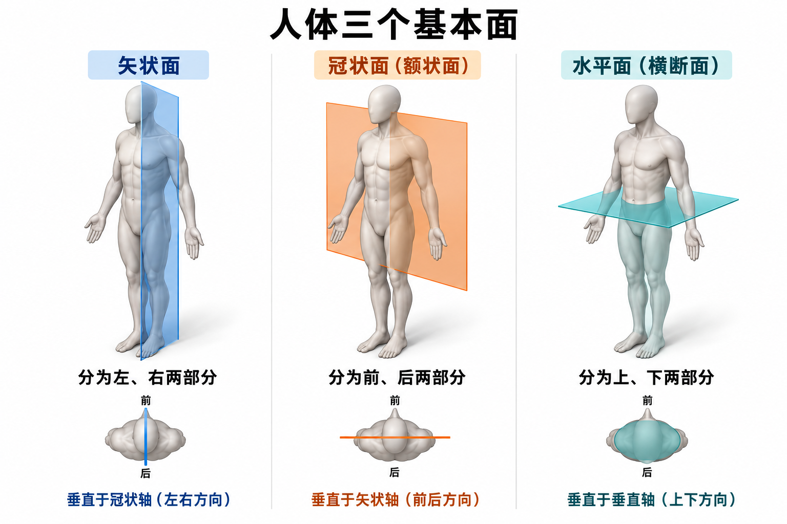

# 运动解剖学基本术语｜详细学习笔记（依据课程知识导引校订）

- 学习日期：2026年10月24日
- 学习主题：人体标准解剖学姿势、常用解剖学术语、人体基本面和基本轴。
- 用户提供的课程：[学堂在线视频](https://next.xuetangx.com/learn/space/bsu04021002713/bsu04021002713/31378305/video/85377011)。

> **来源与使用说明**：本笔记已依据你提供的课程“知识导引”截图及面轴示意图校订主题和重点。课程截图可确认本讲包括标准解剖学姿势、方位术语、三个基本面和三个基本轴；尚未获得完整视频音轨或字幕，因此截图以外的详细解释、英文对照、动作分析与自测题属于学习补充，不是教师讲解原文。截图中的自动摘要有疑似识别错误，已在下方说明。

## 课程知识导引与时间线（依据截图）

| 起始时间 | 本段主题 | 笔记对应内容 |
| --- | --- | --- |
| 00:14 | 运动解剖学基本术语与标准解剖学姿势 | 身体直立、平视前方、双足并拢且足尖朝前、上肢下垂、掌心向前；与日常立正姿势比较 |
| 02:24 | 标准姿势与方位理解 | 上与下、前与后、内侧与外侧、内与外 |
| 05:34 | 方位术语及应用 | 深与浅、近侧与远侧、桡侧与尺侧、胫侧与腓侧；结合手臂和小腿理解 |
| 08:27 | 人体基本面与基本轴 | 冠状面、矢状面、水平面；冠状轴、矢状轴、垂直轴，以及面轴关系 |

**截图文字校正**：05:34段中的“绕侧”应理解为“桡侧”，“颈侧与非侧”按上下文和规范术语应理解为“胫侧与腓侧”；这些是对知识导引疑似识别错误的校正，尚未用视频音轨核实。以下采用规范术语，避免把识别错误记进笔记。

**本讲重点顺序**：先记标准姿势，再掌握方位术语，最后辨认三面三轴。动作名称和训练动作分析用于理解面轴，属于拓展。

## 学习主线

描述人体结构和运动，需要依次确定三个问题：

1. **从什么姿势出发？**——用标准解剖学姿势统一参照。
2. **结构在哪里、彼此是什么关系？**——用方位术语表达。
3. **运动沿什么面、绕什么轴发生？**——用基本面和基本轴分析。

可以把这套知识理解为描述人体的空间坐标体系。姿势提供参照，术语说明位置，面与轴说明空间方向。

---

## 一、人体标准解剖学姿势

### 1. 定义与完整描述

**标准解剖学姿势**（anatomical position）是为统一描述人体结构的位置及相互关系而规定的参考姿势。

常见中文教材表述可整理为：

> 身体直立，面向前方，两眼平视正前方；两上肢自然下垂于躯干两侧，手掌朝向前方；两下肢并拢伸直，足尖朝向前方。

逐项理解：

| 部位 | 姿势要求 | 学习时需要关注的意义 |
| --- | --- | --- |
| 躯干 | 身体直立 | 便于统一上、下、前、后方向 |
| 头与眼 | 面向前，双眼平视 | 不低头、仰头或转头 |
| 上肢 | 位于身体两侧，自然下垂 | 不抬臂、不抱胸 |
| 肘部 | 伸直 | 不用屈肘姿势作为起始参照 |
| 前臂与手 | 掌心向前 | 前臂处于旋后位，是最容易遗漏的要求 |
| 手指 | 自然伸直，拇指位于外侧 | 有助于判断桡侧和尺侧 |
| 下肢 | 并拢、伸直 | 中文教材常采用这一表述 |
| 双足 | 足尖向前 | 不以内八字、外八字作为参照 |

**教材表述差异**：部分英文教材将双足描述为平放地面、略分开。复习本课程时应采用教师或指定教材的版本；不同版本都在建立稳定的描述参照，而不是训练站姿。

### 2. 为什么一定要规定标准姿势？

人的实际姿势不断变化：可以站立、坐下、仰卧、俯卧、举手、屈肘。若每次都按眼前姿势命名结构方向，交流就会混乱。

例如，手臂举过头顶时，手在空间中可能高于肩，但手仍属于上肢远端；人俯卧时，胸部接近地面，但胸部仍属人体前侧。

**核心规则：常规解剖方位关系以标准解剖学姿势为参照，不随身体临时姿势任意改名。** 涉及实际重力方向、运动轨迹时，应另外说明“向地面”“向天花板”等空间方向。

### 3. 左右按谁来判断？

解剖学的左、右，指**被描述者自身的左、右**。

- 你与一个人面对面时，你看到的画面左侧通常是对方右侧。
- 描述右上肢，就是这个人自己的右上肢。
- 看示意图时先检查前面观、后面观与左右标记；影像还需遵守相应显示约定。

### 4. 标准姿势与日常立正的区别

最需要注意的是**掌心朝前**。日常自然站立时，掌心常朝向大腿；标准解剖学姿势则将掌心转向前方。

由此可以推出：

- 手的掌面朝前，手背朝后。
- 拇指在外侧，小指在内侧。
- 前臂的桡侧靠拇指一边，尺侧靠小指一边。

这些关系是学习前臂骨、腕部结构和旋前旋后的基础。

### 5. 便于背诵的句子

> 直立平视面向前，上肢下垂掌向前；下肢并拢足向前，左右以本人为准。

注意：口诀用于回忆，正式答题仍要写出完整定义。

基础定义与参考姿势原则可参照 [OpenStax：Anatomical Terminology](https://openstax.org/books/anatomy-and-physiology-2e/pages/1-6-anatomical-terminology)。

---

## 二、常用的解剖学术语

### 1. 使用方位术语的三个原则

1. **先固定参照**：默认按标准解剖学姿势描述。
2. **说明比较对象**：“A位于B的内侧”比单独说“A在内侧”更明确。
3. **分清比较维度**：内侧不是内部，远端不是下方，深部不是后方。

### 2. 常见方位术语总表

| 术语 | 常见英文 | 定义或参照 | 示例 |
| --- | --- | --- | --- |
| 上 | Superior | 靠近头端 | 胸部位于腹部上方 |
| 下 | Inferior | 靠近足端 | 骨盆位于胸廓下方 |
| 前 | Anterior | 靠近身体腹侧、正面的一侧 | 胸骨位于心脏前方 |
| 后 | Posterior | 靠近身体背侧的一侧 | 脊柱位于心脏后方 |
| 内侧 | Medial | 靠近身体正中面 | 鼻相对于眼位于内侧 |
| 外侧 | Lateral | 远离身体正中面 | 耳相对于眼位于外侧 |
| 浅 | Superficial | 靠近身体表面 | 皮肤位于肌肉浅面 |
| 深 | Deep | 远离身体表面 | 骨通常位于皮肤深部 |
| 近侧／近端 | Proximal | 靠近肢体根部或指定起始点 | 肘位于腕的近侧 |
| 远侧／远端 | Distal | 远离肢体根部或指定起始点 | 手指位于腕的远侧 |
| 内／内部 | Internal | 靠近某器官、腔或结构内部 | 描述管腔内的结构 |
| 外／外部 | External | 靠近某器官、腔或结构外部 | 描述器官外部的结构 |
| 同侧 | Ipsilateral | 位于身体同一侧 | 右上肢与右下肢为同侧 |
| 对侧 | Contralateral | 位于身体相反两侧 | 右上肢与左下肢为对侧 |

上述基本方向概念也可结合 [美国国家癌症研究所 SEER：Anatomical Terminology](https://training.seer.cancer.gov/anatomy/body/terminology.html) 复习。

### 3. 上与下：以人体头足方向为基础

- 靠近头的一端称上，靠近足的一端称下。
- 在直立姿势中，它们通常与日常“高、低”一致。
- 人躺下后，解剖学上的上、下不因此改成房间中的高、低。
- 在四肢位置比较中，近侧与远侧往往比上、下更稳定、明确。

**练习**：膝与踝比较，膝在踝的近侧；直立姿势下也在踝的上方。但抬腿后，不宜只凭空间高低描述二者的肢体序列关系。

### 4. 前与后；腹侧与背侧

- **前**：朝向身体正面。
- **后**：朝向身体背面。
- **腹侧**（ventral）与**背侧**（dorsal）在人体躯干的一般描述中常分别对应前与后。

不要把这种对应无限套用到所有部位：足背位于足的上面，足底位于下面；神经解剖学中还会因神经轴弯曲而采用更具体的方向规则。本节入门学习先掌握一般人体方位。

### 5. 内侧与外侧：看是否靠近正中面

**正中面**是把身体分为左、右两半的参考面。

- 靠近正中面：内侧。
- 远离正中面：外侧。

例子：

- 在标准姿势下，小指位于拇指内侧。
- 胫骨位于腓骨内侧，腓骨位于胫骨外侧。
- 肩部位于颈部外侧。

**相对性**：一个结构可以相对于甲位于内侧，同时相对于乙位于外侧。例如眼相对于耳更靠内，相对于鼻更靠外。不能脱离比较对象把“内侧”理解为某结构永久独占的标签。

### 6. 内与外，不等于内侧与外侧

| 比较 | 参照是什么 | 关注的问题 |
| --- | --- | --- |
| 内侧／外侧 | 身体正中面 | 离中线近还是远？ |
| 内／外 | 某器官、腔或结构 | 在结构里面还是外面？ |
| 浅／深 | 身体表面 | 离体表近还是远？ |

例：肺位于胸腔内，但不能因此说肺相对于心脏位于“内侧”；两肺总体位于心脏两侧。

### 7. 近侧与远侧：看与根部的距离

上肢可按以下顺序理解：

> 肩 → 臂 → 肘 → 前臂 → 腕 → 手 → 手指。

下肢可按以下顺序理解：

> 髋 → 大腿 → 膝 → 小腿 → 踝 → 足 → 足趾。

沿着肢体朝根部是近侧，远离根部是远侧。

- 肩相对于肘为近侧，肘相对于腕为近侧。
- 膝相对于髋为远侧，踝相对于膝为远侧。
- 同一块长骨也有近端和远端，例如股骨近端靠近髋，远端靠近膝。

**重要区别**：上臂、前臂是部位名称；近侧、远侧是相对关系。手举高不会使手变成上肢近端。

### 8. 浅与深：看距体表的层次

理解层次时可从体表逐层向内观察：

> 皮肤 → 皮下组织 → 更深部的筋膜、肌肉等结构。

具体层次随部位而异，不能把这条简图当成所有区域完全一致的排列。

“某肌在另一肌浅面”表示它更靠近体表，并不表示它一定处在前方。例如背部浅层肌位于更深层结构的后方，但“浅”与“后”仍是不同概念。

### 9. 四肢常用的专门方位术语

| 部位 | 术语 | 含义 | 记忆方式 |
| --- | --- | --- | --- |
| 前臂 | 桡侧 | 靠近桡骨的一侧 | 拇指侧 |
| 前臂 | 尺侧 | 靠近尺骨的一侧 | 小指侧 |
| 手 | 掌侧 | 手掌的一侧 | 掌心 |
| 手 | 背侧 | 手背的一侧 | 手背 |
| 小腿 | 胫侧 | 靠近胫骨的一侧 | 标准姿势下偏内侧 |
| 小腿 | 腓侧 | 靠近腓骨的一侧 | 标准姿势下偏外侧 |
| 足 | 足背侧 | 足背的一侧 | 足上面 |
| 足 | 跖侧／足底侧 | 足底的一侧 | 接触地面的足底面 |

**注意**：脚趾上翘是踝背屈，不能仅凭足背朝上，就把“足背侧”在所有姿势下一概改称“上侧”。

### 10. 辅助补充：常用运动术语

本小节用于连接后面的面与轴，不代表已核实为视频内容。

| 术语 | 理解要点 | 简单例子 |
| --- | --- | --- |
| 屈 | 常使相关骨段之间夹角减小 | 屈肘、屈膝 |
| 伸 | 常使相关骨段之间夹角增大 | 伸肘、伸膝 |
| 外展 | 一般使肢体远离身体正中面 | 上臂向体侧抬起 |
| 内收 | 一般使肢体靠近身体正中面 | 侧举上臂放回体侧 |
| 内旋／外旋 | 骨段绕自身长轴向内／外转动 | 大腿在髋关节内旋或外旋 |
| 环转 | 多方向角运动连续组合 | 伸直上臂画圆 |
| 旋前／旋后 | 前臂桡尺关系改变的运动 | 肘屈约90°，掌心翻下／翻上 |
| 背屈／跖屈 | 足背靠近小腿前面／足尖下指 | 勾脚／绷脚 |
| 内翻／外翻 | 足底转向内／外 | 观察足底朝向的改变 |

运动术语不能全部靠日常字面判断：屈膝时小腿向后，肩屈时上臂向前；不能用“向前都是屈、向后都是伸”概括全身。手指外展通常以第三指轴线为参照，足趾以第二趾轴线为参照，也不是简单套用身体正中面。拇指的运动平面还具有特殊性。

前臂旋前、旋后主要发生于桡尺关节；足内翻、外翻涉及足部多个关节，不能全部归为距小腿关节的单独运动。运动定义与示例可参照 [OpenStax：Types of Body Movements](https://openstax.org/books/anatomy-and-physiology-2e/pages/9-5-types-of-body-movements)。

---

## 三、人体的基本面和基本轴

*图：使用内置图像生成工具制作的辅助学习示意图。为便于比较，每个人体仅显示一个基本面。矢状面分左右，冠状面分前后，水平面分上下；相应转动轴垂直于运动面。图中姿势为示意，正式定义以正文为准。*

### 1. “面”和“轴”分别是什么？

**面**：人为设定的假想平面，用于描述身体的分割方向，或说明动作主要发生在哪个平面内。

**轴**：人为设定的假想直线，用于描述方向，或说明转动围绕哪条线进行。

面和轴不是必须在人体内找到的真实解剖结构。分析关节运动时，轴可以想象为经过关节的转动参考线。

区分两个表达：

- “用某面分割身体”——说明分割后得到哪些部分。
- “在某面内运动”——说明动作轨迹主要沿什么方向展开。

二者使用同一组几何参照，但描述目的不同。

### 2. 三个基本面总表

| 基本面 | 常见别名／英文 | 平面延伸的方向 | 将身体分成 | 与其垂直的基本轴 |
| --- | --- | --- | --- | --- |
| 矢状面 | Sagittal plane | 前后、上下 | 左右两部分 | 冠状轴／额状轴 |
| 冠状面 | 额状面；Frontal / coronal plane | 左右、上下 | 前后两部分 | 矢状轴 |
| 水平面 | 横断面；Transverse / horizontal plane | 左右、前后 | 上下两部分 | 垂直轴 |

### 3. 矢状面

#### 定义

在标准解剖学姿势下，沿前后方向并与地面垂直的平面，将身体分为左、右两部分。

#### 正中矢状面与旁矢状面

- **正中矢状面／正中面**：经过身体正中线，将身体分成左、右两半。
- **旁矢状面**：与正中面平行，但偏向一侧，分出的两部分大小通常不同。
- 矢状面有很多个，正中面是其中通过正中的特殊一个。
- “左右两半”指分割的几何意义，不表示两侧器官完全镜像相同。

#### 理解方法

想象一块竖直玻璃板沿鼻、胸腹正中方向穿过身体，并向前后延伸。玻璃板两侧分别是身体左侧与右侧。

**易错点**：矢状面“分左右”，但它本身沿前后方向延伸。不能把“分割后的方向”误认为“平面延伸方向”。

#### 运动联系

屈伸常用矢状面分析，例如屈肘、屈膝、髋屈伸、躯干前屈。对应的转轴是左右走向的冠状轴。

### 4. 冠状面／额状面

#### 定义

在标准解剖学姿势下，沿左右方向并与地面垂直的平面，将身体分为前、后两部分。

#### 理解方法

想象一块竖直玻璃板从左向右展开，与人体正面大致平行。身体腹侧与背侧处在玻璃板两侧。

#### 运动联系

典型分析包括肩或髋的外展、内收，以及躯干侧屈。对应转轴为前后走向的矢状轴。

**易错点**：冠状面不是“水平放置的冠”，而是竖直面。冠状面与矢状面都是纵向延伸的平面。

### 5. 水平面／横断面

#### 定义

在标准解剖学姿势下，与地面平行、与人体纵向相垂直的平面，将身体分为上、下两部分。

#### 理解方法

想象在腰部横放一块玻璃板，头胸与骨盆下肢分别位于它的上下两侧。

#### 运动联系

头颈左右转动、躯干转体等通常用水平面分析，对应上下走向的垂直轴。

#### 限定条件

这里“与地面平行”建立在人体直立的标准姿势上。人体改变姿势后，身体自身的解剖平面与房间地面的关系也会改变。描述某个肢体或器官的横断面时，还需说明它相对于该局部结构长轴的关系。

面与分割方向可结合 [SEER：Planes of the Body](https://training.seer.cancer.gov/anatomy/body/terminology.html) 核对。

### 6. 三个基本轴总表

| 基本轴 | 常见别名／英文 | 方向 | 垂直于哪个面 | 典型动作 |
| --- | --- | --- | --- | --- |
| 矢状轴 | 前后轴；Anteroposterior axis | 前 ↔ 后 | 冠状面 | 外展、内收、侧屈 |
| 冠状轴 | 额状轴、左右轴、横轴；Mediolateral axis | 左 ↔ 右 | 矢状面 | 屈、伸 |
| 垂直轴 | 纵轴；Vertical / longitudinal axis | 上 ↔ 下 | 水平面 | 直立时的转体、头颈旋转 |

“横轴”等别名在不同教材中可能有使用差异，判断时应优先确认它究竟是前后、左右还是上下走向。

#### 6.1 矢状轴

- 从前向后走行。
- 是冠状面运动常用的转动轴。
- 侧举上肢时，可想象一根前后穿过肩关节的轴，上臂围绕它转动。
- **不要因为名称含“矢状”，就把它与矢状面直接配成运动搭档。**

#### 6.2 冠状轴

- 从左向右走行。
- 是矢状面运动常用的转动轴。
- 屈肘时，可将轴大致想象为横向穿过肘部。
- 这里的轴方向是教学近似；真实关节轴可能倾斜，且随运动发生变化。

#### 6.3 垂直轴

- 在标准直立姿势下沿上下方向走行。
- 是水平面运动常用的转动轴。
- 直立转体可近似理解为绕身体纵向的轴转动。
- 身体倒立或平卧时，身体纵轴并不一定与重力方向一致。
- 肢体绕自身长轴旋转时，应看该肢体当前方向，不能一概说轴始终竖直于地面。

### 7. 面与轴的核心关系

对理想化的平面转动而言：

> **运动所在平面与转动轴相互垂直。**

必须成组记忆：

| 运动平面 | 对应转动轴 | 常见动作类别 |
| --- | --- | --- |
| 矢状面 | 冠状轴（左右轴） | 屈、伸 |
| 冠状面 | 矢状轴（前后轴） | 外展、内收、侧屈 |
| 水平面 | 垂直轴（上下轴） | 旋转 |

**推理方法**：一张纸代表运动面，用铅笔垂直穿过纸面代表转动轴。物体绕铅笔转动时，运动轨迹在纸面内。

为什么不是“矢状面配矢状轴”？因为前后方向的矢状轴位于矢状面的方向体系内，而绕轴转动的平面应与轴垂直。

### 8. 静态几何关系与运动关系

三个基本面两两垂直，三个基本轴也两两垂直。每个基本面包含两种方向，垂直于剩下的一种方向：

- 矢状面：包含前后与上下方向；法向为左右方向。
- 冠状面：包含左右与上下方向；法向为前后方向。
- 水平面：包含前后与左右方向；法向为上下方向。

这可以作为不依赖口诀的检查方法。

### 9. 真实运动为什么不总能只归入一个面？

基本面与基本轴是入门分析框架。实际跑步、投掷、挥拍、深蹲等动作往往包含多个关节、多个平面的运动。

- 同一动作中，不同关节可能做不同运动。
- 真实关节面形状会影响瞬时转轴。
- 旋转、滚动与滑动可能同时出现。
- 肢体改变起始姿势后，局部运动轴与全身基本轴的关系也会改变。

因此，应说“某关节的运动主要发生在某面、绕某方向轴”，而不是把整个复杂动作永久归入唯一平面。

---

